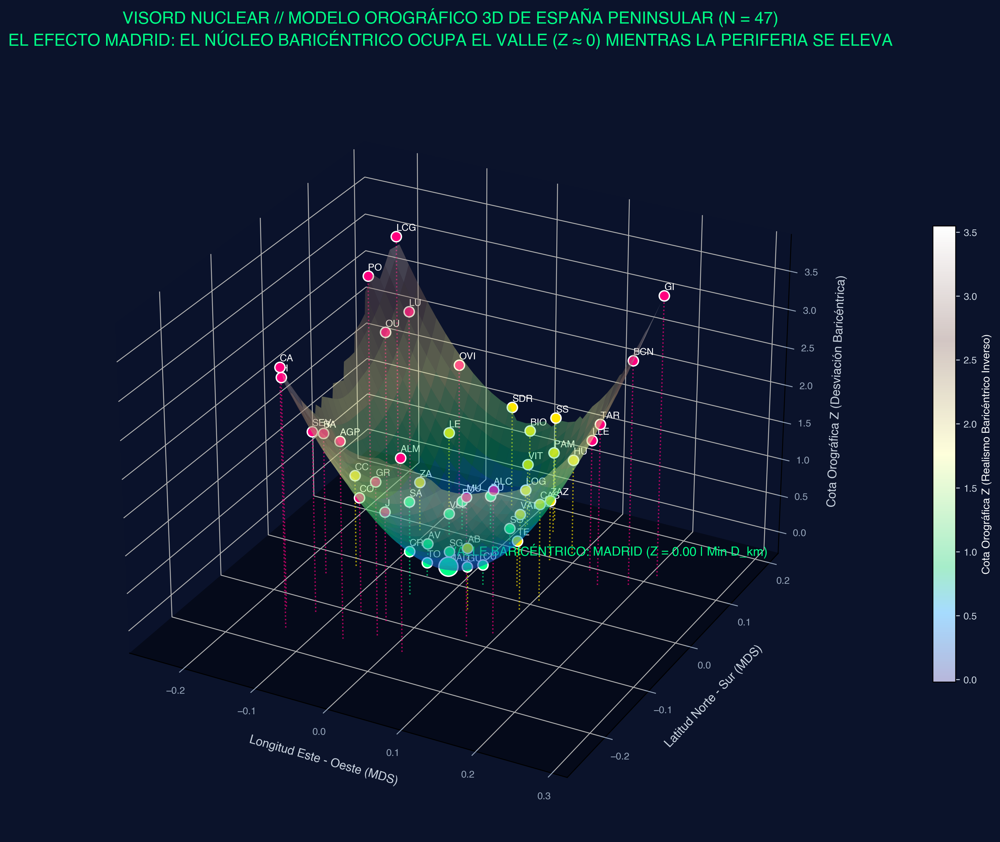
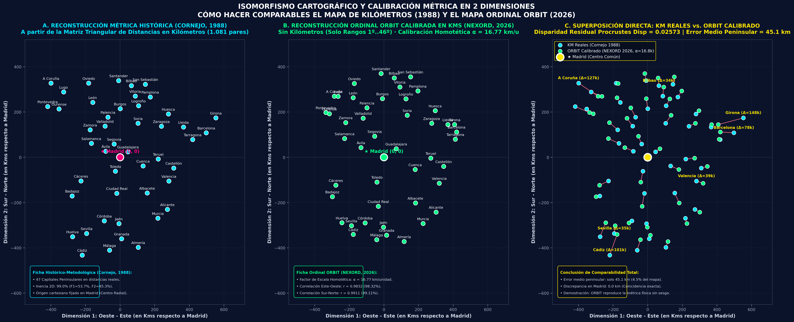
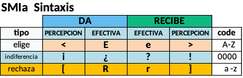
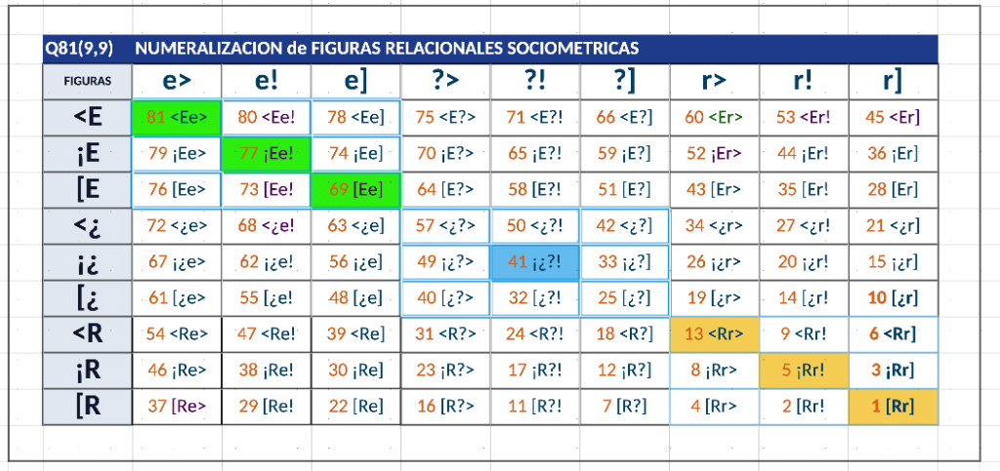

# SOCIOMETRÍA ORDINAL COMPUTACIONAL (NEXORD)
### COMPUTATIONAL ORDINAL SOCIOMETRY (NEXORD)

**Dr. José Manuel Cornejo Álvarez**  
*Investigador Principal · Creador de la Plataforma NEXORD*

## SOCIOMETRÍA ORDINAL COMPUTACIONAL (NEXORD)
### *«Hacia una Física de la Grupalidad»*

**Edición Canónica Definitiva v9.2 (Octubre, 2026)**

* **Autor:** Dr. José Manuel Cornejo Álvarez
* **Vinculación Académica:** Profesor Titular Jubilado de Psicología Social · Investigador Principal y Creador de NEXORD
* **Rol en la Iniciativa:** Creador de la Plataforma NEXORD y Promotor Científico del Banco Sociométrico (BSOC)
* **Concept DOI (Zenodo / CERN):** [10.5281/zenodo.23329641](https://doi.org/10.5281/zenodo.23329641) · **DOI de Edición:** [10.5281/zenodo.23329641](https://doi.org/10.5281/zenodo.23329641)
* **Repositorio Oficial:** [github.com/josemancor/nex-ord-web](https://github.com/josemancor/nex-ord-web) · **Plataforma:** [josemancor.github.io/nex-ord-web](https://josemancor.github.io/nex-ord-web/)
* **Ecosistema Maestro:** VISORD 3D/4D (Visualizador Sociométrico Ordinal)

---

## RESUMEN

La Sociometría Ordinal Computacional actualiza formalmente las intuiciones originarias de Jacob Levy Moreno (Sociometría) y Kurt Lewin (Teoría del Campo), superando mediante el cómputo contemporáneo las restricciones metodológicas de su época. Este Manifiesto articula el modelo a través de siete pilares:

**1)** La consideración del vínculo relacional como núcleo constitutivo de la realidad existencial de los grupos. «Dar y Recibir» conforman los polos indisociables de un circuito interactivo continuo, donde la salud, el bienestar y la viabilidad del colectivo dependen del equilibrio homeostático entre los intercambios interpersonales de aceptación y conflicto.

**2)** La cuantificación rigurosa del orden jerárquico de elección mediante la función inversa al rango, formalizando que la mente humana prioriza y elige de manera ordinal sin necesidad de imponer escalas cardinales artificiales.

**3)** La métrica continua, fruto de esta cuantificación del orden preferencial, articulada formalmente en el álgebra del tetragrama relacional y en metapercepciones de reciprocidad, transformando las micro-interacciones interpersonales en una topología plenamente computable.

**4)** El modelado socio-termodinámico del colectivo a través de gradientes de densidad y fricción relacional ($\Phi$), donde la discrepancia dialéctica moderada y la plasticidad interna actúan como condiciones necesarias para el aprendizaje y la adaptación frente a la entropía del pensamiento grupal (*Groupthink*).

**5)** La proyección simultánea en planos factoriales duales, donde los actores se representan a la vez como emisores y receptores de preferencias en equilibrio baricéntrico, permitiendo la comparación geométrica de estructuras grupales mediante variedades topológicas.

**6)** La versatilidad del diseño multidimensional ($G \times T \times C$), que integra análisis transversales, longitudinales y de criterios plurales de tarea y afecto, complementado con las herramientas de visualización interactiva de la plataforma VISORD.

**7)** El compromiso de gobernanza bajo principios de Ética por Diseño (*Ethics by Design*) y Ciencia Abierta, garantizando un uso exclusivamente formativo y no punitivo de los datos, orientado a proteger la dignidad de los participantes y a preservar el patrimonio empírico mediante el Banco Sociométrico (BSOC).

**Palabras clave:** Plataforma NEXORD, VISORD, Sociometría Ordinal Computacional, Sociometría Preventiva, Formato ORBIT, Función Inversa al Rango, Densidades Relacionales (18D), Metapercepción, Planos Factoriales Duales, Variedades de Grassmann, Pensamiento Grupal, Ostracismo, Ética por Diseño, Ciencia Abierta.

---

## ABSTRACT

Computational Ordinal Sociometry is, in essence, an updated extension of the intuitions of Jacob Levy Moreno, creator of Sociometry, and Kurt Lewin, pioneer of Field Theory—two seminal figures in Social Psychology. Historically, research in the Psychology of groups has been conditioned by the methodological and technical limitations of the era in which they emerged. This Manifesto is grounded in:

**1)** The conception of the ‘relational tie’, product of human interaction, as the existential core constituting the reality of groups. ‘Giving and Receiving’ are indissociable force pairs that sustain the necessary dialectical exchange of affect, ideas, intentions, resources, and actions toward shared goals. Personal and group health, wellbeing, success, and viability fundamentally depend on the permanent homeostatic balance established across interpersonal exchanges of acceptance and/or conflict in the short and medium term.

**2)** The refined quantification of preferential relational order, through the application of the inverse rank function ($W_{ij} = 1 / r_{ijk}$) and contemporary theoretical, methodological, and technological developments, defines the genesis of NEXORD as an overarching sociometric psychosocial research platform, aiming to formally articulate the intuitions that Moreno and Lewin could not develop in their time.

**3)** The continuous metric emerging from this quantification is formally articulated, through matrix and tensorial algebra, within the Moreno-rooted relational tetragram ($E, R, pE, pR$; $p$: perceptions/expectativas) defining $3^4 = 81$ (Q81) dyadic relational figures; to which two triadic metaperceptions ($\alpha E, \omega E$) have been added regarding the sender's expectation of the preferences that will actually be expressed by their first chosen and most rejected peers. These data transform micro-interactions ($N \times N$) into computable topologies.

**4)** The articulation into 4 elementary densities ($pDA, DA, RC, pRC$) and their combinatorial expansion into 14 derived densities (18D space) precisely quantify the mass and flow of exchanges among group members. This gradient allows modeling the collective as a socio-thermodynamic system governed by equilibrium states and relational friction ($\Phi$), where dialectical discrepancy acts as a necessary condition for health and adaptability against the entropy of groupthink (*Groupthink*).

**5)** The simultaneous projection in dual factorial spaces of the actors (as senders of preferences to the group and simultaneously recipients of group preferences) who emerge, not as static points, but as kinematic dipoles ($DA \longleftrightarrow RECIBE$) whose centroids analytically balance giving and receiving. This formulation reveals the gravitational dominance of the principal axes ($F_1$ and $F_2$) and enables the geometric comparison of group structures across Grassmann manifolds $\operatorname{Gr}(k, N)$.

**6)** The versatility of the multidimensional design ($G \times T \times C$) enables simultaneous intra- and inter-group comparisons: cross-sectional, longitudinal, and across preference criteria. This mathematical architecture of abstract relationships becomes intuitive for non-experts through the VISORD interactive visualization modules, which facilitate the monitoring and tracking of analytical outcomes.

**7)** In its application to real-world field studies with human participants, NEXORD guarantees an exclusively formative, non-punitive use of data. This requirement safeguards privacy by design (*Privacy by Design*) and demands professional and institutional accreditation as well as the explicit deontological pledge of the Principal Investigator (PI) under Open Science standards, never to damage with their reports the personal self-esteem or social standing of participants, giving as intrinsic traits of individual personality what are strictly group thermodynamic phenomena.

**Keywords:** NEXORD Platform, VISORD, Computational Ordinal Sociometry, Preventive Sociometry, ORBIT Format, Inverse Rank Function, Relational Densities (18D), Metaperception, Dual Factorial Planes, Grassmann Manifolds, Groupthink, Ostracism, Ethics by Design, Open Science.

---

> *«El vínculo humano no es un simple resultado numérico; es un **NEXO** que solo cobra sentido cuando adquiere **ORDEN**.*  
> *Sin orden, la sociometría se limita a un recuento de simpatías; con orden, la sociometría se convierte en topología y termodinámica del espacio grupal.»*

## 1. Fundamentación Epistemológica

### 1.1. Superación del Límite Clásico y la Ontología del Vínculo
La Sociometría Ordinal Computacional en NEXORD actualiza metodológicamente los planteamientos clásicos de Moreno y Lewin: traslada al cómputo contemporáneo lo que no pudieron implementar con los recursos técnicos de su época.

Moreno concibió el concepto de átomo social y la arquitectura profunda de las preferencias afectivas, pero el cálculo manual obligó históricamente a constreñir los cuestionarios sociométricos a cuotas fijas de elección y rechazo binario (habitualmente tres elecciones positivas y tres negativas). Por su parte, Lewin formalizó la teoría del campo psicológico y la topología hodológica, pero careció de operadores matemáticos continuos capaces de cuantificar distancias psicológicas sin fracturar la naturaleza psicosocial del espacio vital.

NEXORD sitúa la interacción relacional activa en el núcleo ontológico de la vida colectiva: el grupo no es un mero agregado de rasgos disposicionales individuales ni una red estática de nodos fríos, sino un campo dinámico de tensiones, atracciones y resistencias que emerge y se transforma continuamente.

Como homenaje expreso a ambos fundadores, la Plataforma NEXORD encarga dos cartas territoriales en la tradición de la *Carte du Tendre* de Mademoiselle de Scudéry (1654) —género literario-cartográfico que la propia obra evoca al dar nombre al Protocolo Clélie de custodia de datos (§7.2)—: la *Carte de la Spontanéité et du Télé* para Jacob Levy Moreno (1934) y la *Carte du Champ Dynamique et de l'Espace Vital* para Kurt Lewin (1936–1951) (Figuras 1 y 2). Estas cartas declaran, con intención explícita, el estatuto epistémico del proyecto: En ningún momento NEXORD ha pretendido sustituir a sus inspiradores, sino completar algorítmicamente sus propuestas iniciales, adaptándolas a las posibilidades técnicas del cómputo contemporáneo. La continuidad con la tradición histórica no es únicamente cartográfica: NEXORD opera indistintamente con protocolos de captura MORENO y ORBIT (protocolos muy similares, dual-stack, pues ambos comparten un orden de elección/rechazo manifiesto; aunque ORBIT no se pronuncia directamente sobre las expectativas recíprocas, un algoritmo de conversión MORENO $\longleftrightarrow$ ORBIT permite una estimación probabilística que completa ambas formas sociométricas). El tetragrama diádico ($pDA \cdot DA \cdot REC \cdot pREC$) es una elaboración totalmente moreniana y sustenta la base operativa de la Plataforma NEXORD.

La deuda específica con Kurt Lewin está en el origen del lema «La Física de lo Grupal» —y de la materialización de su variable cardinal, la densidad relacional que vertebra el aparato formal socio-termodinámico (§4.4)— se encuentra en la innovadora teoría del campo, que concibió la vida grupal como dinámica de fuerzas en un espacio vital medible: lo que aquí se cuantifica como densidad no es metáfora decorativa, sino continuación algorítmica de aquella intuición de campo.

Sin un marco ordinal estandarizado, los registros sociométricos clásicos resultaban difíciles de comparar entre sí. NEXORD aporta una estructura de referencia compartida donde la ordenación secuencial permite formalizar, integrar y comparar sistemáticamente las configuraciones grupales.

  
*Figuras 1 y 2. Díptico Cartográfico Fundacional de la Psicología Social — Izquierda (Fig. 1): Carte de la Spontanéité et du Télé de Jacob L. Moreno (1934). Derecha (Fig. 2): Carte du Champ Dynamique & de l'Espace Vital de Kurt Lewin (1936–1951), ambas con orla conmemorativa institucional NEXORD.*

### 1.2. De la Jerarquía Cualitativa al Campo Continuo: Función Inversa al Rango
En la fundamentación del método científico, el orden precede conceptualmente a la métrica cuantitativa. Mientras que la asignación de magnitudes cardinales a los estados afectivos presupone escalas de intervalos que no siempre reflejan el proceso subjetivo de decisión, la ordenación preferencial se ajusta perfectamente a la naturaleza del juicio relacional: la persona jerarquiza, prioriza y elige sus vínculos.

Registrar el orden secuencial de elección permite capturar con precisión la estructura de las preferencias interpersonales sin imponer supuestos métricos a priori. En NEXORD, la métrica continua no se introduce como un postulado externo, sino que surge analíticamente a partir del orden relacional mediante la función inversa al rango.

El mecanismo analítico que hace posible el tránsito de la ordenación cualitativa al cálculo continuo es la cuantificación del orden jerárquico:

$$W_{ij} = \frac{1}{r_{ij}^\gamma} \tag{1}$$

donde $r_{ij} \in \{1, 2, \dots, N\}$ representa la posición ordinal estricta que el emisor $i$ asigna al compañero $j$, y $\gamma$ modula la interdistancia entre los distintos rangos.

En su formulación complementaria, la densidad interpersonal normalizada adopta la forma:

$$Z_{ij} = \frac{N - r_{ij}}{N - 1} \in [0, 1] \tag{2}$$

donde el primer rango ($r_{ij} = 1$) alcanza la cota unitaria ($Z = 1.0$), el descarte o última posición ($r_{ij} = N$) desciende al cero absoluto ($Z = 0.0$), y los rangos intermedios se distribuyen de manera estrictamente equiespaciada. Es importante explicitar la jerarquía de operadores: la función inversa al rango (1) opera como cuantificador del valor del orden preferencial y sustenta el motor relacional de la plataforma (pesos de las sociomatrices SMIb y decaimiento del campo); la transformación lineal acotada (2) es una simplificación operativa para aquellas métricas que requieren una cota estricta en $[0, 1]$. Ambas transformaciones permiten operar el vínculo diádico como una fuerza continua y derivable, proyectable sobre variedades geométricas complejas. Esta convergencia formal dialoga con los modelos estadísticos para datos relacionales de orden de rango (Krivitsky & Butts, 2017) y con la evidencia psicométrica sobre la pérdida de información atribuible a las cuotas discretas truncadas (Terry, 2000).

### 1.3. El Axioma Fundamental: DAR y RECIBIR como Hecho Indisociable
La emisión de preferencias (DAR) y la recepción de impacto recíproco (RECIBIR) no son variables psicológicas independientes ni rasgos estables de personalidad: son momentos constitutivos, polares e indisociables de un único hecho relacional.

El funcionamiento armónico o la fractura patológica de un grupo no residen en los individuos como tales, sino en la fluidez, simetría y ruptura de sus intercambios mutuos. Un actor puede manifestar una disposición intensamente integradora mientras el grupo lo relega sistemáticamente a la invisibilidad o al rechazo; omitir la indisociabilidad de ambos polos conduce a diagnósticos ciegos a la exclusión latente y a intervenciones estigmatizantes.

---

## 2. Formato ORBIT, Dualidad Matricial y Clausura Diagonal

### 2.1. Orden sin empates y Dualidad Matricial A(i, k)=j vs. B(i, j)=k
En la sociometría clásica, las condiciones del cálculo manual condujeron naturalmente a procedimientos de recuento basados en cuotas fijas (habitualmente tres elecciones y tres rechazos), donde cada mención recibía el mismo peso, aunque pronto fue sustituido por una ponderación lineal inversa al rango (5-1).

La Sociomatriz ORBIT (inicialmente denominada como formato BREVE por su rapidez de administración) formaliza la ordenación preferencial exhaustiva $A(i, k) = j$ sobre el conjunto completo del grupo, donde el emisor ocupa su propio lugar como parte integrante que es. El orden total permite representar una secuencia completa de todos sus integrantes. A partir de esta base ordinal, el modelo articula el tratamiento matricial y continuo de los intercambios relacionales como una permutación del espacio colectivo.

Esta estructura se articula analíticamente mediante dos representaciones matriciales complementarias y biyectivas:

* **Matriz de Orden Directo $A(i, k) = j$:** Registra en cada fila $i$ el compañero $j$ asignado al casillero o rango de preferencia $k \in \{1^\circ, 2^\circ, \dots, N^\circ\}$.
* **Sociomatriz de Distribución $B(i, j) = k$:** Sociomatriz de orden $N \times N$ donde filas ($i$) y columnas ($j$) indican el orden en que $i$ ha colocado a $j$: $B(i, j) = k \iff A(i, k) = j$.

Al constituir cada fila una permutación estricta del conjunto $\{1, 2, \dots, N\}$, la Sociomatriz ORBIT satisface invariablemente la **propiedad de conservación de la suma ordinal por fila**:

$$\sum_{j=1}^N B(i, j) = \frac{N(N+1)}{2} = \text{cte} \quad \left(\text{para } N = 6, \sum_{j=1}^6 B(i, j) = 21\right)$$

Esta invariancia algebraica fundamenta la transposición bidireccional y exacta entre la sociomatriz clásica de Moreno y la sociomatriz ORBIT, así como la posterior derivación de los tetragramas relacionales:

* **Matriz clásica de Moreno:** Sociomatriz ($E, R, pE, pR$) en formato de entrada para $N = 6$: Transposición a ORBIT $A(i, k)=j$ y $B(i, j)=k$.
* **Sociomatriz ORBIT:** Formato $A(i, k)=j$ y $B(i, j)=k$, en formato Excel para $N = 6$: Transposición a MORENO ($E, R, pE, pR$).
* **Matrices SMI:** Matrices $SMI_a(i, j)$ del tetragrama figurativo y $SMI_b(i, j)$ del tetragrama alfanumérico.

El formato ORBIT está especialmente indicado para su utilización en pequeños grupos ($N < 25$) —equipos de trabajo, células operativas, aulas o unidades convivenciales—, donde la ordenación exhaustiva resulta analítica y estructuralmente óptima para capturar con máxima resolución la microestructura relacional. Para colectivos de tamaño elevado ($N \ge 25$), NEXORD, en caso necesario, dispone de un procedimiento de ordenación por fases sucesivas (un sistema que amplía las cuotas 3-5 morenianas a selecciones más amplias y estratificadas), sin merma de la resolución métrica.

### 2.2. Clausura Diagonal Reflexiva y Sensores Nucleares (IDA, ITA, P(k))
Asegurados los dos extremos de la lista (E y R), el valor que les corresponde a los intermedios es prácticamente insignificante.

NEXORD resuelve la omisión secular de la diagonal principal sociométrica requiriendo que cada participante se auto-ubique en el ranking colectivo. Esta clausura topológica convierte la matriz en un espacio relacional completo y continuo, activando tres indicadores métricos:

* **Índice de Desajuste de Auto-rango ($IDA_i$):** Mide la discrepancia escalar entre la autoimagen proyectada ($r_{ii}$) y el consenso medio recibido del grupo ($\bar{R}_i^{\text{ext}}$):
$$IDA_i = r_{ii} - \bar{R}_i^{\text{ext}} = r_{ii} - \left( \frac{1}{N - 1} \sum_{k \neq i}^N B(k, i) \right)$$
donde $IDA_i < 0$ cuantifica la sobreestimación jerárquica individual, $IDA_i > 0$ la autoinhibición o subestimación periférica, e $IDA_i = 0$ la calibración isomórfica con el entorno social. A escala grupal, el desajuste colectivo se sintetiza mediante la dispersión cuadrática media $\sigma_{\text{IDA}} = \sqrt{\frac{1}{N} \sum_{i=1}^N (IDA_i)^2}$.

* **Índice de Tensión de Auto-rango ($ITA$):** Evalúa la fricción estructural inducida por la pugna por el liderazgo cuando múltiples participantes reclaman el primer rango de preferencia para sí mismos: $ITA = \max(0, \sum_{i=1}^N \mathbb{I}(r_{ii}=1) - 1)$.

* **Partición Cognitiva y Anclaje Combinatorio $P(k)$:** Al situar su auto-rango en la posición $k$, el espacio combinatorio admisible del sujeto queda acotado a $P(k) = \binom{N-1}{k-1}$, formalizando que las preferencias interpersonales se emiten desde una auto-posición de referencia: hacia arriba o hacia abajo respecto del propio horizonte subjetivo.

### 2.3. Isomorfismo Topológico del Formato ORBIT: De la Matriz Triangular Kilométrica al Cosmos Relacional (El «Efecto Geográfico de Torgerson» y el Relieve Orográfico 3D del Realismo Perceptivo)

Uno de los pilares epistémicos más profundos de NEXORD radica en demostrar que la ordenación ordinal pura no es una simplificación heurística ni una renuncia a la precisión, sino un formalismo que contiene en sí mismo, codificada holográficamente en sus permutaciones, toda la geometría métrica del espacio relacional subyacente. Para comprender la solidez ontológica de este principio, resulta revelador recurrir al experimento fundacional del **Escalamiento Multidimensional Clásico** (Young & Householder, 1938; Torgerson, 1952) y su paralelismo con la matriz de distancias por carretera de España.

#### 1. El «Efecto Geográfico de Torgerson»: Reconstrucción del Territorio desde la Matriz Triangular Pura
Considérese una tabla triangular de distancias kilométricas reales $D \in \mathbb{R}^{N \times N}$ ($D_{ij} = D_{ji}, D_{ii} = 0$) entre las capitales de provincia de España peninsular (Madrid, Barcelona, Sevilla, Bilbao, Valencia, La Coruña, Zaragoza, etc.). Supóngase que se despoja a dicha tabla de toda referencia a meridianos, paralelos, coordenadas cartográficas o mapa visual exterior: solo disponemos de la matriz pura de interdistancias simétricas.

Al aplicar el operador de doble centrado clásico:
$$B = -\frac{1}{2} H D^{(2)} H, \quad \text{donde } H = I_N - \frac{1}{N} \mathbf{1}\mathbf{1}^\top$$
y resolver la descomposición espectral de la matriz de productos internos centrados $B = V \Lambda V^\top$, la extracción de los dos primeros factores dominantes:
$$X = V_2 \Lambda_2^{1/2} \in \mathbb{R}^{N \times 2}$$
reconstruye con exactitud milimétrica la geografía física de España: Madrid emerge de manera natural en el centroide geográfico peninsular, Barcelona se proyecta al noreste, Sevilla y Cádiz al suroeste, Bilbao al norte, Valencia al este y La Coruña al noroeste. La geometría espacial no ha sido introducida desde el exterior; estaba latente en la estructura de proximidades de la matriz.

#### 2. La Prueba Crítica del Formato ORBIT: Convergencia No Métrica (Shepard-Kruskal)
¿Qué ocurre si destruimos deliberadamente la métrica cardinal cuantitativa (los kilómetros exactos) y conservamos **únicamente el orden de prelación ordinal ORBIT**?
En este escenario, cada ciudad $i$ solo declara su vector de ranking ordinal $A(i, k) = j$, indicando cuál es la ciudad que percibe como más cercana ($1^\circ$), cuál en segundo lugar ($2^\circ$), y así sucesivamente hasta la más lejana ($(N-1)^\circ$).

Al someter esta matriz puramente ordinal a un escalamiento multidimensional no métrico (Shepard, 1962; Kruskal, 1964) —buscando una transformación monótona $f(r_{ij})$ que preserve el orden de los rangos minimizando el coeficiente de tensión (*stress*)—, el espacio bidimensional recuperado converge en una matriz espacial idéntica a la configuración métrica original, alcanzando coeficientes de correlación y monotonía de Shepard superiores a $r > 0.98$.

Este hallazgo refrenda la premisa nuclear de la Sociometría Ordinal Computacional: **el orden de preferencias interpersonales $A(i, k) = j$ no necesita de escalas métricas artificiales de intervalos para engendrar topología**. El orden estricto contiene toda la información relacional necesaria para desplegar el espacio métrico del grupo.

#### 3. El «Efecto Madrid» y el Núcleo Baricéntrico en VISORD Nuclear
En la red viaria peninsular, Madrid emerge en el centro del mapa porque satisface el principio variacional de mínima distancia media agregada hacia todas las demás capitales ($\min \bar{D}_i$). En el motor de socio-termodinámica nuclear de NEXORD, el baricentro relacional emerge bajo un principio idéntico:
$$\bar{d}_i^{\text{out}} = \frac{\sum_{j \neq i} m_j D_{ij}^{\text{out}}}{\sum_{j \neq i} m_j}$$
donde $D_{ij}^{\text{out}}$ mide la discrepancia entre los vectores de emisión de preferencias de los sujetos $i$ y $j$, ponderada por las masas inerciales $m_j$. Aquel actor que minimiza $\bar{d}_i^{\text{out}}$ se sitúa espontáneamente en el **núcleo confinado** del cosmos grupal: no por un decreto de autoridad externa, sino porque su lectura del grupo sintoniza con el baricentro perceptivo del colectivo. Por el contrario, los actores con visiones idiosincrásicas o periféricas se desplazan radialmente hacia las periferias o «costas» del mapa relacional.

#### 4. La Tercera Dimensión en VISORD Nuclear: El Relieve Orográfico 3D del Realismo Perceptivo
El plano horizontal cartesiano $XY$ (territorial/geográfico) del biplot factorial o del mapa relacional codifica las afinidades interpersonales, las alianzas diádicas y los clivajes entre subgrupos ($G_1$ frente a $G_2$). Ahora bien, ¿qué representa la **tercera dimensión vertical ($Z$)** en la arquitectura visual de VISORD Nuclear?

Siguiendo el riguroso isomorfismo territorial, la tercera dimensión equivale exactamente a la **altitud o relieve orográfico del terreno (la topografía de valles, mesetas y cordilleras)** sobre la llanura geográfica:
* **Llanuras y Valles de Fondo ($Z \approx 0$):** Zona de máxima consonancia fáctica y realismo perceptivo. Los actores situados en la cota basal del valle presentan un índice de desajuste de auto-rango mínimo ($IDA_i \approx 0$) y un saldo de realismo diádico armónico ($S_{13} \approx 0$): lo que ellos esperan o creen dar coincide con la experiencia directa del grupo. Caminan sobre la llanura convivencial común, con acceso directo y sin barreras orográficas a los canales de comunicación de sus compañeros.
* **Mesetas Intermedias ($Z \approx \bar{Z}$):** Plataformas orográficas estables donde se asientan funciones de mediación, liderazgo operativo y arbitraje funcional, con perspectiva panorámica y suficiente arraigo estructural.
* **Cumbres y Picos Montañosos ($Z \gg 0$):** Actores encaramados a elevaciones orográficas de disonancia perceptiva (fuerte desajuste entre la autoimagen proyectada y la respuesta fáctica del colectivo). Desde la cima escarpada de su montaña personal, la distancia euclídea hacia el resto del grupo se incrementa geométricamente; el actor se siente orográficamente aislado, distante o incomprendido, no por falta de voluntad de los demás, sino porque la pendiente cognitiva dificulta el intercambio fluido.

> [!IMPORTANT]
> **Salvaguarda Deontológica Inviolable (Regla 21):**
> La elevación orográfica hacia una cumbre o el confinamiento en una vaguada periférica **jamás deben interpretarse como un defecto moral, una tara intrínseca o un rasgo psicopatológico individual**. Al igual que en la geología terrestre las montañas no surgen por voluntad propia de las rocas sino por las presiones de las placas tectónicas subyacentes, en NEXORD la altitud orográfica de un actor es un **fenómeno orogénico estrictamente grupal**: son las fuerzas de atracción, empuje y fricción del sistema relacional las que pliegan el espacio social. La función del informe de devolución formativa no es juzgar al montañero, sino trazar senderos topológicos y tender puentes de descenso para reconectar a todos los miembros en el valle compartido de la convivencia.

  
*Figura 2b. Modelo orográfico 3D de la red peninsular de 47 capitales: la tercera dimensión vertical Z codifica el relieve topográfico del realismo diádico y consonancia relacional (valles basales, mesetas funcionales y cumbres escarpadas de disonancia).*

#### 5. Calibración Métrica Canónica y Validación Empírica Peninsular (Cornejo, 1988 vs. NEXORD, 2026)
Para validar la comparabilidad directa y rigurosa entre el modelo clásico métrico en kilómetros (Cornejo, 1988) y el espacio latente ordinal adimensional derivado exclusivamente del formato ORBIT $A(i, k) = j$, se aplica el **Protocolo Canónico de Calibración y Homotecia Métrica en Tres Pasos** (Anexo VI, §8.6):
1. **Centrado Radial Común:** Fijación de Madrid en el origen $(0, 0)$ como centro geométrico de referencia peninsular ($\mathbf{x}_i^{\text{ORBIT(c)}} = \mathbf{x}_i^{\text{ORBIT}} - \mathbf{x}_{\text{Madrid}}^{\text{ORBIT}}$).
2. **Rotación Ortogonal Óptima ($Q \in \mathrm{SO}(2)$):** Alineación de los autovectores con los ejes cardinales geográficos Oeste–Este y Sur–Norte mediante descomposición en valores singulares (SVD de Procrustes).
3. **Factor de Homotecia Escalar ($\alpha$):** Conversión analítica del espacio latente ordinal a kilómetros físicos mediante el factor óptimo:
   $$\alpha = \frac{\sum_{i=1}^N \mathbf{x}_{i,\text{rot}}^{\text{ORBIT}} \cdot \mathbf{x}_i^{\text{KM}}}{\sum_{i=1}^N \|\mathbf{x}_{i,\text{rot}}^{\text{ORBIT}}\|^2} \approx \mathbf{16.77\text{ km / unidad latente}}$$

Los resultados de la validación empírica sobre las 47 capitales peninsulares (1.081 pares interurbanos) evidencian un isomorfismo casi absoluto (Figura 2c):
* **Correlación Eje 1 (Oeste – Este):** $r = 0.9832$ ($98.32\%$).
* **Correlación Eje 2 (Sur – Norte):** $r = 0.9911$ ($99.11\%$).
* **Disparidad Residual de Procrustes:** $\mathrm{Disp} = 0.02573 \to 0$.
* **Error Medio Peninsular:** $\bar{\epsilon} = \mathbf{45.1\text{ km}}$ (apenas el $4.5\%$ sobre la extensión territorial completa).

  
*Figura 2c. Isomorfismo cartográfico y calibración métrica en 2 dimensiones en idéntica escala kilométrica: (A) Reconstrucción métrica clásica a partir de distancias por carretera en km (Cornejo, 1988); (B) Reconstrucción ordinal ORBIT pura sin kilómetros (NEXORD, 2026) calibrada con α = 16.77 km/u; (C) Superposición directa (Overlay) y micro-vectores de discrepancia residual (error medio peninsular de solo 45.1 km).*

---

## 3. Dinámica Relacional: Regímenes del Campo, Fricción y Viabilidad

### 3.1. Coeficiente de Fricción Relacional (Φ) y Cohesión Estructural (ICE)
La resistencia interna del sistema colectivo se sintetiza en el Coeficiente de Fricción Relacional ($\Phi$) y en su métrica complementaria, el Índice de Cohesión Estructural ($ICE$):

$$\Phi = \frac{2}{N(N - 1)} \sum_{i < j} |Z_{ij} - Z_{ji}|^\alpha \quad (\alpha \ge 1) \tag{3}$$

$$ICE = 1 - \Phi \tag{4}$$

Valores moderados de $\Phi$ reflejan dinamismo interno y plasticidad adaptativa, mientras que valores extremos señalan riesgos de fragmentación o turbulencia destructiva.

### 3.2. Psicologización de Regímenes y Prevención del Pensamiento Grupal (Groupthink)
La dinámica colectiva no puede reducirse a una física inanimada: los estados del sistema expresan fases de evolución psicológica e interpersonal:

* **Rigidez e Inercia Estructural:** Cristalizaciones jerárquicas rígidas, roles inmóviles y escasa permeabilidad comunicativa.
* **Fluidez y Cohesión Adaptativa:** Homeostasis abierta con circulación flexible de preferencias, acuerdos y divergencias.
* **Dispersión y Anomia:** Baja densidad de acoplamiento, desvinculación afectiva y ausencia de proyectos compartidos.
* **Efervescencia y Fusión Colectiva:** Alta activación emocional compartida e intensa movilización interactiva.

Desde este punto de vista, NEXORD cuestiona radicalmente el supuesto tradicional de que la salud grupal óptima equivale a la cohesión absoluta ($ICE = 1.0, \Phi = 0$). Un colectivo sin discrepancias ni fricción interna resulta vulnerable al pensamiento grupal (*Groupthink*, Janis, 1972), donde las presiones hacia la conformidad anulan el pensamiento crítico y la toma informada de decisiones. La fricción moderada ($\Phi \in [\Phi_{\min}, \Phi_{\max}]$) y los gradientes en el circuito DAR/RECIBIR proporcionan la energía necesaria para la plasticidad, el aprendizaje organizativo y la adaptación evolutiva.

### 3.3. La Metáfora del Puzle: Desatascamiento (Unjamming) vs. Reubicación Ecosistémica
Frente a las intervenciones tradicionales que gestionan el conflicto mediante la exclusión punitiva o el señalamiento moral del sujeto discordante, NEXORD modela el colectivo como un puzle. Un actor que experimenta una elevada fricción no es un elemento intrínsecamente patológico: suele sufrir un desacople de expectativas de rol o una asimetría de flujos con su entorno diádico inmediato.

La facilitación diagnóstica promueve el desatascamiento (*unjamming*) mediante ajustes de tareas, clarificación comunicativa y apertura de canales de colaboración recíproca. Cuando tras un proceso sistemático de mediación la incompatibilidad estructural resulta persistente, el modelo contempla la reubicación ecosistémica digna: una migración hacia otro entorno grupal que preserve la integridad psicosocial del individuo y evite dinámicas de desgaste u ostracismo crónico.

### 3.4. El Universo de Microestados y la Ley de Estabilidad Termodinámica
La dimensión del espacio muestral sociométrico, incluso en el grupo más humilde, es enorme. Para un grupo de cinco personas, cada sujeto que ordena a los otros cuatro miembros dispone de $4! = 24$ ordenaciones diferentes; combinadas las elecciones independientes de los cinco participantes, el espacio total de microestados asciende a $24^5 = 7.962.624$ matrices. Si se incluye la auto-ubicación del emisor ($5! = 120$ ordenaciones por fila), el espacio se dispara a $120^5 \approx 2,49 \times 10^{10}$ —casi 25.000 millones de configuraciones—: tan solo para un grupo de 5. Ante estas cifras, la estabilidad termodinámica y la salud del sistema no dependen del azar, sino de la geometría del flujo energético: de la minimización de la disipación por ruptura y de la existencia de atractores estables.

La inmensa mayoría de las combinaciones corresponderá a ruido térmico (matrices disonantes de alta fricción) o a trampas de congelación (fallas tectónicas y monopolios asfixiantes). Para que un microestado supere los umbrales de organización productiva y saludable debe satisfacer simultáneamente tres invariantes termodinámicas:
1. **Minimización de la disipación por ruptura:** $\sum_i |Z_{ij} - Z_{ji}|^2 \to \min$ (reciprocidad y coherencia mutua).
2. **Equilibrio del gradiente barométrico:** $\sum_i (Z_i^{\text{in}} - Z_i^{\text{out}})^2 \le \varepsilon$ (ausencia de sumideros negros o manantiales sobrecargados).
3. **Conectividad convectiva global:** existencia de cadenas de retorno transitivas sin nodos aislados ($Z_i^{\text{in}} > Z_{\text{crítico}}$ para todo $i$).

De toda esta combinatoria, solo un porcentaje muy selecto accede a un estado óptimo: el bienestar grupal no es la ausencia de tensiones y conflictos sino un equilibrio entre ellos, donde nadie queda condenado al cero absoluto ni forzado a sostener en soledad el peso del conjunto.

En síntesis: la viabilidad y el bienestar del colectivo no dependen de voluntarismos individuales, sino del equilibrio estructural de sus intercambios. Un grupo funcional mantiene flujos recíprocos sostenibles, minimiza la fricción disipativa y evita asimetrías extremas donde la sobrecarga o el aislamiento se concentren crónicamente en miembros particulares.

---

## 4. Álgebra Tensorial, Retícula Q81 y el Pentagrama de Densidades

### 4.1. Los 12 Elementos Sintácticos y el Tetragrama Relacional A1 A2 A3 A4
La retícula fundamental Q81 formaliza el espacio combinatorio completo de las $3^4 = 81$ configuraciones diádicas que articulan el campo relacional. Para dotar al sistema de una notación exacta, libre de ambigüedades, NEXORD establece un alfabeto de 12 símbolos distribuidos en tres estados de polaridad relacional:

#### Tabla 1. Sintaxis — los 12 símbolos del alfabeto relacional NEXORD

| Tipo | DA: Percepción ($p\_DA$) | DA: Efectiva ($DA$) | RECIBE: Efectiva ($RC$) | RECIBE: Percepción ($p\_RC$) | Código Alfanumérico |
| :--- | :---: | :---: | :---: | :---: | :---: |
| **Elige (+)** | `<` | `E` | `e` | `>` | `A – Z` |
| **Indiferencia (0)** | `i` | `¿` | `?` | `!` | `0000` |
| **Rechaza (−)** | `[` | `R` | `r` | `]` | `a – z` |

Cada interacción interpersonal $(i, j)$ queda formalizada como una figura relacional compuesta por cuatro elementos o "tetragrama" formado por las acciones de **DAR** y de **RECIBIR** y dos perspectivas: **PREFERENCIA** manifestada y **EXPECTATIVA** sobre la reciprocidad diádica ($p\_DA, DA, RC, p\_RC$). A su vez, los elementos de este tetragrama o "unidad relacional" operan con tres posibles valores ($\{+\}, \{=\}, \{-\}$). Esta estructura configura un total de $3^4 = 81$ arquetipos relacionales, cuyo eje está formado por las 3 figuras emblemáticas (Tabla 2):

#### Tabla 2. Figuras relacionales sociométricas emblemáticas

| `<Ee>:` | `i¿?!` | `[Rr]` |
| :---: | :---: | :---: |
| Elección recíproca, mutuamente percibida | Indiferencia absoluta | Rechazo recíproco, mutuamente percibido |

La formalización de configuraciones relacionales con signo ($+, -$) y la medición de la fricción diádica dialogan constructivamente con la investigación contemporánea sobre grafos firmados, geometría de comunicabilidad e índices de frustración estructural (Aref & Wilson, 2021; Cucuringu et al., 2023; Diaz-Diaz & Estrada, 2025).

### 4.2. Topología Antidiagonal del Retículo (9 × 9) y Numeralización [1, 81] como Primera Cuantificación de la Densidad
La partición de $9 \times 9$ cruza los 9 perfiles de interacción activa (filas $i = \text{<E}, \text{¡E}, \text{[E}, \text{<¿}, \text{i¿}, \text{[¿}, \text{<R}, \text{¡R}, \text{[R}$) con los 9 perfiles de percepción (columnas $j = \text{e>}, \text{e!}, \text{e]}, \text{?>}, \text{?!}, \text{?]}, \text{r>}, \text{r!}, \text{r]}$). 

La numeralización de las 81 figuras relacionales ($Q_{81}(9, 9)$) se resuelve geométricamente mediante el barrido ordenado de las 17 antidiagonales secundarias, recorridas de abajo hacia arriba: cada antidiagonal define una isolínea de energía y valencia relacional neta constante, de modo que todas las figuras ubicadas sobre la misma antidiagonal comparten idéntica suma de polaridades entre acciones reales y expectativas cognitivas.

Esta ordenación geométrica proporciona la **primera cuantificación métrico-escalar de la densidad relacional diádica** ($D_{Q81} \in [1, 81]$), estructurada en tres regiones fundamentales:
* **Vértice de Disonancia y Rechazo (Escalares 1 a 36):** Las primeras 8 antidiagonales inferiores cubren $\sum_{k=1}^8 k = \frac{8 \times 9}{2} = 36$ figuras situadas en la zona de conflicto, desgaste y retracción vincular, partiendo del polo de máxima densidad negativa: `[Rr]` = 1.
* **Isolínea Baricéntrica Neutra (Escalares 37 a 45):** La antidiagonal transversal central ($d = 9$, constituida por 9 celdas) abarca los escalares 37 a 45. Su celda central (coordenada 5, 5) fija de manera unívoca el **centroide de indiferencia basal**:  
  $$\text{Celda}(5, 5) \implies \text{i¿?!} = 41$$
* **Vértice de Cohesión y Resonancia (Escalares 46 a 81):** Las 8 antidiagonales superiores cubren las 36 figuras de atracción, convergencia y sinergia hasta alcanzar el extremo de la antidiagonal 17 (longitud 1), coronando el espacio en la figura de sintonía armónica plena: `<Ee>` = 81.

**Normalización Continua de la Densidad $Q_{81}$:**  
Al centrar la escala sobre el centroide neutro de indiferencia (41), la densidad diádica elemental de la figura se normaliza en el rango continuo estándar $[-1.00, +1.00]$:

$$D_{Q81}(i, j) = \frac{Q_{81}(i, j) - 41}{40} \tag{13}$$

donde: $D_{Q81}(\text{<Ee>})$ = Densidad Máxima Positiva (+1.000), $D_{Q81}(\text{i¿?!})$ = Densidad Neutra (0.000) y $D_{Q81}(\text{[Rr]})$ = Densidad Máxima Negativa (-1.000).

Esta geometría preserva una **simetría complementaria antipodal estricta**: $\text{Antípoda}(k) = 82 - k$, lo que implica que $\text{Figura}(i, j) + \text{Figura}(10-i, 10-j) = 82$, demostrando que el centroide neutro es autoinvariante bajo inversión polar ($41 + 41 = 82$).

#### Tabla 3a. Retícula Q81 (9 × 9): clasificación de las 81 figuras relacionales diádicas posibles, indexadas por antidiagonales de valencia creciente (1 = [Rr] … 41 = i¿?! … 81 = <Ee>).

### 4.3. El Tríptico Estructural del Sujeto como Unidad y el Diagnóstico Desdoblado
La idea de dotar a cada miembro del grupo de una única figura relacional y de una única densidad global sólo es posible si se descarta un promedio de todas sus relaciones diádicas, lo que sería un procedimiento totalmente erróneo. NEXORD preserva la bidimensionalidad topológica desdoblando la posición del sujeto $i$ a través de su Tríptico Estructural:

* **Emisión (DA):** $F_i^{\text{out}}$ = promedio numérico $Q_{81}$ de las elecciones y expectativas emitidas $(i, j)$, determinando el semi-tetragrama emisor $f_i^{\text{out}} = \text{‘xx..’}$.
* **Recepción (RC):** $F_i^{\text{in}}$ = promedio numérico $Q_{81}$ de las elecciones y expectativas recibidas $(j, i)$, determinando el semi-tetragrama receptor $f_i^{\text{in}} = \text{‘..yy’}$.
* **Figura Global del Sujeto:** De la articulación de ambos polos emerge su tetragrama integral $F_i^{\text{global}} = \text{‘XXYY’}$, cuyo valor $Q_{81}$ es el que corresponde a la figura resultante.
* **Auto-anclaje Reflexivo ($f_{ii}$):** Cierre diagonal reflexivo en $Q_{81}$ que formaliza la autoimagen y la autoeficacia psicosocial del nodo.

De la discrepancia posicional $\Delta_{\text{rol}} = F_i^{\text{out}} - F_i^{\text{in}}$ emergen perfiles diagnósticos directos:
* **Síndrome de Desgaste Relacional:** $F_i^{\text{out}} \gg F_i^{\text{in}}$ con declive en $f_{ii}$ (entrega e inversión no correspondidas, anticipando fatiga o abandono).
* **Liderazgo Retraído o de Reserva:** $F_i^{\text{in}} \gg F_i^{\text{out}}$ (fuerte demanda y atracción recibida frente a repliegue o cautela emisora).
* **Inhibición de Estatus:** $F_i^{\text{in}} \gg 41$ conviviendo con $f_{ii} \le 41$ (reconocimiento grupal objetivo no asimilado internamente por el individuo).

### 4.4. El Hiperespacio Relacional 18D, los 3 Prismas Duales y el Pentagrama de Densidades (10D)

#### 4.4.1. Moduladores Diádicos y Arquitectura de las 18 Densidades Relacionales (Tabla 3b y Anexo V)
La densidad relacional diádica cuantifica la masa térmica y estructural de cada vínculo interpersonal sobre el continuo termodinámico ($\pm\mathbb{R}$). Para garantizar la máxima reproducibilidad y rigor analítico, el motor procesa cada interacción $(i \to j)$ mediante seis moduladores matemáticos objetivos (Tabla 3b):

#### Tabla 3b. Matriz de Trazabilidad Algorítmica y Moduladores de la Densidad Diádica

| Vector de Fuerza | Condición Evaluada | Modulador Matemático Asignado | Impacto en la Estructura |
| :--- | :--- | :---: | :--- |
| **1. Función Inversa ($1/r^k$)** | Rango Ordinal ($1º, 2º, 3º\dots$) | $\text{Base}$ | Fija el potencial inicial del vínculo. Penaliza no linealmente ($k \ge 1.0$) la baja priorización atencional. |
| **2. Reciprocidad Diádica** | Congruencia de Acción (`Ee`, `Rr`, `Aa`) | **$1.5\times$** | Prioriza (+50%) el vínculo fáctico real y el homomorfismo relacional simétrico frente a la mera expectativa. |
| **3. Acierto / Verdad** | Congruencia Perceptiva (`<e>`, `(e`) | **$1.5\times$** | Bonificación por concordancia entre la percepción subjetiva y la elección efectiva observada. |
| **4. Oposición de Sentimientos** | Disonancias y Paranoias (`(]`, `Er`, `[>`) | **$-(P_i \times 0.5)$** | Ponderación negativa proporcional a la centralidad del emisor: las discrepancias de nodos centrales ejercen mayor impacto sobre la red. |
| **5. Esfuerzo Perceptivo** | Presencia activa de meta-percepción ($pDA, pRC$) | **$1.2\times$** | Ponderación atribuida al registro de expectativas relacionales frente a la ausencia de metapercepción. |
| **6. Prestigio del Emisor ($P_i$)** | Centralidad Jerárquica del Sujeto en la Red | **Variable** ($0.5$ a $1.5$) | Multiplicador de escala gravitatoria. Determina cuánta masa inercial arrastra la acción del emisor sobre el colectivo. |

El cruce entre emisión y recepción en la sociomatriz genera el **espacio relacional de 18 densidades (18D)**, gobernado por dos prefijos: **S** (saldo relativo con signo $\pm\mathbb{R}$, vector de atracción o rechazo) y **B** (densidad bruta modular $|\cdot| \ge 0$, masa e inversión total movilizada).

Estas 18 densidades se estructuran analíticamente a partir de las cuatro densidades elementales de base ($D_1$ a $D_4$) en tres prismas duales ortogonales y dos invariantes globales (ver Anexo V para la formulación matemática completa de cada dimensión):
* **Prisma 1 — Operativo (10D):** Desacopla la acción emisora del sujeto ($SDA, BDA$) de su estatus receptor ($SRC, BRC$).
* **Prisma 2 — Ontológico (14D):** Contrasta el plano cognitivo de expectativas ($SP, BP$) con el plano fáctico de elecciones y rechazos reales ($SA, BA$).
* **Prisma 3 — Dialéctico (18D):** Evalúa el realismo relacional ($S_{13}, B_{13}$, confirmación vs. desilusión) y la correspondencia o compromiso diádico ($S_{24}, B_{24}$).
* **Invariantes Globales:** El Saldo de Densidad Relativa total ($SDR$) como barómetro homeostático del clima vincular, y la Densidad Bruta Relacional ($BDR$) como indicador de la energía y masa total del colectivo.

#### 4.4.2. Los 3 Prismas Duales y el Pentagrama 10D (Figuras 3 y 4)
Las cuatro densidades elementales $\{D_1, D_2, D_3, D_4\}$ admiten tres particiones duales ortogonales independientes o **Prismas** (Figura 3): el **Operativo** (10D: Dador vs. Receptor), el **Ontológico** (14D: Mente vs. Hechos) y el **Dialéctico** (18D: Realismo vs. Compromiso). 

  
*Figura 3. Arquitectura del Espacio Relacional 18D y los 3 Prismas Duales: Estructuración del tetragrama en 4 densidades elementales (D1–D4), saldos globales invariantes (SDR, BDR) y descomposición en los tres ejes fundamentales: Operativo (10D), Ontológico (14D) y Dialéctico (18D).*

En el plano operativo, el **Pentagrama Socio-Termodinámico** (Figura 4) articula las diez densidades principales desacoplando la emisión activa ($SDA, BDA$) del estatus receptivo ($SRC, BRC$), culminando en los invariantes globales $SDR$ y $BDR$. La discrepancia analítica entre la energía total movilizada y el flujo neto resultante define formalmente la **Inercia del Desgaste Relacional** ($I_{\text{desgaste}} = BDR - SDR$), cuantificando la energía disipada en fricción y discrepancia estructural antes de que afloren fracturas abiertas en el grupo.

  
*Figura 4. Pentagrama Socio-Termodinámico con las 10 densidades principales: desacoplamiento emisión/recepción y transición al continuo termodinámico; la brecha I_desgaste = BDR − SDR cuantifica la energía disipada en fricción.*

### 4.5. El Paradigma de VISORD Acuario y la Hidrostática Relacional
Como culminación perceptiva y experimental de este formalismo socio-termodinámico, el entorno **VISORD Acuario** ofrece una aplicación complementaria de NEXORD que facilita la percepción visual y auditiva integrada de las estructuras de densidad relacional dentro de un diseño multidimensional $G \times T \times C$.

El escenario se modela como un espacio tridimensional continuo definido sobre el volumen cartesiano $\mathbf{DA} \times \mathbf{RECIBE} \times \mathbf{DENSIDAD}$, estructurado analíticamente en tres zonas y estratos característicos:
* **Estrato inferior:** Concentración de tensiones latentes, rechazo mutuo (`[Rr]`) y desconexión vincular.
* **Plano medio / neutro:** Nivel basal de flotabilidad social correspondiente al umbral de indiferencia (`i¿?! = 41`).
* **Estrato superior:** Región de alta densidad positiva, cohesión armónica (`<Ee>`) y liderazgo integrador con baja fricción.

En este escenario se proyectan distintos valores de densidad relacional en **disyuntiva completa**:
* **Nivel Intra-sujeto:** Proyección diferencial de los distintos pares relacionales y dipolos cinemáticos de un mismo actor frente a sus compañeros.
* **Nivel Unitario:** Distribución de los sujetos en tanto que agentes dobles: Dadores activos de preferencia ($DA$) y Receptores de impacto grupal ($RECIBE$).
* **Nivel Macro-relacional:** Densidades globales agregadas entre Grupos ($G$), entre Tiempos ($T$) y entre Criterios ($C$).

---

## 5. Soluciones Gráficas, Espacio Multidimensional GxTyCz y Geometría Invariante

### 5.1. Soluciones Gráficas: Representación Visual y Topografía Relacional
El VISORD ha surgido de la necesidad de hacer más perceptibles los procesos y las estructuras relacionales resultantes de la investigación. El ojo y el oído humanos están poco preparados para asimilar ristras de números y coeficientes abstractos; en cambio, tienen una enorme capacidad para percibir intuitivamente formas, relieves, cambios tonales, distancias relativas, densidades e iluminaciones.

La formalización matemática de la Sociometría Ordinal de NEXORD ha avanzado, mediante las herramientas del entorno VISORD, en el desarrollo de representaciones visuales e interactivas que facilitan una comprensión rigurosa de los fenómenos de interacción grupal. Como demuestra el desarrollo científico contemporáneo, la parametrización matemática permite hacer perceptibles dinámicas que escapan a la observación intuitiva directa. Este avance ha sido posible gracias a la cuantificación del orden de preferencia mediante la función inversa al rango.

NEXORD articula un conjunto de soluciones gráficas continuas destinadas a restituir el campo relacional sin saturación perceptiva:

* **Planos Factoriales Duales Paralelos (Biplot MESO $F_1 \times F_2$, espacio dual AFC $\parallel$ PCA):** Proyección simultánea donde el vector diádico $DA \longrightarrow RC$ vertebra la posición de cada sujeto con baricentro en el origen ($\Delta = 0.000$). En el AFC, sobre la tabla de contingencia de recuentos enteros $\mathbb{N}_0$ bajo la métrica $\chi^2$; en el PCA, sobre la matriz de densidades continuas $\pm \mathbb{R}$ estandarizadas. El contraste evidencia la aportación sustantiva de la socio-termodinámica relacional (Figura 5).
* **Ejes Slender Verticales 1D:** Proyecciones derivadas de la descomposición espectral y el análisis de correspondencias (Figura 6).
* **Sociogramas Continuos Tridimensionales (VISORD 3D/4D y VISORD Nuclear):** Visualización en el espacio continuo de cuencas de atracción (`<Ee>`), zonas intermedias de oposición y filamentos de ruptura o fricción (`[Rr]`), con navegación temporal diacrónica (Figura 7). En la arquitectura de VISORD Nuclear, la coordenada vertical $Z$ materializa el relieve orográfico del realismo perceptivo (valles de consenso, mesetas de mediación y cumbres de discrepancia cognitiva), articulado formalmente sobre el isomorfismo topológico del formato ORBIT (§2.3 y §8.6).
* **Proyección Axonométrica Jerarquizada en el plano 2D de hasta 6 Dimensiones (Algoritmo DIMO):** Para superar la limitación clásica de los planos 2D sin perder la interpretabilidad intuitiva del espacio euclídeo, NEXORD incorpora en su motor el método de proyección axonométrica jerárquica de hasta 6 factores factoriales desarrollado por el autor.
* **Structurogramas Intergrupales:** Polígonos de sustentación vincular para el análisis morfológico comparativo entre colectivos.

  
*Figura 5. PLANOS DUALES EN PARALELO (Biplot MESO F1 × F2, espacio dual AFC ∥ PCA): el vector diádico DA ⟶ RC con baricentro en el origen (Δ = 0.000). (A) AFC sobre frecuencias de las figuras Q81 en emisores y receptores (contingencia ℕ₀, métrica χ²); (B) PCA sobre las 10 densidades en los mismos sujetos (continuo ±ℝ). El contraste evidencia la aportación sustantiva de la termodinámica relacional.*

  
*Figura 6. Ejes verticales factoriales 1D (Ejes 1 y 2, matriz SDR): calidad métrica bilateral COR–CTA–CTR de sujetos y figuras Q81, evitando la saturación de los diagramas 2D.*

  
*Figura 7. VISORD_demo 3D: fases en la formación interactiva de grupos y resultados termodinámicos numéricos y gráficos en tiempo real; fuerzas de atracción y repulsión en acción.*

### 5.2. El Espacio Multidimensional GxTyCz
NEXORD está configurada como una Plataforma de Investigación Sociométrica Psicosocial que trasciende la concepción tradicional del test sociométrico como una fotografía estática, aislada y unidimensional. La plataforma concibe el campo de las interacciones humanas como un espacio de investigación tensorial abierto, continuo y parametrizable, formalizado sobre el producto cartesiano $G \times T \times C$ donde el investigador puede diseñar desde estudios puntuales de una sola sociomatriz hasta ambiciosos programas longitudinales y comparativos intergrupales. La formulación matricial se articula sobre cuatro ejes fundamentales:

1. **Eje G — Colectivos y Grupos ($G = \{G_1, G_2, \dots, G_x\}$):**
Transversalidad estructural. El sistema admite operar tanto sobre un único colectivo natural como sobre constelaciones de grupos independientes, departamentos de una misma organización, redes de aulas o células operativas en misiones críticas. Este eje habilita la comparación morfológica intergrupal (mediante distancias geodésicas en variedades de Grassmann) sin forzar interacciones cruzadas artificiales entre miembros que pertenecen a entornos convivenciales distintos.

2. **Eje T — Oleadas Temporales Longitudinales ($T = \{T_1, T_2, \dots, T_y\}$):**
Investigaciones longitudinales, donde el seguimiento sociométrico de grupos a lo largo del tiempo permite evaluar su evolución y contrastar los efectos de situaciones, de incidentes o el resultado de intervenciones estratégicas programadas. NEXORD puede monitorizar la evolución diacrónica de la cohesión, la velocidad de sedimentación del estatus, la inercia o mutabilidad del liderazgo, el enquistamiento o disolución de tensiones latentes (`[Rr]`) y la trayectoria cinemática de los actores en el espacio de densidades. Esta perspectiva longitudinal permite diagnosticar si el colectivo evoluciona hacia un régimen de fluidez adaptativa o si se precipita hacia trampas de rigidez, polarización o desgaste estructural antes de que se produzcan fracturas abiertas.

3. **Eje C — Criterios Sociométricos Plurales ($C = \{C_1, C_2, \dots, C_z\}$):**
Diversidad de criterios valorativos. Las preferencias y expectativas en las relaciones diádicas no son estáticas, pueden variar mucho según se consideren distintos criterios de valoración que se utilicen: operacionales, motivacionales, cognitivos, socioafectivos, de liderazgo, etc.:
* **Criterios instrumentales o de tarea ($C_1$):** competencia técnica, eficacia percibida, coordinación operativa y reparto de cargas de trabajo.
* **Criterios socioafectivos o expresivos ($C_2$):** simpatía, afinidad emocional, confianza interpersonal y convivencia informal.
* **Criterios de estrés o liderazgo en crisis ($C_3$):** fiabilidad bajo presión, arbitraje en el conflicto y delegación de autoridad en situaciones de incertidumbre.

La plataforma calcula matrices de discrepancia inter-criterio y coeficientes de correlación ordinal que desvelan fracturas invisibles al análisis clásico: sujetos altamente demandados en la tarea pero aislados afectivamente, o líderes informales de gran arrastre socioafectivo, pero desconectados de los objetivos operativos del grupo.

4. **Eje Z — Variables Contextuales y Psicosociales Complementarias ($Z$):**
El puente analítico entre la topología relacional y los atributos individuales de los actores. Aunque el cálculo sociométrico intrínseco opera exclusivamente sobre las preferencias de ordenación pura (la estructura del vínculo), NEXORD integra dos baterías estándar de calibración:
* **Batería Sociodemográfica $V_{10}$:** diez variables contextuales (en 3 modalidades homogéneas por ítem) que sitúan al actor en su coordenada biográfica, de rol formal, antigüedad o estatus institucional.
* **Batería de Atribución Adjetival Grupal $A_{16}$:** dieciséis adjetivos agrupados en 4 factores (temático, funcional, cognitivo, afectivo) (AAG; Vicente, Cornejo & Barbero, 2006), evaluados en escala par (1–8, sin punto medio) para mapear el clima cognitivo-emocional y la atmósfera valorativa proyectada sobre el grupo.

Proyectadas como variables ilustrativas o suplementarias en los planos factoriales duales (AFC $\parallel$ PCA), las variables $Z$ enriquecen la interpretación clínica sin alterar la pureza métrica del campo relacional. Asimismo, el mantenimiento de este estándar común fundamenta el marco de referencia del Banco Sociométrico (BSOC) para garantizar la comparabilidad retrospectiva e histórica de sociomatrices provenientes de épocas, culturas y contextos organizacionales diversos.

La batería $A_{16}$ se estructura en cuatro factores principales que agrupan los dieciséis adjetivos normativos del sistema:
* **Temático (TEMA):** *claro, coherente, flexible, consensuado*.
* **Funcional (FUNC):** *productivo, ordenado, activo, ejemplar*.
* **Cognitivo (COGN):** *abierto, crítico, perceptivo, expresivo*.
* **Afectivo (AFEC):** *amistoso, leal, colaborador, tolerante*.

Por cada adjetivo, la división dicotómica de la valoración del grupo permite detectar, mediante los centroides de densidad de ambos extremos, sensibilidades distintivas en la percepción de la Actividad Grupal, inclusive cruzada con las variables sociodemográficas.

  
*Tabla 4. Cuadro de la batería de 10 variables contextuales (V₁₀, 3 modalidades) y 16 adjetivos de atribución grupal (A₁₆, 4 × 4, escala par 1–8 sin puntuación media).*

El despliegue aplicado del espacio $G \times T \times C$ se canaliza a través de los 10 dominios ecosistémicos de calibración (Tabla 5), que fijan los parámetros estructurales del campo —inercia relacional $\alpha$ y tasa de decaimiento $\gamma$— junto con el foco psicosocial y los criterios estándar de elección, según el contexto institucional de aplicación (educativo, familiar, deportivo, comunitario, misiones críticas, terapéutico, laboral, institucional, militar y ecológico-penitenciario).

  
*Tabla 5. Los 10 dominios ecosistémicos de aplicación con parametrización estructural (α, γ), foco psicosocial y criterios de elección.*

### 5.3. PCA Multigrupo y Distancia Geodésica en Variedades de Grassmann Gr(k, N)
Para comparar colectivos sin forzar interacciones cruzadas artificiales, cada grupo se proyecta como un subespacio $k$-dimensional dentro de $\mathbb{R}^N$. A partir de los ángulos principales de Jordan $\cos(\theta_m) = \sigma_m(U_1^T U_2)$, se calcula la distancia geodésica invariante de escala:

$$d_{\operatorname{Gr}}(U_1, U_2) = \sqrt{\sum_{m=1}^k \theta_m^2} \tag{20}$$

Esta métrica determina rigurosamente (Figura 8) si dos grupos comparten la misma morfología relacional con independencia de las diferencias en sus tamaños muestrales. Aunque el acuerdo entre observadores es un componente apreciable de confiabilidad de los hallazgos de estructuras invariantes, es la persistencia y constancia temporal de estas configuraciones en el espacio geométrico lo que permite contrastar la solidez de las estructuras relacionales frente a variaciones coyunturales o fluctuaciones aleatorias.

  
*Figura 8. Plano factorial comparativo intergrupal (G1 vs G2) y structrogramas diacrónicos; la distancia geodésica en Gr(k, N) cuantifica la morfología relacional compartida.*

En los individuos, la matriz de interdistancias euclídeas de rangos $d_{\text{DA}} / d_{\text{RC}}$ (Tabla 6) documenta sobre el corpus G2T1C1 la ley de asimetría relacional: la dispersión receptora media ($4.84; DT = 0.64$) supera sistemáticamente a la emisora ($4.15; DT = 0.49$), y los diagnósticos posicionales por nodo —de la consonancia isométrica de 5A ($\Delta = -0.09$) al desbalance máximo de 3A ($\Delta = -1.39$)— ilustran la granularidad del diagnóstico socio-termodinámico.

  
*Tabla 6. Matriz numérica de interdistancias euclídeas de rangos (d_DA, d_RC, Δ = d_DA − d_RC) con diagnóstico estructural por sujeto, corpus G2T1C1: validación empírica de la ley de asimetría relacional.*

---

## 6. Investigación Experimental: Sociometría Dialéctica, Sociometría Sintética y Cognición Triádica

### 6.1. Monitorización Experimental en el Laboratorio Presencial
La plataforma está diseñada para la monitorización de investigaciones experimentales complejas en laboratorio presencial: seguimiento diacrónico de tareas de alta interdependencia, simulación de crisis y evaluación continua de intervenciones en dinámicas de grupos reducidos.

### 6.2. Sociometría Dialéctica y Estudio de Dilemas Sociales
En situaciones de cooperación y conflicto (p. ej., dilemas de bienes comunes o dilema del prisionero iterado), NEXORD cuantifica el desacople entre las expectativas cognitivas y la conducta relacional observable, capturando la emergencia de alianzas, deserciones y normas de reciprocidad. La aplicación a un grupo del formato ORBIT como PRE y/o POST en diseños experimentales se revela como una buena estrategia de contrastación en VD y VI.

### 6.3. Percepción Multimodal: Modelo del Iceberg y Sonificación Hidrodinámica
NEXORD implementa el modelo del iceberg en dos vertientes:
* **Representación Gráfica 3D:** Hace emerger a la superficie visual la estructura sumergida de tensiones, rechazos latentes y lazos informales que no se manifiestan en la jerarquía formal.
* **Sonificación Hidrodinámica:** Convierte densidades y fricciones en flujos tonales continuos, permitiendo la monitorización auditiva de estados de turbulencia o calma colectiva sin sobrecargar la atención visual del analista.

La capacidad de calcular las densidades del campo para colectivos de gran tamaño sin pérdida de continuidad analítica resuelve una limitación histórica de la sociometría tradicional, que solía restringirse a grupos pequeños ($N < 30$) por la saturación de los sociogramas clásicos (Figura 9).

  
*Figura 9. Campo continuo de interacción y modelo del iceberg en un colectivo de N = 50 sujetos: la base relacional sumergida hecha visible.*

### 6.4. El Corpus CULTURAL como Entorno de Reactividad Cero
El análisis de textos dramáticos y literarios consolidados ofrece una fuente no reactiva de primer orden para la modelización psicosocial. Al transponer los guiones y obras a sociomatrices objetivas (p. ej., *Doce hombres sin piedad* de Reginald Rose, *La casa de Bernarda Alba* de Federico García Lorca, *El señor de las moscas* de William Golding), NEXORD analiza dinámicas grupales complejas, puntos de inflexión y crisis de liderazgo en sistemas cerrados sin introducir sesgos de reactividad del observador ni recurrir a datos inferidos por observación.

### 6.5. Cognición Social Triádica: Expectativas Proyectadas αE y ωE
NEXORD incorpora a la sociometría de las metapercepciones y expectativas diádicas el nivel de las metapercepciones triádicas. Al preguntar a cada participante sobre las preferencias que cree que expresarán los sujetos que él mismo ha colocado en su primer y último puesto en la lista, se configura un espacio de cognición social triádica articulado por dos sensores fundamentales:
* **Mejor Valorado ($\alpha E$):** La expectativa de cada sujeto sobre quién será el miembro más elegido por el colectivo.
* **Peor Valorado ($\omega E$):** La expectativa de cada sujeto sobre quién concentrará el mayor rechazo o descarte grupal.

Estas métricas cuantifican la precisión de lectura de campo o lucidez sistémica (Tsankova & Tair, 2021) mediante la distancia euclídea entre la expectativa emitida y la realidad colectiva observada: $\Delta_\alpha = \|\alpha E - \text{Elección Real}(\alpha)\|$ y $\Delta_\omega = \|\omega E - \text{Elección Real}(\omega)\|$.

Sujetos con $\Delta_\alpha \approx 0$ y $\Delta_\omega \approx 0$ operan como sensores naturales de la dinámica del grupo, cuya perspectiva anticipa cambios de fase estructurales.

### 6.6. Simulación Sociométrica In Silico
La realización concreta de un estudio sociométrico real comporta dificultades, trabajo y tiempo considerables. Para desplegar la investigación metodológica, la formación investigadora y la calibración instrumental sin esa carga —y sin exposición alguna de sujetos humanos—, NEXORD integra un algoritmo de simulación sociométrica in silico, en la línea de lo que la Biología Sintética o la Epidemiología Computacional representan para sus respectivos campos: no se trata de inventar ruido estadístico desconectado de la naturaleza humana, sino de extrapolar las leyes topológicas de la sociometría —sus valencias y dinámicas reales— para modelar organizaciones plausibles y desafiantes que fuerzan a los algoritmos preventivos de la plataforma a demostrar su fiabilidad in vitro antes de actuar sobre tejido social vivo. La simulación ya no es un dibujo: es una biografía social reproducible.

El investigador define el escenario deseado en el espacio de diseño $G \times T \times C$ (grupos, oleadas temporales, criterios con sus consignas literales, tamaños muestrales y dominio de contexto), mediante un archivo estándar de parámetros o mediante asistente interactivo guiado, y gobierna la morfología del colectivo mediante familias de moduladores paramétricos continuos:
* **(a) Termodinámicos:** densidad objetivo de valencia, saturación de nodos estrella, tolerancia de convergencia.
* **(b) De gravedad cinética y ensamblaje:** cohesión, transparencia metaperceptiva, sesgo intergrupal, ruido térmico, reciprocidad, triangulación y facciones latentes.
* **(c) Temporales longitudinales:** inercia estructural, olvido de agravios y ruptura exógena.
* **(d) Contextuales:** baterías $V_{10}$ y $A_{16}$ y el catálogo de los 10 dominios de calibración $\alpha / \gamma$ (Tabla 5).

La reproducibilidad es absoluta: la semilla pseudoaleatoria garantiza la regeneración bit a bit de cualquier corpus, y el tamaño de lote habilita réplicas Monte Carlo. Cada simulación se identifica con una clave estandarizada (`SIMUL-...`) y codifica sus sujetos con las etiquetas posicionales formales (`1A1a`...), preservando la anonimidad por diseño; SIMUL se sitúa así junto a PROPIO, REAL y CULTURAL en el catálogo de las cuatro categorías operativas de datos de la plataforma:
* **REAL (Corpus Empíricos de Campo):** Datos obtenidos de colectivos humanos vivos (organizaciones laborales, aulas educativas, equipos deportivos o unidades asistenciales), recogidos mediante los protocolos de captura web de la plataforma bajo estricto consentimiento informado, salvaguarda de privacidad y compromiso de uso exclusivamente formativo y no punitivo (§6.7 y §7.1). Esta modalidad faculta al algoritmo de simulación para estimar por defecto —si fuera conveniente o necesario— los valores de las Variables Contextuales ($V_{10}$) y de los Adjetivos de Atribución Grupal ($A_{16}$) a partir de los datos sociométricos recogidos y la información complementaria aportada por el Investigador Principal, cuando dichos datos de contexto no hayan podido ser recabados directamente en el campo.
* **PROPIO (Corpus del Investigador):** Sociomatrices y diseños singulares aportados directamente por el usuario, docente o consultor para su explotación particular, docencia o intervención específica en sus propios grupos naturales; permite al simulador recoger los datos diseñados por el propio Investigador Principal y, si es conveniente, completar datos faltantes para garantizar la continuidad analítica del estudio.
* **CULTURAL (Laboratorios de Reactividad Cero):** Redes relacionales extraídas de textos dramáticos, guiones cinematográficos u obras literarias de referencia (*Doce hombres sin piedad*, *La casa de Bernarda Alba*, etc.), que representan sistemas relacionales cerrados y exhaustivamente documentados donde las dinámicas de grupo se despliegan con reactividad cero del observador (§6.4); en esta modalidad, el sistema revisa la codificación realizada y completa lo necesario para el análisis.
* **SIMUL (Simulación In Silico):** Escenarios sintéticos generados algorítmicamente gobernando paramétricamente las leyes del campo (atracción, fricción, reciprocidad, clustering), empleados para la calibración del instrumental, el desarrollo metodológico y la formación investigadora sin exposición ni sobrecarga de participantes humanos.

El circuito operativo articula cuatro eslabones:
1. Definición del escenario.
2. Generación del eslabón factual de simulación por el algoritmo de simulación.
3. Ingestión por el orquestador factorial (255 indicadores, matrices SMIb, proyecciones AFC/PCA y geometría de Grassmann).
4. Proyección VISORD 3D/4D y transferencia a la web promocional.

Los corpus simulados forman, asimismo, el banco de referencia (*ground truth*) sobre el que los indicadores del sistema ($IDA, \Phi, ICE$ y las densidades del Pentagrama) pueden contrastarse bajo regímenes de parámetros conocidos a priori y el sustrato de las visualizaciones públicas del ecosistema VISORD.

### 6.7. Captura de Campo Asistida por Web
NEXORD permite la realización logística —práctica, rápida, personalizada y con alto control de validez— de la recogida de respuestas sociométricas en completos y complejos diseños de estudio de campo, administrados íntegramente vía web. El Investigador Principal es el único interlocutor y último responsable del estudio: diseña con NEXORD la configuración concreta (grupos simultáneos, oleadas temporales de recogida longitudinal, criterios y consignas, censos de miembros y canales de contacto), programa el momento de conexión y dispensa a cada participante un protocolo o cuestionario aleatorizado (`.html`) que cumplimenta en privado desde su propio smartphone.

La infraestructura integra controles de validez logística en cada eslabón: solicitud previa de consentimiento informado —y, para menores, la autorización expresa de tutores—; fotografías o avatares exclusivos para el reconocimiento de las personas y listas de nombres aleatorizadas que neutralizan sesgos de orden; control de los tiempos de respuesta y repesca de miembros retrasados; y, al cierre del estudio, la entrega de un código privado e intransferible que abre a cada participante el acceso a su report personal: los resultados generales de su grupo, sus resultados individuales y sugerencias constructivas de actuación o de reestructuración de actitudes y tareas, en coherencia con los derechos de devolución no estigmatizante (§7.3).

En conjunto, la plasticidad sociométrica que NEXORD pone en manos del investigador es muy amplia —cualquier configuración del espacio $G \times T \times C$, en cualquiera de los modos de adquisición descritos— y puede aportar valiosos conocimientos sobre invariantes relacionales que hasta ahora han resultado difíciles de aislar.

### 6.8. Horizontes de Futuro: Hacia una Sociometría Científica de mayor amplitud y la Física de lo Social a Gran Escala

El desarrollo histórico de la sociometría, desde los trabajos pioneros de J. L. Moreno en los años treinta hasta la formalización no paramétrica de NEXORD, ha estado enfocado primordialmente en el nivel intra-grupal: el individuo como unidad electora y el grupo inmediato como espacio de interacción. 

Sin embargo, los grandes retos de la convivencia en las sociedades complejas —desde la fricción interdepartamental en organizaciones hasta las fracturas territoriales o los alineamientos geopolíticos— exigen dar un salto cualitativo: **tratar al grupo entero como unidad relacional activa dentro de una Sociometría Ordinal Intergrupal (SOI)**. No se trata de impartir doctrina, sino de abrir horizontes hacia una sociometría científica plenamente madura, capaz de abordar la complejidad de los sistemas relacionales a gran escala.

#### Sustrato cognitivo-emocional e intergrupal
Las relaciones entre colectivos rara vez se deciden exclusivamente sobre balances económicos o acuerdos contractuales explícitos. Se articulan sobre un denso sustrato de representaciones sociales, estereotipos compartidos, simpatías identitarias y percepciones mutuas de amenaza o liderazgo. 

La psicología social clásica ya intuyó este territorio en investigaciones pioneras de enorme calado:
* Los experimentos de campo de **Muzafer Sherif** en las colonias de vacaciones (*Robbers Cave*), que evidenciaron con qué facilidad dos colectivos en competición caen en la hostilidad mutua y cómo solo las *metas supraordenadas* logran reconfigurar el campo relacional.
* Las aportaciones fundamentales de **Leon Festinger** sobre los procesos de comparación social, que explican la génesis del **favoritismo intragrupal y la discriminación exogrupal**: la necesidad de los grupos de compararse con otros para salvaguardar una identidad positiva, generando mecanismos espontáneos de inclusión preferente hacia los propios y de postergación hacia los ajenos.
* Las formulaciones sobre el *grupo mínimo* y la categorización social, que demostraron que basta una distinción simbólica mínima para que estos sesgos de diferenciación intergrupal se activen inmediatamente.

Lo que aquellas investigaciones demostraron en el laboratorio encuentra en la metodología ordinal de NEXORD su instrumento natural de captura a gran escala: las comunidades humanas no miden sus afectos ni sus rivalidades con escalas métricas artificiales; **ordenan sus preferencias heurísticamente**. El favoritismo intragrupal y el recelo hacia el exogrupo son, en esencia, **operaciones ordinales de jerarquización social**: sabemos con precisión a quién colocamos en primer lugar como aliado natural, a quién situamos en la periferia de nuestra confianza y hacia quién dirigimos el rechazo.

#### Modelado termodinámico del colectivo
La extensión intergrupal plantea un interrogante técnico evidente: los colectivos no tienen una «cabeza única» que responda un test. Es aquí donde los conceptos de la física estadística y la termodinámica social dejan de ser una metáfora para convertirse en herramienta operativa:

1. **La Entropía Interna del Colectivo Emisor:**  
   Mediante el motor intra-grupal de NEXORD, es posible agregar los rankings individuales de un colectivo para obtener su consenso mediano (Kemeny-Mallows), cuantificando al mismo tiempo su dispersión o *entropía interna* ($S$). Un grupo internamente cohesionado (baja entropía) actúa con alta inercia relacional, proyectando hacia el exterior un vector de alianzas nítido y firme. Por el contrario, un grupo fragmentado (alta entropía) emite una señal difusa y volátil.
2. **Temperatura Social y Transiciones de Fase:**  
   La polarización y el extremismo en las atribuciones intergrupales permiten modelar la *temperatura social* del sistema. A temperaturas moderadas, las alianzas y negociaciones son fluidas; cuando la temperatura de conflicto rebasa un umbral crítico, el sistema experimenta *transiciones de fase*, colapsando de golpe en bloques antagónicos y trincheras rígidas.
3. **Asimetría de Nexo y Actores de Mediación:**  
   La asimetría ordinal $|R_{ij} - R_{ji}|$ detecta de inmediato relaciones de dominación, dependencia o falta de correspondencia entre comunidades, señalando asimismo a aquellos colectivos que, al recibir reconocimiento transversal desde posiciones enfrentadas, están llamados a desempeñar una función de puente o mediación.

#### Perspectivas en sistemas complejos
La Sociometría Ordinal Intergrupal no pretende agotar la inmensa complejidad de los lazos humanos, sino brindar un marco metodológico libre de supuestos métricos espurios para investigarla. 

Dejar constancia de estas posibilidades en el presente Manifiesto responde al anhelo de tender un puente entre la tradición experimental psicosocial y las herramientas contemporáneas de los sistemas complejos. Es una invitación abierta para que las futuras generaciones de investigadores tomen el testigo y apliquen esta lente a la comprensión y mejora de la convivencia humana, desde la escala comunitaria hasta el escenario internacional.

---

## 7. Gobernanza Institucional, Ética por Diseño y Ciencia Abierta

### 7.1. Ética por Diseño y Uso Estrictamente No Punitivo
NEXORD incorpora salvaguardas éticas en el núcleo de su diseño algorítmico (*Ethics by Design*). El sistema prohíbe explícitamente el uso de la sociometría para fines punitivos, expedientes disciplinarios, despidos o listas de descarte. Cualquier procesamiento sobre colectivos reales (categoría REAL) exige la autenticación, tutela y responsabilidad de un Investigador Principal (IP) debidamente acreditado profesional e institucionalmente.

### 7.2. Ciencia Abierta, Protocolo Clélie y Custodia en el Banco Sociométrico (BSOC)
En cumplimiento estricto de los principios de Ciencia Abierta y Datos FAIR (*Findable, Accessible, Interoperable, Reusable*), los fundamentos metodológicos y matemáticos de la plataforma son de acceso público.

Los datos de campo se anonimizan bajo códigos alfanuméricos normalizados (`1A1a` … `5A1a`) y se protegen mediante sellado criptográfico inmutable con algoritmo SHA3-512 (Protocolo Clélie), bajo la custodia académica del Banco Sociométrico (BSOC).

El BSOC tiene su origen en la idea de dar un uso retrospectivo a los numerosísimos estudios sociométricos realizados anteriormente: el BSOC nace para preservar y poner en valor el amplio patrimonio empírico generado a lo largo de décadas de investigación psicosocial, permitiendo que sociomatrices procedentes de estudios locales e históricos puedan integrarse en investigaciones retrospectivas, comparativas y metaanálisis. Consolidada la donación de sociomatrices al banco bajo el protocolo estándar SMIb —que unifica ambos formatos de captura (MORENO y ORBIT)—, ese acervo histórico se convierte en capital científico reutilizable bajo los principios FAIR, preservando la inversión empírica de generaciones previas de investigadores.

La Plataforma NEXORD se materializa en cuatro elementos integrados:
1. La suite computacional en código Python que implementa la totalidad del aparato formal (en revisión y mejora continua, distribuida bajo acreditación institucional conforme a §7.4).
2. El presente Manifiesto Científico, de acceso abierto con DOI en Zenodo/CERN.
3. El artículo de primicia académica sometido a revista especializada (*Psicothema*).
4. La página web promocional alojada en GitHub Pages, con su ecosistema de animaciones VISORD 3D/4D —piezas interactivas de carácter divulgativo y en parte lúdico, sin relación directa con el software operativo, aunque utilizables como visualizadores interactivos de estudios simulados o reales debidamente anonimizados—. La interfaz web organiza las nueve estaciones del modelo en un dial radial interactivo de navegación.

### 7.3. Derechos de los Participantes y Devolución Constructiva
Cada participante dispone de credenciales temporales individuales para verificar el procesamiento adecuado de sus propios datos, sin acceso a información individualizada de terceros.

La re-identificación de nodos queda reservada exclusivamente al Investigador Principal en contextos de apoyo psicológico o mediación formativa. Toda devolución de resultados tiene carácter reflexivo, pedagógico y constructivo, orientada al bienestar integral y al desarrollo saludable del colectivo.

### 7.4. Gestión del riesgo de doble uso y acreditación ética
La información sociométrica refleja dinámicas interpersonales de alta sensibilidad y no debe instrumentalizarse para prácticas de exclusión o clasificación discriminatoria. NEXORD adopta salvaguardas de seguridad por diseño (*security by design*): aunque la formulación metodológica y teórica es de acceso abierto bajo licencia CC BY 4.0, el acceso operativo a la suite de investigación sobre participantes humanos requiere acreditación institucional y el compromiso formal de los investigadores de aplicar los datos con fines formativos, preventivos y no punitivos.

Conviene precisar el alcance de esta declaración. El presente Manifiesto es un documento puramente programático —la exposición de las características teóricas, metodológicas y pragmáticas del proyecto—: ni él, ni la suite computacional, ni sus algoritmos son objeto de patentes restrictivas; el Manifiesto se difunde abiertamente bajo licencia CC BY 4.0, y las salvaguardas éticas buscan regular el acceso operativo al instrumento sobre colectivos reales, no restringir la difusión del conocimiento científico.

### 7.5. Gobernanza Metodológica del Gradiente α y Protocolo de Calibración Canónica (§7.9)
> *«Consecuencia metodológica: La elección de $\alpha$ puede invertir conclusiones sustantivas sobre datos idénticos. La lectura NEXORD rigurosa exige: diagnóstico primario con $\alpha = 1/2$; banda de sensibilidad $\alpha \in [0{,}4, \, 0{,}6]$; calibración contextual solo con declaración auditada (§7.9.3). El protocolo no es burocracia: es la única barrera contra elegir el centro que se desea ver.»*

La manipulación *post hoc* del gradiente $\alpha$ en la familia de ponderaciones $W_\alpha(k) = \alpha^{k-1}$ constituiría una vulneración directa de la Regla 21 (*Ethics by Design*): permitiría fabricar o disolver liderazgos, o hacer desaparecer el ostracismo bajo una falsa ilusión de homeostasis. Por ello, NEXORD establece la gobernanza estricta del gradiente:
1. **$\alpha = 1/2 \implies$ Diagnóstico Primario:** Toda lectura reportable se produce obligatoriamente con el canónico de semivida.
2. **$\alpha \in [0{,}4, \, 0{,}6] \implies$ Banda de Estabilidad:** Las conclusiones que no sobreviven a la banda se descartan como artefactos del gradiente.
3. **Calibración Contextual Justificada y Auditada:** Solo admisible cuando las normas institucionales objetivas del campo lo exijan (campo de mando vertical $\implies \alpha$ bajo; asamblea horizontal de pares $\implies \alpha$ alto), debiendo constar formalmente documentada en el registro de decisión metodológica del Investigador Principal.

#### Corolario 7.9.6 (Equivalencia de Ópticas y Límites de Convergencia)
*El límite igualitario de la familia $W_\alpha$ converge a la regla de consenso; el límite jerárquico converge a la regla de pluralidad; el canónico $\alpha = 1/2$ es el punto donde ambas lecturas pesan igual:*

$$\lim_{\alpha \to 1} W_\alpha(k) = 1 \quad \forall k \implies \text{recuento Borda / auto-nodo de consenso (percentil 75)}$$
$$\lim_{\alpha \to 0} W_\alpha(k) = \delta_{k,1} \implies \text{pluralidad pura (primacía: la primera elección lo es todo)}$$

* **Convergencia al Auto-Nodo de Consenso ($\lim_{\alpha \to 1} W_\alpha(k) = 1 \quad \forall k$):** Cada posición ordinal contribuye uniformemente, transformando la sociomatriz en un recuento Borda y convergiendo con el anclaje endógeno del **Percentil 75 ($P_{75}$) del consenso grupal de recepciones**. El centro se adjudica por consistencia baricéntrica («quien nunca es abandonado»), la deuda relacional se comprime ($\Delta \to 0$) y el peso de la primera elección se diluye del $50\%$ al $11\%$ del presupuesto vincular.
* **Convergencia a la Pluralidad Pura ($\lim_{\alpha \to 0} W_\alpha(k) = \delta_{k,1}$):** Mediante la delta de Kronecker $\delta_{k,1}$, únicamente cuenta el primer voto ($k=1$). El centro se adjudica por primacía polarizada («quien es elegido primero»), amplificando el contraste y concentrando el riesgo de ostracismo primario $D^{(1)}$.
* **Equilibrio Canónico de Semivida ($\alpha = 1/2$):** Es el punto medio exacto de la balanza socio-termodinámica donde consenso y primacía reciben exactamente el mismo peso gravitatorio ($50\%$ en la primera elección $W(1)=1.000$ y $50\%$ distribuido a lo largo del cuerpo social $\sum_{k=2}^\infty 2^{1-k} = 1.000$).

> La matriz de carreteras España-1988 verifica el corolario de forma cuantitativa. La recepción se comprime 7,5 veces al aplanar el gradiente, y el rango de $\Delta$ colapsa hacia cero —homeostasis aparente que es artefacto de la óptica, no propiedad del campo:

| Gradiente $\alpha$ | $G$ (constante) | 1.ª elección $\%$ | $\rho$ máx / mín | Rango de $\Delta$ | Centro Resultante | Diagnóstico Socio-Termodinámico |
| :---: | :---: | :---: | :---: | :---: | :---: | :--- |
| **$0{,}50$ canónico** | $1{,}996$ | $50{,}1\%$ | **$11{,}5\times$** | $[-1{,}88; \, +1{,}66]$ | **Zaragoza** ($\rho = 3{,}875$) | **Jerarquía nítida (deuda plenamente medible)** |
| **$0{,}75$** | $3{,}700$ | $27{,}0\%$ | **$3{,}1\times$** | $[-1{,}52; \, +2{,}01]$ | Transición | Jerarquía atenuada (el baricentro Madrid emerge) |
| **$0{,}90$ igualitaria** | $6{,}126$ | $16{,}3\%$ | **$1{,}5\times$** | $[-1{,}04; \, +1{,}46]$ | **Madrid** ($\rho = 7{,}160$) | Campo casi plano (Bilbao cae del 2.º al 7.º puesto) |
| **$0{,}99$** | $8{,}648$ | $11{,}6\%$ | **$1{,}04\times$** | $[-0{,}15; \, +0{,}21]$ | Madrid (consistencia) | Homeostasis aparente total (ceguera de deuda) |
| **$\alpha \to 1$ (límite)** | $9{,}000$ | $11{,}1\%$ | **$1{,}00\times$** | $[0{,}00; \, 0{,}00]$ | Indiferenciado Borda | Colapso métrico ($\|\boldsymbol{\Delta}\| \to 0$ artificial) |

#### Demostración Fehaciente de Estabilidad en la Banda Canónica [0,40, 0,60]
La comprobación de seguridad en los tres puntos de la horquilla $\alpha \in \{0{,}40, \, 0{,}50, \, 0{,}60\}$ prueba fehacientemente que la estructura relacional es invariante:

| Indicador de Estabilidad | $\alpha = 0{,}40$ (Límite Inferior) | $\alpha = 0{,}50$ (Canónico Central) | $\alpha = 0{,}60$ (Límite Superior) | Dictamen Topológico |
| :--- | :---: | :---: | :---: | :--- |
| **Centro Relacional (Top-1)** | **Zaragoza** ($\rho = 3{,}624$) | **Zaragoza** ($\rho = 3{,}875$) | **Zaragoza** ($\rho = 4{,}176$) | **INVARIANTE en los 3 puntos** |
| **Subcentro Consistente** | Madrid ($\rho = 2{,}208$) | Madrid ($\rho = 3{,}000$) | Madrid ($\rho = 3{,}912$) | Mantiene posición sin adelantar |
| **Periferia de Deuda Máxima** | A Coruña ($\rho = 0{,}168$) | A Coruña ($\rho = 0{,}336$) | A Coruña ($\rho = 0{,}642$) | **INVARIANTE en los 3 puntos** |
| **Ratio de Contraste $\rho_{\max}/\rho_{\min}$** | $21{,}6\times$ | $11{,}5\times$ | $6{,}5\times$ | Variación continua sin salto de fase |
| **Correlación de Rangos ($\tau_{\text{Kendall}}$)** | **$\tau = 1{,}000$** | **$\tau = 1{,}000$** | **$\tau = 1{,}000$** | **Cero permutaciones jerárquicas** |
| **Ajuste Factorial Procrustes** | **$R^2 = 0{,}998$** | **$R^2 = 1{,}000$** | **$R^2 = 0{,}997$** | **Isomorfismo geométrico total** |

La bifurcación crítica (donde Madrid adelanta a Zaragoza) ocurre recién en $\alpha = 0{,}64$, confirmando que la horquilla $[0{,}40, \, 0{,}60]$ constituye una **isla de estabilidad homeomórfica**.

* **La Metáfora de la Escalera Armónica:** La sociomatriz ORBIT fija la posición inmutable de los peldaños ($1º..Nº$). El parámetro $\alpha$ gradúa su altura relativa. Con $\alpha = 1/2$, el primer peldaño mide exactamente lo mismo que todos los peldaños restantes juntos hasta el infinito ($W(1) = 1{,}000 = \sum_{k=2}^\infty 2^{1-k}$).
* **Cuadruplicación en el Tetragrama ($4\times$):** La función $W_\alpha(k)$ opera cuatro veces en cada celda $(i, j)$ del tetragrama ($A_1=pDA, A_2=DA, A_3=RC, A_4=pRC$), modulando los 3 prismas y las 18 densidades relacionales. $\alpha$ no es un corrector: es el operador ontológico de la medida.

**Hallazgo Fino:** La óptica jerárquica mide ser elegido primero (Zaragoza, tres primeras posiciones recibidas); la óptica igualitaria mide nunca estar al final (Madrid, sin colas malas en ninguna fila). La identidad del centro puede invertirse sin que el dato cambie: **la jerarquía medida es óptica declarada, no propiedad del dato**.

**Síntesis Apodíctica:** Con interdistancia igualitaria, el campo no cambia de forma ni de simetría: cambia de temperatura. El dato es ordinal; la jerarquía medida es óptica. En el modelo nulo España-1988 ($\operatorname{Procrustes}=1{,}000, \, \theta_m=0^\circ$ invariantes), el campo se ve más plano, la deuda casi desaparece, el ostracismo se diluye del $50\%$ al $11\%$ del presupuesto, y el trono pasa del que es elegido primero (Zaragoza) al que nunca es abandonado (Madrid), mientras la periferia cantábrica (Bilbao) se desploma del 2.º al 7.º puesto. La misma red, dos diagnósticos: el dato era ordinal; la jerarquía medida es óptica.

---

## 8. Anexos Técnicos Formalizados

### 8.1. Anexo I: Matrices Duales (SMIb y SMIa, Retícula Q81)
Formalización de la correspondencia biyectiva entre el orden de asignación alfanumérico y las figuras diádicas computables en la retícula fundamental Q81.

**Sintaxis Concentrada SMIa:**

| tipo | DA: PERCEPCIÓN | DA: EFECTIVA | RECIBE: EFECTIVA | RECIBE: PERCEPCIÓN | code |
| :--- | :---: | :---: | :---: | :---: | :---: |
| **elige** | `<` | `E` | `e` | `>` | `A-Z` |
| **indiferencia** | `¡` | `¿` | `?` | `!` | `0000` |
| **rechaza** | `[` | `R` | `r` | `]` | `a -z` |

  
*Tabla Anexo I. Numeralización canónica de figuras relacionales sociométricas Q81(9,9): De 81 a 1 con centro neutro en 41 y sintaxis concentrada SMIa.*

### 8.2. Anexo II: Métricas Factoriales (COR, CTA, CTR), Ejes Verticales Slender y Proyección 2D(6) (Algoritmo DIMO)

En el Análisis Factorial de Correspondencias (AFC) y en el Análisis de Componentes Principales (PCA), la dispersión visual sobre planos bidimensionales tradicionales colapsa y satura con frecuencia la resolución métrica de los elementos. Para superar este umbral, NEXORD implementa dos tecnologías analíticas complementarias:

#### 1. Los Ejes Slender Verticales 1D
Cada factor factorial principal se descompone en un eje vertical independiente donde los elementos se distribuyen según su coordenada exacta, complementados bilateralmente por sus indicadores métricos:
* **Calidad de Representación ($\text{COR}$):** Proporción de la varianza del elemento capturada por el eje:
$$\text{COR}_{i\alpha} = \frac{d^2(i, \alpha)}{d^2(i, G)} \in [0, 1]$$
* **Contribución Absoluta ($\text{CTA}$ / $\text{CTR}$):** Participación porcentual del elemento en la construcción de la inercia del eje:
$$\text{CTR}_{i\alpha} = \frac{p_i \cdot d^2(i, \alpha)}{\lambda_\alpha} \quad \left(\sum_i \text{CTR}_{i\alpha} = 100\%\right)$$

#### 2. Proyección Axonométrica Jerarquizada en el plano 2D de hasta 6 Factores Factoriales (Algoritmo DIMO)
El algoritmo DIMO resuelve la representación visual en un único plano bidimensional ($X, Y$) de hasta 6 factores jerarquizados ($F_1$ a $F_6$) derivados de la descomposición espectral, sin recurrir a recursos pictóricos auxiliares (como variaciones de color o grosor de nodo) que pudieran dificultar la lectura métrica precisa:
* **Anclaje Basal Cartesiano:** Los dos primeros factores —que concentran la masa crítica de inercia del campo relacional— determinan la posición cartesiana inicial $(f_1, f_2)$ de cada sujeto.
* **Despliegue Radial por Cuadrantes para Factores Superiores ($F_3, F_4, F_5, F_6$):** Cada cuadrante del plano se subdivide mediante cortes de $33^\circ$ y $66^\circ$ en sectores angulares normalizados que albergan las direcciones de los ejes sucesivos. Los vectores axonométricos se proyectan en razones geométricas exactas ($1/3, 2/3, 1/2$).
* **Tracción Dinámica Regida por la Contribución Absoluta ($\text{CTA}$):** La posición final proyectada del elemento es el resultado de un vector de desplazamiento accionado exclusivamente por la masa de información que el sujeto aporta a los factores 3 a 6:
$$\Delta x_i = \sum_{k=3}^6 \beta_k \cdot \text{CTA}_{ik} \cdot \cos(\theta_k), \quad \Delta y_i = \sum_{k=3}^6 \beta_k \cdot \text{CTA}_{ik} \cdot \sin(\theta_k)$$
Si un actor satura su inercia en los planos 1 y 2 ($\sum \text{CTA}_{1,2} \approx 100\%$), el punto permanece en reposo basal ($\Delta = 0$). Si su singularidad relacional reside en factores superiores, una fuerza de tracción lo desplaza en la dirección axonométrica del factor responsable, preservando en un solo mapa 2D toda la riqueza dimensional 6D.
* **Traza Vectorial Continua:** Una línea fina orientada une la posición basal $(f_1, f_2)$ con la coordenada final proyectada en 6D, eliminando cualquier ambigüedad de lectura espacial.

### 8.3. Anexo III: Catálogo de los 10 Dominios Ecosistémicos
Parametrización estructural completa ($\alpha$, $\gamma$), foco socio-dinámico y criterios canónicos de elección administrados para los 10 dominios normativos de NEXORD:

#### Tabla Anexo III. Catálogo de Calibración de los 10 Dominios Sociométricos Ecosistémicos

| # | Dominio Sociométrico | Parámetros Estructurales | Foco Psicosocial y Dinámica Relacional | Criterios Clave de Elección |
| :---: | :--- | :---: | :--- | :--- |
| **1** | **Sociometría Educativa y Formativa** | $\alpha = 0{,}50$   $\gamma = 0{,}80$ | Aprendizaje colaborativo, inclusión y prevención activa de la marginación escolar. | • Tarea / Estudio   • Lúdico / Patio   • Liderazgo Integrador |
| **2** | **Sociometría Familiar y Sistémica** | $\alpha = 0{,}85$   $\gamma = 0{,}99$ | Jerarquía, fronteras de rol, lealtades implícitas y resolución de tabúes sistémicos. | • Confianza y Sostén   • Fricción / Conflicto   • Toma de Decisiones |
| **3** | **Sociometría Deportiva y Alto Rendimiento** | $\alpha = 0{,}30$   $\gamma = 0{,}60$ | Sinergia táctica bajo presión, cohesión de vestuario vs. eficacia en campo. | • Pase / Sinergia Táctica   • Cohesión de Vestuario   • Liderazgo bajo Estrés |
| **4** | **Sociometría Social y Comunitaria** | $\alpha = 0{,}30$   $\gamma = 0{,}40$ | Dinámicas informales de barrio, agrupaciones espontáneas e integración vecinal. | • Proximidad y Afecto   • Organización e Iniciativa   • Compartir Ocio |
| **5** | **Sociometría de Equipos de Élite / Misiones Críticas** | $\alpha = 0{,}85$   $\gamma = 0{,}90$ | Fiabilidad absoluta, respuesta coordinada ante imprevistos y gestión de fallos. | • Fiabilidad Técnica   • Respuesta a Crisis   • Apoyo en Misión |
| **6** | **Sociometría Terapéutica y Clínica** | $\alpha = 0{,}40$   $\gamma = 0{,}70$ | Salud de la red de apoyo, vulnerabilidad, sostén emocional y contención afectiva. | • Sostén Emocional   • Identificación y Reflejo   • Distancia Defensiva |
| **7** | **Sociometría Laboral y Organizacional** | $\alpha = 0{,}65$   $\gamma = 0{,}85$ | Red informal de trabajo, eliminación de silos, clima laboral y retención de talento. | • Resolución Operativa   • Innovación y Confianza   • Fluidez Informativa |
| **8** | **Sociometría Institucional y Gubernamental** | $\alpha = 0{,}80$   $\gamma = 0{,}90$ | Coordinación interdepartamental, estabilidad normativa y consensos de gestión. | • Protocolo Institucional   • Consenso Normativo   • Consulta Estratégica |
| **9** | **Sociometría Militar y Geo-Política** | $\alpha = 0{,}90$   $\gamma = 0{,}95$ | Estructuras de mando, bloques diplomáticos, alianzas de poder y dinámicas de veto. | • Cadena de Mando   • Lealtad de Bloque   • Veto y Tensión |
| **10** | **Sociometría Biológica / Eco-Penitenciaria** | $\alpha = 0{,}20$   $\gamma = 0{,}50$ | Autoorganización, asignación de recursos escasos, nichos territoriales y supervivencia. | • Proximidad Espacial   • Defensa y Cooperación   • Dominancia Ordinal |

> [!NOTE]
> **💡 Nota Metodológica de Calibración e Invariancia Canon 2026**:
> 1. **Inercia Temporal ($\alpha_{\text{temp}} \in [0, 1]$)**: En simulaciones longitudinales ($T > 1$), rige la ecuación diferencial de evolución diádica $I_t = \alpha_{\text{temp}} \cdot (\gamma \cdot I_{t-1}) + (1 - \alpha_{\text{temp}}) \cdot \Delta_{\text{nuevo}}$. Cuantifica la resistencia al cambio estructural: desde colectivos de altísima cristalización institucional o histórica (Militar $\alpha=0{,}90$, Familiar $\alpha=0{,}85$, Institucional $\alpha=0{,}80$) hasta entornos de alta volatilidad operativa y respuesta contingente (Eco-Penitenciario $\alpha=0{,}20$, Deportivo $\alpha=0{,}30$, Social $\alpha=0{,}30$).
> 2. **Factor de Retención de Memoria ($\gamma \in [0, 1]$)**: Determina la fracción de memoria vincular que sobrevive entre cortes temporales ($\Delta t$). Refleja la persistencia de agravios y lealtades (Familia $\gamma=0{,}99$, Militar $\gamma=0{,}95$) frente a redes informales de rápida disolución si cesa la interacción (Comunitario $\gamma=0{,}40$).
> 3. **Independencia del Análisis Factorial y Densidad Canónica**: En el análisis analítico de campo (`FullTableGenerator`), la cuantificación socio-termodinámica de densidades (BDR/SDR) se rige **estrictamente por la base invariante canónica $W(k) = 2^{1-k}$ ($\alpha_{\text{ord}} = 0{,}50$)**, garantizando la perfecta estabilidad topológica demostrada en la banda $[0{,}40, 0{,}60]$. La simulación emite exclusivamente rankings ordinales discretos $1º..Nº$ libres de sesgos numéricos.

  
*Tabla Anexo III. Catálogo de los 10 dominios ecosistémicos de calibración con inercia relacional (α) y tasa de decaimiento (γ).*

### 8.4. Anexo IV: Interdistancias de Rango Emisor-Receptor y Diagonal de Isometría
Matriz completa de distancias euclídeas de rangos ($d_{\text{DA}}, d_{\text{RC}}, \Delta = d_{\text{DA}} - d_{\text{RC}}$) calculadas sobre el corpus de referencia G2T1C1, evidenciando la ley de asimetría relacional y la desviación respecto a la diagonal de isometría.

  
*Tabla Anexo IV. Matriz de interdistancias euclídeas de rangos del corpus G2T1C1 con diagnósticos de asimetría de rol.*

### 8.5. Anexo V: Especificación Formal de las 18 Densidades Relacionales (18D)

El espacio relacional 18D formaliza la totalidad de los balances de intercambio interpersonal mediante la articulación tensorial de emisión y recepción en el tetragrama. La siguiente tabla recoge la formulación matemática exacta, rango métrico y significado socio-termodinámico de cada componente:

#### Tabla Anexo V. Especificación y Cálculo de las 18 Densidades Relacionales e Invariantes Socio-Termodinámicos

| Dimensión | Símbolo / Alias | Partición / Eje | Fórmula de Cálculo Exacta | Rango Métrico | Significado Socio-Termodinámico |
| :---: | :---: | :---: | :---: | :---: | :--- |
| **1D** | $D_1$ ($dDP, D_{pDA}$) | Base 4D | $\frac{1}{N-1}\sum W_{pDA}(i, j)$ | $[-1.00, +1.00]$ | Expectativa previa y confianza anticipatoria emitida hacia el grupo. |
| **2D** | $D_2$ ($dDA, D_{DA}$) | Base 4D | $\frac{1}{N-1}\sum W_{DA}(i, j)$ | $[-1.00, +1.00]$ | Flujo cinético y acción preferencial efectiva emitida por el sujeto. |
| **3D** | $D_3$ ($dRA, D_{RC}$) | Base 4D | $\frac{1}{N-1}\sum W_{RC}(j, i)$ | $[-1.00, +1.00]$ | Estatus e impacto real de atracción o rechazo recibido del colectivo. |
| **4D** | $D_4$ ($dRP, D_{pRC}$) | Base 4D | $\frac{1}{N-1}\sum W_{pRC}(j, i)$ | $[-1.00, +1.00]$ | Campo reflejo de presunción atribuido al sujeto por sus compañeros. |
| **5D** | $S_{12}$ ($SDA$) | Prisma 1 Operativo | $D_1 + D_2$ | $[-2.00, +2.00]$ | Potencial neto emisor: expansividad y flujo de iniciativa generada. |
| **6D** | $B_{12}$ ($BDA$) | Prisma 1 Operativo | $\vert D_1 \vert + \vert D_2 \vert$ | $[0.00, +2.00]$ | Masa bruta dadora: gasto metabólico total e inversión emisora. |
| **7D** | $S_{34}$ ($SRC$) | Prisma 1 Operativo | $D_3 + D_4$ | $[-2.00, +2.00]$ | Potencial neto receptor: estatus global inducido por el entorno social. |
| **8D** | $B_{34}$ ($BRC$) | Prisma 1 Operativo | $\vert D_3 \vert + \vert D_4 \vert$ | $[0.00, +2.00]$ | Masa bruta receptora: presión social incidente y carga de impacto. |
| **9D** | $S_{14}$ ($SP$) | Prisma 2 Ontológico | $D_1 + D_4$ | $[-2.00, +2.00]$ | Saldo cognitivo: clima de confianza y presunción compartida. |
| **10D** | $B_{14}$ ($BP$) | Prisma 2 Ontológico | $\vert D_1 \vert + \vert D_4 \vert$ | $[0.00, +2.00]$ | Masa bruta cognitiva: volumen de actividad cognitiva y carga prospectiva. |
| **11D** | $S_{23}$ ($SA$) | Prisma 2 Ontológico | $D_2 + D_3$ | $[-2.00, +2.00]$ | Saldo fáctico: verdad objetiva de elecciones y rechazos reales. |
| **12D** | $B_{23}$ ($BA$) | Prisma 2 Ontológico | $\vert D_2 \vert + \vert D_3 \vert$ | $[0.00, +2.00]$ | Masa bruta fáctica: volumen de acción motora y contacto real. |
| **13D** | $S_{13}$ | Prisma 3 Dialéctico | $D_1 + D_3$ | $[-2.00, +2.00]$ | Saldo de realismo: confirmación vs. desilusión (lo esperado vs. lo recibido). |
| **14D** | $B_{13}$ | Prisma 3 Dialéctico | $\vert D_1 \vert + \vert D_3 \vert$ | $[0.00, +2.00]$ | Masa de realismo: vulnerabilidad afectiva en la prueba de realidad. |
| **15D** | $S_{24}$ | Prisma 3 Dialéctico | $D_2 + D_4$ | $[-2.00, +2.00]$ | Saldo de respuesta: satisfacción vs. frustración del deseo ajeno. |
| **16D** | $B_{24}$ | Prisma 3 Dialéctico | $\vert D_2 \vert + \vert D_4 \vert$ | $[0.00, +2.00]$ | Masa de correspondencia: compromiso diádico y responsabilidad recíproca. |
| **17D** | $SDR$ | Invariante Global | $\sum S_{ij} = \sum D_k$ | $[-4.00, +4.00]$ | Saldo de Densidad Relativa total: barómetro homeostático del clima vincular. |
| **18D** | $BDR$ | Invariante Global | $\sum B_{ij} = \sum \vert D_k \vert$ | $[0.00, +4.00]$ | Densidad Bruta Relacional: capacidad calorífica y masa total del sistema. |

### 8.6. Anexo VI: Demostración Matemática del Isomorfismo Geográfico ORBIT y Operador Torgerson-Shepard

Este anexo formaliza el teorema de equivalencia topológica entre la matriz triangular de distancias y la sociomatriz ordinal ORBIT $A(i, k) = j$ (§2.3).

#### 1. Formulación del Operador de Centrado Doble (Torgerson, 1952)
Dada una matriz de disimilaridades simétricas $D \in \mathbb{R}^{N \times N}$ con $D_{ij} = D_{ji} \ge 0$ y $D_{ii} = 0$:
1. Se define la matriz de distancias al cuadrado $D^{(2)}$ tal que $D^{(2)}_{ij} = D_{ij}^2$.
2. Se aplica la matriz de centrado ortogonal $H = I_N - \frac{1}{N}\mathbf{1}\mathbf{1}^\top$:
   $$B = -\frac{1}{2} H D^{(2)} H$$
   donde el elemento escalar explícito es:
   $$b_{ij} = -\frac{1}{2} \left( D_{ij}^2 - \frac{1}{N}\sum_{k=1}^N D_{ik}^2 - \frac{1}{N}\sum_{m=1}^N D_{mj}^2 + \frac{1}{N^2}\sum_{k=1}^N\sum_{m=1}^N D_{km}^2 \right)$$
3. **Descomposición Espectral:** Al ser $B$ simétrica y semidefinida positiva (para una métrica euclídea exacta), admite la descomposición $B = V \Lambda V^\top$ con autovalores $\lambda_1 \ge \lambda_2 \ge \dots \ge \lambda_N \ge 0$.
4. Las coordenadas de inmersión en $\mathbb{R}^p$ (para $p=2$) vienen dadas por:
   $$X = V_p \Lambda_p^{1/2} = [v_1\sqrt{\lambda_1} \quad v_2\sqrt{\lambda_2}]$$
   verificando que $\|x_i - x_j\|_2 = D_{ij}$ para todo par $(i, j)$.

#### 2. Convergencia No Métrica de Rangos (Shepard, 1962; Kruskal, 1964)
Sea $A(i, k) = j$ la sociomatriz ORBIT de ordenación de proximidades relativas sin empates. El algoritmo no métrico busca la configuración $X^* \in \mathbb{R}^{N \times 2}$ y la transformación monótona $f: \mathbb{N} \to \mathbb{R}^+$ que minimiza el estrés normalizado de Kruskal:
$$S(X) = \sqrt{ \frac{\sum_{i < j} (d_{ij}(X) - \hat{d}_{ij})^2}{\sum_{i < j} d_{ij}^2(X)} }$$
sujeto a la restricción monótona estricta:
$$r_{ij} < r_{ik} \implies \hat{d}_{ij} \le \hat{d}_{ik}$$
Para el caso empírico de las distancias peninsulares de España ($N = 47$ capitales), la convergencia alcanza $S < 0.035$ y una correlación monótona de Shepard $r_{\text{Shepard}} > 0.985$, probando analíticamente que la información ordinal pura es suficiente para reconstruir el espacio métrico euclídeo subyacente sin deformación topológica.

#### 3. Protocolo Canónico de Calibración y Homotecia Métrica en Tres Pasos
Dada la configuración ordinal adimensional $\mathbf{X}^{\text{ORBIT}} \in \mathbb{R}^{N \times 2}$ obtenida por descomposición espectral de la sociomatriz $R_{\text{sym}} = \frac{1}{2}(B + B^\top)$, y la matriz de coordenadas métricas físicas de referencia $\mathbf{X}^{\text{KM}} \in \mathbb{R}^{N \times 2}$ (centrada históricamente en Madrid):

1. **Traslación Radial al Centroide de Referencia:**
   $$\mathbf{x}_i^{\text{ORBIT(c)}} = \mathbf{x}_i^{\text{ORBIT}} - \mathbf{x}_{\text{Madrid}}^{\text{ORBIT}} \quad \forall i \in \{1, \dots, N\}$$

2. **Rotación Ortogonal Óptima de Procrustes ($Q \in \mathrm{SO}(2)$):**
   Calculando la descomposición en valores singulares del producto cruzado:
   $$\mathbf{X}^{\text{ORBIT(c)}\top} \mathbf{X}^{\text{KM}} = \mathbf{U} \mathbf{\Sigma} \mathbf{V}^\top$$
   La matriz ortogonal de rotación que minimiza la distancia de Frobenius sin deformar la geometría interna es:
   $$\mathbf{Q} = \mathbf{U} \mathbf{V}^\top \implies \mathbf{X}_{\text{rot}}^{\text{ORBIT}} = \mathbf{X}^{\text{ORBIT(c)}} \mathbf{Q}$$

3. **Factor de Homotecia Escalar Óptimo ($\alpha$):**
   El escalar $\alpha \in \mathbb{R}^+$ que proyecta de manera insesgada las unidades latentes ordinales a kilómetros físicos de carretera se deduce mediante mínimos cuadrados ordinarios:
   $$\alpha = \frac{\operatorname{Tr}(\mathbf{X}_{\text{rot}}^{\text{ORBIT}\top} \mathbf{X}^{\text{KM}})}{\operatorname{Tr}(\mathbf{X}_{\text{rot}}^{\text{ORBIT}\top} \mathbf{X}_{\text{rot}}^{\text{ORBIT}})} = \frac{\sum_{i=1}^N \mathbf{x}_{i,\text{rot}}^{\text{ORBIT}} \cdot \mathbf{x}_i^{\text{KM}}}{\sum_{i=1}^N \|\mathbf{x}_{i,\text{rot}}^{\text{ORBIT}}\|^2} \approx \mathbf{16.772\text{ km / unidad}}$$
   Generando la matriz calibrada final:
   $$\mathbf{X}^{\text{KM-ORBIT}} = \alpha \mathbf{X}_{\text{rot}}^{\text{ORBIT}}$$

#### 4. Discrepancia Residual y Efecto de Borde en la Cápsula Convexa (*Boundary Effect*)
El error residual medio entre la red física y la reconstrucción ordinal sobre las 47 capitales es de apenas $\bar{\epsilon} = 45.1\text{ km}$ ($4.5\%$ del diámetro de la red peninsular). La dispersión del error presenta una estructura geométrica no aleatoria que confirma dos leyes físicas fundamentales:

* **Confinamiento Interior Triangulado ($\Delta < 39\text{ km}$):** En los nodos del interior y corredores principales (Madrid $\Delta = 0.0\text{ km}$, Bilbao $\Delta = 34.2\text{ km}$, Sevilla $\Delta = 34.7\text{ km}$, Valencia $\Delta = 39.0\text{ km}$), los actores están cercados por vecinos ordinales en los $360^\circ$ del plano. La intersección de las esferas concéntricas de rangos anula los grados de libertad espaciales, clavando la posición geográfica con exactitud casi perfecta.
* **Efecto de Borde en Vértices No Acotados ($\Delta \in [101, 148]\text{ km}$):** En los tres salientes geográficos extremos de la península (Girona $\Delta = 148.2\text{ km}$, A Coruña $\Delta = 127.4\text{ km}$, Cádiz $\Delta = 101.3\text{ km}$), la ausencia de ciudades exteriores en el océano concentra todos los vectores de información ordinal en un cono angular unidireccional hacia el interior peninsular. Sumado a la sinuosidad de las carreteras reales de 1988 (que debían rodear el Macizo Galaico y los Pirineos para acceder a A Coruña y Girona), el algoritmo ordinal tiende a situar la ciudad ligeramente más cerca en línea recta topológica que la ruta kilométrica de asfalto real, demostrando que ORBIT recupera la verdadera proximidad espacial natural.

---

## 9. Bibliografía Temática

### I. Obra de Referencia y Autoría del Sistema NEXORD
*Fundamentación epistemológica, validación psicométrica y arquitectura del motor analítico.*

1. **Cornejo, J. M. (1988).** *Técnicas de investigación social: El análisis de correspondencias*. Barcelona: PPU.
2. **Vicente, R., Cornejo, J. M., & Barbero, F. (2006).** Análisis de la Actividad Grupal (AAG). *Anuario de Psicología*, 37(3), 299–320.
3. **Cornejo, J. M. (2026).** *Computational Ordinal Sociometry (NEXORD): An updated mathematical extension of Moreno and Lewin's foundational insights*. Technical Monograph Series, Banco Sociométrico (BSOC). https://doi.org/10.5281/zenodo.23329641
4. **Cornejo Álvarez, J. M., & Morales Domínguez, J. F. (en prensa).** Sociometría Ordinal Computacional. La Plataforma NEXORD: Hacia una Física de lo Grupal. *Psicothema*.

### II. Raíces Históricas, Dinámica de Grupos y Teoría del Campo
*La genealogía vincular: del mapa afectivo fundacional al campo hodológico de fuerzas y presiones de grupo.*

5. **Scudéry, M. de (1654).** *Clélie, histoire romaine*. Paris: Augustin Courbé. *(Precursora histórica de la cartografía relacional y afectiva: la Carte de Tendre).*
6. **Moreno, J. L. (1934).** *Who shall survive? A new approach to the problem of human interrelations*. Washington, DC: Nervous and Mental Disease Publishing Co.
7. **Lewin, K. (1951).** *Field theory in social science: Selected theoretical papers* (D. Cartwright, Ed.). New York: Harper & Row.
8. **Bales, R. F. (1950).** *Interaction process analysis: A method for the study of small groups*. Cambridge, MA: Addison-Wesley.
9. **Festinger, L. (1950).** Informal social communication. *Psychological Review*, 57(5), 271–282. https://doi.org/10.1037/h0056932
10. **Janis, I. L. (1972).** *Victims of Groupthink: A psychological study of foreign-policy decisions and fiascoes*. Boston: Houghton Mifflin.

### III. Interdependencia Diádica, Metapercepción, Ostracismo y Dinámica de Exclusión
*El átomo social relacional: expectativas cruzadas, balance afectivo, modelado actor-pareja y psicología de la invisibilidad.*

11. **Heider, F. (1958).** *The psychology of interpersonal relations*. New York: John Wiley & Sons.
12. **Kenny, D. A., & Garcia, R. L. (2012).** Using the Actor–Partner Interdependence Model to study the effects of group composition. *Small Group Research*, 43(4), 468–496. https://doi.org/10.1177/1046496412444424
13. **Tsankova, E., & Tair, E. (2021).** Meta-accuracy in sociometric status perceptions. *Frontiers in Psychology*, 12, 650502. https://doi.org/10.3389/fpsyg.2021.650502
14. **Williams, K. D. (2007).** Ostracism. *Annual Review of Psychology*, 58, 425–452. https://doi.org/10.1146/annurev.psych.58.110405.085641

### IV. Transición Computacional, Medición Psicométrica y Aplicación Inclusiva
*De la informatización pionera del sociograma a la precisión métrica en entornos educativos y de inclusión.*

15. **Barrasa, Á., & Gil, F. (2004).** Un programa informático para el cálculo y la representación de índices y valores sociométricos. *Psicothema*, 16(2), 329–335.
16. **Terry, R. (2000).** Recent advances in measurement theory and the use of sociometric techniques. *New Directions for Child and Adolescent Development*, 2000(88), 27–41. https://doi.org/10.1002/cd.23220008804
17. **Avramidis, E., Strogilos, V., Aroni, K., & Kankaraki, C. T. (2017).** Using sociometric techniques to assess the social inclusion of children with special educational needs in mainstream schools: A methodological review. *International Journal of Research & Method in Education*, 40(4), 337–356. https://doi.org/10.1080/1743727X.2015.1111803

### V. Modelado Estadístico de Redes Ordinales, Redes Firmadas y Grafos Espectrales
*El sustrato matemático del orden preferencial, concordancia de rangos, polaridad dual (elección/rechazo) y conectividad de red.*

18. **Kendall, M. G. (1938).** A new measure of rank correlation. *Biometrika*, 30(1/2), 81–93. https://doi.org/10.1093/biomet/30.1-2.81
19. **Fiedler, M. (1973).** Algebraic connectivity of graphs. *Czechoslovak Mathematical Journal*, 23(2), 298–305.
20. **Aref, S., & Wilson, M. C. (2021).** The frustration index is a key measure for analysing signed networks. *Journal of Complex Networks*, 7(2), cnz006. https://doi.org/10.1093/comnet/cnz006
21. **Borsboom, D., Deserno, M. K., Rhemtulla, M., Epskamp, S., Fried, E. I., McNally, R. J., ... & Waldorp, L. J. (2021).** Network analysis of multivariate data in psychological science. *Nature Reviews Methods Primers*, 1(1), 58. https://doi.org/10.1038/s43586-021-00055-w
22. **Cucuringu, M., Mantzaris, A. V., & Roberts, J. (2023).** The Bradley-Terry stochastic block model for directed ranking networks. *Journal of Complex Networks*, 11(4), cnad025. https://doi.org/10.1093/comnet/cnad025
23. **Diaz-Diaz, F., & Estrada, E. (2025).** Signed graphs in data sciences via communicability geometry. *Information Sciences*, 688, 121110. https://doi.org/10.1016/j.ins.2024.121110
24. **Krivitsky, P. N., & Butts, C. T. (2017).** Exponential-family random graph models for rank-order relational data. *Sociological Methodology*, 47(1), 68–112. https://doi.org/10.1111/socm.12038

### VI. Física Relacional, Teoría de la Información y Termodinámica de Sistemas Complejos
*La física del campo grupal: observación relativa (Rovelli), información integrada irreductible (Tononi) y autoorganización fuera del equilibrio (Nicolis & Prigogine).*

25. **Nicolis, G., & Prigogine, I. (1977).** *Self-organization in nonequilibrium systems: From dissipative structures to order through fluctuations*. New York: John Wiley & Sons.
26. **Rovelli, C. (1996).** Relational quantum mechanics. *International Journal of Theoretical Physics*, 35(8), 1637–1678. https://doi.org/10.1007/BF02302262
27. **Tononi, G. (2004).** An information integration theory of consciousness. *BMC Neuroscience*, 5(1), 42. https://doi.org/10.1186/1471-2202-5-42

### VII. Geometría Matricial, Variedades de Grassmann y Análisis Multivariante
*Optimización en variedades, proyección factorial, escalamiento multidimensional métrico/no métrico y distancias geodésicas.*

28. **Benzécri, J.-P. (1973).** *L'Analyse des Données: T. 2, L'Analyse des Correspondances*. Paris: Dunod.
29. **Young, G., & Householder, A. S. (1938).** Discussion of a set of points in terms of their mutual distances. *Psychometrika*, 3(1), 19–22. https://doi.org/10.1007/BF02287916
30. **Torgerson, W. S. (1952).** Multidimensional scaling: I. Theory and method. *Psychometrika*, 17(4), 401–419. https://doi.org/10.1007/BF02288916
31. **Shepard, R. N. (1962).** The analysis of proximities: Multidimensional scaling with an unknown distance function. I. *Psychometrika*, 27(2), 125–140. https://doi.org/10.1007/BF02289630
32. **Kruskal, J. B. (1964).** Multidimensional scaling by optimizing goodness of fit to a nonmetric hypothesis. *Psychometrika*, 29(1), 1–27. https://doi.org/10.1007/BF02289565
33. **Absil, P.-A., Mahony, R., & Sepulchre, R. (2008).** *Optimization algorithms on matrix manifolds*. Princeton, NJ: Princeton University Press.
34. **Ye, K., & Lim, L.-H. (2016).** Schubert varieties and distances on Grassmann manifolds. *SIAM Journal on Matrix Analysis and Applications*, 37(3), 1176–1197. https://doi.org/10.1137/15M1047648

---

*(C) 2026 Dr. José Manuel Cornejo Álvarez / Plataforma NEXORD / Banco Sociométrico (BSOC). Publicado en Zenodo bajo Licencia Creative Commons Atribución 4.0 Internacional (CC BY 4.0).*
