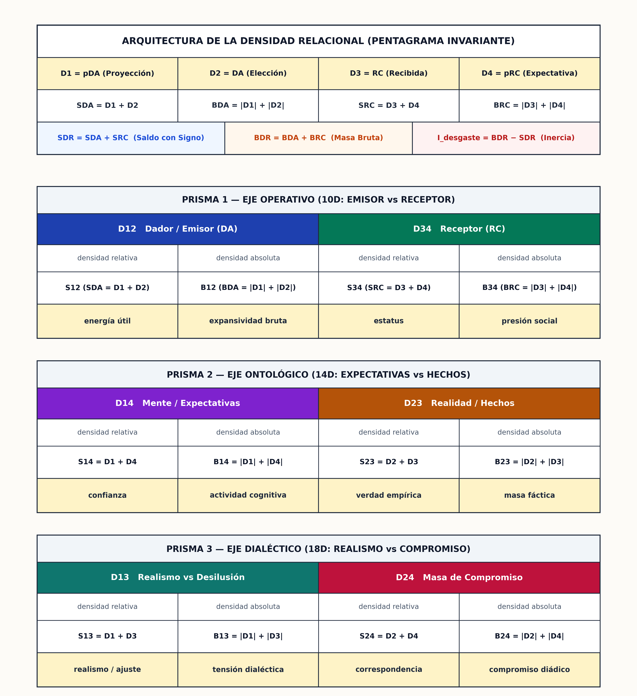
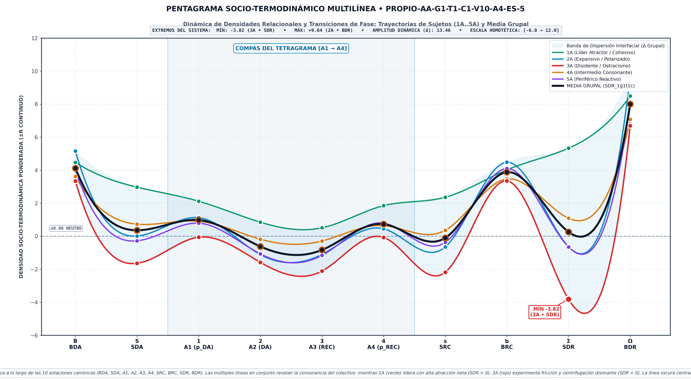

# SOCIOMETRÍA ORDINAL COMPUTACIONAL (NEXORD)
### COMPUTATIONAL ORDINAL SOCIOMETRY (NEXORD)

**Dr. José Manuel Cornejo Álvarez**  
*Universidad de Barcelona (UB)*

## SOCIOMETRÍA ORDINAL COMPUTACIONAL (NEXORD)
### *«Hacia una Física de la Grupalidad»*

**Edición V9.0 (Octubre, 2026)**

* **Autor:** Dr. José Manuel Cornejo Álvarez
* **Vinculación Académica:** Profesor Emérito Jubilado · Psicología Social
* **Rol en la Iniciativa:** Creador de la Plataforma NEXORD y Promotor Científico del Banco Sociométrico (BSOC)
* **Concept DOI (Zenodo / CERN):** [10.5281/zenodo.18926396](https://doi.org/10.5281/zenodo.18926396) · **DOI de Edición:** [10.5281/zenodo.18941691](https://doi.org/10.5281/zenodo.18941691)
* **Repositorio Oficial:** [github.com/josemancor/nex-ord-web](https://github.com/josemancor/nex-ord-web) · **Plataforma:** [josemancor.github.io/nex-ord-web](https://josemancor.github.io/nex-ord-web/)
* **Ecosistema Maestro:** VISORD 3D/4D (Visualizador Sociométrico Ordinal)

---

## RESUMEN

La Sociometría Ordinal Computacional constituye una actualización formal de las intuiciones fundacionales de Jacob Levy Moreno (Sociometría) y Kurt Lewin (Teoría del Campo), superando mediante el cómputo contemporáneo las restricciones metodológicas de su época. Este Manifiesto articula el modelo a través de siete pilares:

**1)** La consideración del vínculo relacional como núcleo constitutivo de la realidad existencial de los grupos. «Dar y Recibir» conforman los polos indisociables de un circuito interactivo continuo, donde la salud, el bienestar y la viabilidad del colectivo dependen del equilibrio homeostático entre los intercambios interpersonales de aceptación y conflicto.

**2)** La cuantificación rigurosa del orden jerárquico de elección mediante la función inversa al rango, formalizando que la mente humana prioriza y elige de manera ordinal sin necesidad de imponer escalas cardinales artificiales.

**3)** La métrica continua, fruto de esta cuantificación del orden preferencial, articulada formalmente en el álgebra del tetragrama relacional y en metapercepciones de reciprocidad, transformando las micro-interacciones interpersonales en una topología plenamente computable.

**4)** El modelado socio-termodinámico del colectivo a través de gradientes de densidad y fricción relacional ($\Phi$), donde la discrepancia dialéctica moderada y la plasticidad interna actúan como condiciones necesarias para el aprendizaje y la adaptación frente a la entropía del pensamiento grupal (*Groupthink*).

**5)** La proyección simultánea en planos factoriales duales, donde los actores se representan a la vez como emisores y receptores de preferencias en equilibrio baricéntrico, permitiendo la comparación geométrica de estructuras grupales mediante variedades topológicas.

**6)** La versatilidad del diseño multidimensional ($G \times T \times C$), que integra análisis transversales, longitudinales y de criterios plurales de tarea y afecto, complementado con las herramientas de visualización interactiva de la plataforma VISORD.

**7)** El compromiso de gobernanza bajo principios de Ética por Diseño (*Ethics by Design*) y Ciencia Abierta, garantizando un uso exclusivamente formativo y no punitivo de los datos, orientado a proteger la dignidad de los participantes y a preservar el patrimonio empírico mediante el Banco Sociométrico (BSOC).

**Palabras clave:** Plataforma NEXORD, VISORD, Sociometría Ordinal Computacional, Sociometría Preventiva, Formato ORBIT, Función Inversa al Rango, Densidades Relacionales (18D), Metapercepción, Planos Factoriales Duales, Variedades de Grassmann, Pensamiento Grupal, Ostracismo, Ética por Diseño, Ciencia Abierta.

---

## ABSTRACT

Computational Ordinal Sociometry is, in essence, an updated extension of the intuitions of Jacob Levy Moreno, creator of Sociometry, and Kurt Lewin, pioneer of Field Theory—two seminal figures in Social Psychology. Historically, research in the Psychology of groups has been conditioned by the methodological and technical limitations of the era in which they emerged. This Manifesto is grounded in:

**1)** The conception of the ‘relational tie’, product of human interaction, as the existential core constituting the reality of groups. ‘Giving and Receiving’ are indissociable force pairs that sustain the necessary dialectical exchange of affect, ideas, intentions, resources, and actions toward shared goals. Personal and group health, wellbeing, success, and viability fundamentally depend on the permanent homeostatic balance established across interpersonal exchanges of acceptance and/or conflict in the short and medium term.

**2)** The refined quantification of preferential relational order, through the application of the inverse rank function ($W_{ij} = 1 / r_{ijk}$) and contemporary theoretical, methodological, and technological developments, defines the genesis of NEXORD as an overarching sociometric psychosocial research platform, aiming to formally articulate the intuitions that Moreno and Lewin could not develop in their time.

**3)** The continuous metric emerging from this quantification is formally articulated, through matrix and tensorial algebra, within the Moreno-rooted relational tetragram ($E, R, pE, pR$; $p$: perceptions/expectativas) defining $3^4 = 81$ (Q81) dyadic relational figures; to which two triadic metaperceptions ($\alpha E, \omega E$) have been added regarding the sender's expectation of the preferences that will actually be expressed by their first chosen and most rejected peers. These data transform micro-interactions ($N \times N$) into computable topologies.

**4)** The articulation into 4 elementary densities ($pDA, DA, RC, pRC$) and their combinatorial expansion into 14 derived densities (18D space) precisely quantify the mass and flow of exchanges among group members. This gradient allows modeling the collective as a socio-thermodynamic system governed by equilibrium states and relational friction ($\Phi$), where dialectical discrepancy acts as a necessary condition for health and adaptability against the entropy of groupthink (*Groupthink*).

**5)** The simultaneous projection in dual factorial spaces of the actors (as senders of preferences to the group and simultaneously recipients of group preferences) who emerge, not as static points, but as kinematic dipoles ($DA \longleftrightarrow RECIBE$) whose centroids analytically balance giving and receiving. This formulation reveals the gravitational dominance of the principal axes ($F_1$ and $F_2$) and enables the geometric comparison of group structures across Grassmann manifolds $\operatorname{Gr}(k, N)$.

**6)** The versatility of the multidimensional design ($G \times T \times C$) enables simultaneous intra- and inter-group comparisons: cross-sectional, longitudinal, and across preference criteria. This mathematical architecture of abstract relationships becomes intuitive for non-experts through the VISORD interactive visualization modules, which facilitate the monitoring and tracking of analytical outcomes.

**7)** In its application to real-world field studies with human participants, NEXORD guarantees an exclusively formative, non-punitive use of data. This requirement safeguards privacy by design (*Privacy by Design*) and demands professional and institutional accreditation as well as the explicit deontological pledge of the Principal Investigator (PI) under Open Science standards, never to damage with their reports the personal self-esteem or social standing of participants, giving as intrinsic traits of individual personality what are strictly group thermodynamic phenomena.

**Keywords:** NEXORD Platform, VISORD, Computational Ordinal Sociometry, Preventive Sociometry, ORBIT Format, Inverse Rank Function, Relational Densities (18D), Metaperception, Dual Factorial Planes, Grassmann Manifolds, Groupthink, Ostracism, Ethics by Design, Open Science.

---

> *«El vínculo humano no es un simple resultado numérico; es un **NEXO** que solo cobra sentido cuando adquiere **ORDEN**.*  
> *Sin orden, la sociometría se limita a un recuento de simpatías; con orden, la sociometría se convierte en topología y termodinámica del espacio grupal.»*

## 1. Fundamentación Epistemológica

### 1.1. Superación del Límite Clásico y la Ontología del Vínculo
El propósito de la Sociometría Ordinal Computacional en NEXORD es actualizar metodológicamente la tradición fundacional de la psicología social: trasladar al plano computacional las intuiciones que ni Jacob Levy Moreno ni Kurt Lewin pudieron implementar con el instrumental técnico de su época.

Moreno concibió el concepto de átomo social y la arquitectura profunda de las preferencias afectivas, pero el cálculo manual obligó históricamente a constreñir los cuestionarios sociométricos a cuotas fijas de elección y rechazo binario (habitualmente tres elecciones positivas y tres negativas). Por su parte, Lewin formalizó la teoría del campo psicológico y la topología hodológica, pero careció de operadores matemáticos continuos capaces de cuantificar distancias psicológicas sin fracturar la naturaleza psicosocial del espacio vital.

NEXORD sitúa la interacción relacional activa en el núcleo ontológico de la vida colectiva: el grupo no es un mero agregado de rasgos disposicionales individuales ni una red estática de nodos fríos, sino un campo dinámico de tensiones, atracciones y resistencias que emerge y se transforma continuamente.

Como homenaje expreso a ambos fundadores, la Plataforma NEXORD encarga dos cartas territoriales en la tradición de la *Carte du Tendre* de Mademoiselle de Scudéry (1654) —género literario-cartográfico que la propia obra evoca al dar nombre al Protocolo Clélie de custodia de datos (§7.2)—: la *Carte de la Spontanéité et du Télé* para Jacob Levy Moreno (1934) y la *Carte du Champ Dynamique et de l'Espace Vital* para Kurt Lewin (1936–1951) (Figuras 1 y 2). Estas cartas declaran, con intención explícita, el estatuto epistémico del proyecto: En ningún momento NEXORD ha pretendido sustituir a sus inspiradores, sino completar algorítmicamente sus geniales intuiciones, adaptándolas a las posibilidades técnicas del cómputo contemporáneo. La continuidad con la tradición fundacional no es únicamente cartográfica: NEXORD opera indistintamente con protocolos de captura MORENO y ORBIT (protocolos muy similares, dual-stack, pues ambos comparten un orden de elección/rechazo manifiesto; aunque ORBIT no se pronuncia directamente sobre las expectativas recíprocas, un algoritmo de conversión MORENO $\longleftrightarrow$ ORBIT permite una estimación probabilística que completa ambas formas sociométricas). El tetragrama diádico ($pDA \cdot DA \cdot REC \cdot pREC$) es una elaboración totalmente moreniana y constituye la base sólida sobre la que se ha construido la Plataforma NEXORD.

La deuda específica con Kurt Lewin está en el origen del lema «La Física de lo Grupal» —y de la materialización de su variable cardinal, la densidad relacional que vertebra el aparato formal socio-termodinámico (§4.4)— se encuentra en la innovadora teoría del campo, que concibió la vida grupal como dinámica de fuerzas en un espacio vital medible: lo que aquí se cuantifica como densidad no es metáfora decorativa, sino continuación algorítmica de aquella intuición fundacional.

Sin un orden canónico explícito, la sociometría histórica acumuló mediciones aisladas e inconmensurables entre sí: hermosas melodías que nadie podía leer en una misma partitura. NEXORD ofrece ese pentagrama común donde el orden no impone la música, sino que la hace legible y comparable.

  
*Figuras 1 y 2. Díptico Cartográfico Fundacional de la Psicología Social — Izquierda (Fig. 1): Carte de la Spontanéité et du Télé de Jacob L. Moreno (1934). Derecha (Fig. 2): Carte du Champ Dynamique & de l'Espace Vital de Kurt Lewin (1936–1951), ambas con orla conmemorativa institucional NEXORD.*

### 1.2. De la Jerarquía Cualitativa al Campo Continuo: Función Inversa al Rango
En la fundamentación del método científico, el orden precede conceptualmente a la métrica cuantitativa. Mientras que la asignación de magnitudes cardinales a los estados afectivos presupone escalas de intervalos que no siempre reflejan el proceso subjetivo de decisión, la ordenación preferencial se ajusta perfectamente a la naturaleza del juicio relacional: la persona jerarquiza, prioriza y elige sus vínculos.

Registrar el orden secuencial de elección permite capturar con precisión la estructura de las preferencias interpersonales sin imponer supuestos métricos a priori. En NEXORD, la métrica continua no se introduce como un postulado externo, sino que surge de forma analítica a partir del orden relacional mediante la función inversa al rango.

El mecanismo analítico que hace posible el tránsito de la ordenación cualitativa al cálculo continuo es la cuantificación del orden jerárquico:

$$W_{ij} = \frac{1}{r_{ij}^\gamma} \tag{1}$$

donde $r_{ij} \in \{1, 2, \dots, N\}$ representa la posición ordinal estricta que el emisor $i$ asigna al compañero $j$, y $\gamma$ modula la interdistancia entre los distintos rangos.

En su formulación complementaria, la densidad interpersonal normalizada adopta la forma:

$$Z_{ij} = \frac{N - r_{ij}}{N - 1} \in [0, 1] \tag{2}$$

donde el primer rango ($r_{ij} = 1$) alcanza la cota unitaria ($Z = 1.0$), el descarte o última posición ($r_{ij} = N$) desciende al cero absoluto ($Z = 0.0$), y los rangos intermedios se distribuyen de manera estrictamente equiespaciada. Es importante explicitar la jerarquía de operadores: la función inversa al rango (1) constituye el operador de cuantificación del valor del orden preferencial y sustenta el motor relacional de la plataforma (pesos de las sociomatrices SMIb y decaimiento del campo); la transformación lineal acotada (2) es una simplificación operativa para aquellas métricas que requieren una cota estricta en $[0, 1]$. Ambas transformaciones permiten operar el vínculo diádico como una fuerza continua y derivable, proyectable sobre variedades geométricas complejas. Esta convergencia formal dialoga con los modelos estadísticos para datos relacionales de orden de rango (Krivitsky & Butts, 2017) y con la evidencia psicométrica sobre la pérdida de información atribuible a las cuotas discretas truncadas (Terry, 2000).

### 1.3. El Axioma Fundamental: DAR y RECIBIR como Hecho Indisociable
La emisión de preferencias (DAR) y la recepción de impacto recíproco (RECIBIR) no constituyen variables psicológicas independientes ni rasgos estables de personalidad: son momentos constitutivos, polares e indisociables de un único hecho relacional.

El funcionamiento armónico o la fractura patológica de un grupo no residen en los individuos como tales, sino en la fluidez, simetría y ruptura de sus intercambios mutuos. Un actor puede manifestar una disposición intensamente integradora mientras el grupo lo relega sistemáticamente a la invisibilidad o al rechazo; omitir la indisociabilidad de ambos polos conduce a diagnósticos ciegos a la exclusión latente y a intervenciones estigmatizantes.

---

## 2. Formato ORBIT, Dualidad Matricial y Clausura Diagonal

### 2.1. Orden sin empates y Dualidad Matricial A(i, k)=j vs. B(i, j)=k
En la sociometría clásica, las condiciones del cálculo manual condujeron de forma natural a procedimientos de recuento basados en cuotas fijas (habitualmente tres elecciones y tres rechazos), donde cada mención recibía el mismo peso, aunque pronto fue sustituido por una ponderación lineal inversa al rango (5-1).

La Sociomatriz ORBIT (inicialmente denominada como formato BREVE por su rapidez de administración) formaliza la ordenación preferencial exhaustiva $A(i, k) = j$ sobre el conjunto completo del grupo, donde el emisor ocupa su propio lugar como parte integrante que es. El orden total permite representar una secuencia completa de todos sus integrantes. A partir de esta base ordinal, el modelo articula el tratamiento matricial y continuo de los intercambios relacionales como una permutación del espacio colectivo.

Esta estructura se articula analíticamente mediante dos representaciones matriciales complementarias y biyectivas:

* **Matriz de Orden Directo $A(i, k) = j$:** Registra en cada fila $i$ el compañero $j$ asignado al casillero o rango de preferencia $k \in \{1^\circ, 2^\circ, \dots, N^\circ\}$.
* **Sociomatriz de Distribución $B(i, j) = k$:** Sociomatriz de orden $N \times N$ donde filas ($i$) y columnas ($j$) indican el orden en que $i$ ha colocado a $j$: $B(i, j) = k \iff A(i, k) = j$.

Al constituir cada fila una permutación estricta del conjunto $\{1, 2, \dots, N\}$, la Sociomatriz ORBIT satisface de forma invariante la **propiedad de conservación de la suma ordinal por fila**:

$$\sum_{j=1}^N B(i, j) = \frac{N(N+1)}{2} = \text{cte} \quad \left(\text{para } N = 6, \sum_{j=1}^6 B(i, j) = 21\right)$$

Esta invariancia algebraica constituye el fundamento que hace posible la transposición bidireccional y exacta entre la sociomatriz clásica de Moreno y la sociomatriz ORBIT, así como la posterior derivación de los tetragramas relacionales (Figuras 3–5):

* **Figura 3.** Sociomatriz clásica de Moreno ($E, R, pE, pR$) en formato Excel para $N = 6$: Transposición a ORBIT $A(i, k)=j$ y $B(i, j)=k$.
* **Figura 4.** Sociomatriz ORBIT $A(i, k)=j$ y $B(i, j)=k$, en formato Excel para $N = 6$: Transposición a MORENO ($E, R, pE, pR$).
* **Figura 5.** Matrices $SMI_a(i, j)$ del tetragrama figurativo y $SMI_b(i, j)$ del tetragrama alfanumérico.

El formato ORBIT está especialmente indicado para su utilización en pequeños grupos ($N < 25$) —equipos de trabajo, células operativas, aulas o unidades convivenciales—, donde la ordenación exhaustiva resulta analítica y estructuralmente óptima para capturar con máxima resolución la microestructura relacional. Para colectivos de tamaño elevado ($N \ge 25$), NEXORD, en caso necesario, dispone de un procedimiento de ordenación por fases sucesivas (un sistema que amplía las cuotas 3-5 morenianas a selecciones más amplias y estratificadas), sin merma de la resolución métrica.

### 2.2. Clausura Diagonal Reflexiva y Sensores Nucleares (IDA, ITA, P(k))
Asegurados los dos extremos de la lista (E y R), el valor que les corresponde a los intermedios es prácticamente insignificante.

NEXORD resuelve la omisión secular de la diagonal principal sociométrica requiriendo que cada participante se auto-ubique en el ranking colectivo. Esta clausura topológica convierte la matriz en un espacio relacional completo y continuo, activando tres indicadores métricos:

* **Índice de Desajuste de Auto-rango ($IDA_i$):** Mide la discrepancia escalar entre la autoimagen proyectada ($r_{ii}$) y el consenso medio recibido del grupo ($\bar{R}_i^{\text{ext}}$):
$$IDA_i = r_{ii} - \bar{R}_i^{\text{ext}} = r_{ii} - \left( \frac{1}{N - 1} \sum_{k \neq i}^N B(k, i) \right)$$
donde $IDA_i < 0$ cuantifica la sobreestimación jerárquica individual, $IDA_i > 0$ la autoinhibición o subestimación periférica, e $IDA_i = 0$ la calibración isomórfica con el entorno social. A escala grupal, el desajuste colectivo se sintetiza mediante la dispersión cuadrática media $\sigma_{\text{IDA}} = \sqrt{\frac{1}{N} \sum_{i=1}^N (IDA_i)^2}$.

* **Índice de Tensión de Auto-rango ($ITA$):** Evalúa la fricción estructural inducida por la pugna por el liderazgo cuando múltiples participantes reclaman el primer rango de preferencia para sí mismos: $ITA = \max\left(0, \sum_{i=1}^N \mathbb{I}(r_{ii} = 1)\right) - 1$.

* **Partición Cognitiva y Anclaje Combinatorio $P(k)$:** Al situar su auto-rango en la posición $k$, el espacio combinatorio admisible del sujeto queda acotado a $P(k) = \binom{N-1}{k-1}$, formalizando que las preferencias interpersonales se emiten desde una auto-posición de referencia: hacia arriba o hacia abajo respecto del propio horizonte subjetivo.

---

## 3. Dinámica Relacional: Regímenes del Campo, Fricción y Viabilidad

### 3.1. Coeficiente de Fricción Relacional (Φ) y Cohesión Estructural (ICE)
La resistencia interna del sistema colectivo se sintetiza en el Coeficiente de Fricción Relacional ($\Phi$) y en su métrica complementaria, el Índice de Cohesión Estructural ($ICE$):

$$\Phi = \frac{2}{N(N - 1)} \sum_{i < j} |Z_{ij} - Z_{ji}|^\alpha \quad (\alpha \ge 1) \tag{3}$$

$$ICE = 1 - \Phi \tag{4}$$

Valores moderados de $\Phi$ reflejan dinamismo interno y plasticidad adaptativa, mientras que valores extremos señalan riesgos de fragmentación o turbulencia destructiva.

### 3.2. Psicologización de Regímenes y Prevención del Pensamiento Grupal (Groupthink)
La dinámica colectiva no puede reducirse a una física inanimada: los estados del sistema expresan fases de evolución psicológica e interpersonal:

* **Rigidez e Inercia Estructural:** Cristalizaciones jerárquicas rígidas, roles inmóviles y escasa permeabilidad comunicativa.
* **Fluidez y Cohesión Adaptativa:** Homeostasis abierta con circulación flexible de preferencias, acuerdos y divergencias.
* **Dispersión y Anomia:** Baja densidad de acoplamiento, desvinculación afectiva y ausencia de proyectos compartidos.
* **Efervescencia y Fusión Colectiva:** Alta activación emocional compartida e intensa movilización interactiva.

Desde este punto de vista, NEXORD cuestiona radicalmente el supuesto tradicional de que la salud grupal óptima equivale a la cohesión absoluta ($ICE = 1.0, \Phi = 0$). Un colectivo sin discrepancias ni fricción interna constituye un sistema vulnerable al pensamiento grupal (*Groupthink*, Janis, 1972), donde las presiones hacia la conformidad anulan el pensamiento crítico y la toma informada de decisiones. La fricción moderada ($\Phi \in [\Phi_{\min}, \Phi_{\max}]$) y los gradientes en el circuito DAR/RECIBIR proporcionan la energía necesaria para la plasticidad, el aprendizaje organizativo y la adaptación evolutiva.

### 3.3. La Metáfora del Puzle: Desatascamiento (Unjamming) vs. Reubicación Ecosistémica
Frente a las intervenciones tradicionales que gestionan el conflicto mediante la exclusión punitiva o el señalamiento moral del sujeto discordante, NEXORD modela el colectivo como un puzle. Un actor que experimenta una elevada fricción no es un elemento intrínsecamente patológico: suele sufrir un desacople de expectativas de rol o una asimetría de flujos con su entorno diádico inmediato.

La facilitación diagnóstica promueve el desatascamiento (*unjamming*) mediante ajustes de tareas, clarificación comunicativa y apertura de canales de colaboración recíproca. Cuando tras un proceso sistemático de mediación la incompatibilidad estructural resulta persistente, el modelo contempla la reubicación ecosistémica digna: una migración hacia otro entorno grupal que preserve la integridad psicosocial del individuo y evite dinámicas de desgaste u ostracismo crónico.

### 3.4. El Universo de Microestados y la Ley de Estabilidad Termodinámica
La dimensión del espacio muestral sociométrico, incluso en el grupo más humilde, es enorme. Para un grupo de cinco personas, cada sujeto que ordena a los otros cuatro miembros dispone de $4! = 24$ ordenaciones diferentes; combinadas las elecciones independientes de los cinco participantes, el espacio total de microestados asciende a $24^5 = 7.962.624$ matrices. Si se incluye la auto-ubicación del emisor ($5! = 120$ ordenaciones por fila), el espacio se dispara a $120^5 \approx 2,49 \times 10^{10}$ —casi 25.000 millones de configuraciones—: tan solo para un grupo de 5. Ante estas cifras, la estabilidad termodinámica y la salud del sistema no dependen del azar, sino de la geometría del flujo energético: de la minimización de la disipación por ruptura y de la existencia de atractores estables.

La inmensa mayoría de las combinaciones corresponderá a ruido térmico (matrices disonantes de alta fricción) o a trampas de congelación (fallas tectónicas y monopolios asfixiantes). Para que un microestado supere los umbrales de organización productiva y saludable debe satisfacer de forma simultánea tres invariantes termodinámicas:
1. **Minimización de la disipación por ruptura:** $\sum_i |Z_{ij} - Z_{ji}|^2 \to \min$ (reciprocidad y coherencia mutua).
2. **Equilibrio del gradiente barométrico:** $\sum_i (Z_i^{\text{in}} - Z_i^{\text{out}})^2 \le \varepsilon$ (ausencia de sumideros negros o manantiales sobrecargados).
3. **Conectividad convectiva global:** existencia de cadenas de retorno transitivas sin nodos aislados ($Z_i^{\text{in}} > Z_{\text{crítico}}$ para todo $i$).

De toda esta combinatoria, solo un porcentaje muy selecto accede a un estado óptimo: el bienestar grupal no es la ausencia de tensiones y conflictos sino un equilibrio entre ellos, donde nadie queda condenado al cero absoluto ni forzado a sostener en soledad el peso del conjunto.

En síntesis: la salud y la productividad de un grupo no son una cuestión moral ni de buena voluntad, sino de aerodinámica e hidrostática relacional. Un grupo productivo es aquel cuyo elipsoide vuela horizontal, cuyos saldos de energía están en balance homeostático, y donde nadie tiene que ahogarse en el fondo del abismo para que otros puedan tomar el sol a cielo abierto.

---

## 4. Álgebra Tensorial, Retícula Q81 y el Pentagrama de Densidades

### 4.1. Los 12 Elementos Sintácticos y el Tetragrama Relacional A1 A2 A3 A4
La retícula fundamental Q81 formaliza el espacio combinatorio completo de las $3^4 = 81$ configuraciones diádicas que articulan el campo relacional. Para dotar al sistema de una notación exacta, libre de ambigüedades, NEXORD establece un alfabeto de 12 símbolos distribuidos en tres estados de polaridad relacional:

#### Tabla 1: Sintaxis — los 12 símbolos del alfabeto relacional NEXORD

| Tipo | DA: Percepción ($p\_DA$) | DA: Efectiva ($DA$) | RECIBE: Efectiva ($RC$) | RECIBE: Percepción ($p\_RC$) | Código Alfanumérico |
| :--- | :---: | :---: | :---: | :---: | :---: |
| **Elige (+)** | `<` | `E` | `e` | `>` | `A – Z` |
| **Indiferencia (0)** | `i` | `¿` | `?` | `!` | `0000` |
| **Rechaza (−)** | `[` | `R` | `r` | `]` | `a – z` |

Cada interacción interpersonal $(i, j)$ queda formalizada como una figura relacional compuesta por cuatro elementos o "tetragrama" formado por las acciones de **DAR** y de **RECIBIR** y dos perspectivas: **PREFERENCIA** manifestada y **EXPECTATIVA** sobre la reciprocidad diádica ($p\_DA, DA, RC, p\_RC$). A su vez, los elementos de este tetragrama o "unidad relacional" operan con tres posibles valores ($\{+\}, \{=\}, \{-\}$). Esta estructura configura un total de $3^4 = 81$ arquetipos relacionales, cuyo eje está formado por las 3 figuras emblemáticas (Tabla 2):

#### Tabla 2. Figuras relacionales sociométricas emblemáticas

| `<Ee>:` | `i¿?!` | `[Rr]` |
| :---: | :---: | :---: |
| Elección recíproca, mutuamente percibida | Indiferencia absoluta | Rechazo recíproco, mutuamente percibido |

La formalización de configuraciones relacionales con signo ($+, -$) y la medición de la fricción diádica dialogan constructivamente con la investigación contemporánea sobre grafos firmados, geometría de comunicabilidad e índices de frustración estructural (Aref & Wilson, 2021; Cucuringu et al., 2023; Diaz-Diaz & Estrada, 2025).

### 4.2. Topología Antidiagonal del Retículo (9 × 9) y Numeralización [1, 81] como Primera Cuantificación de la Densidad
La partición de $9 \times 9$ cruza los 9 perfiles de interacción activa (filas $i = \text{<E}, \text{¡E}, \text{[E}, \text{<¿}, \text{i¿}, \text{[¿}, \text{<R}, \text{¡R}, \text{[R}$) con los 9 perfiles de percepción (columnas $j = \text{e>}, \text{e!}, \text{e]}, \text{?>}, \text{?!}, \text{?]}, \text{r>}, \text{r!}, \text{r]}$). 

La numeralización de las 81 figuras relacionales ($Q_{81}(9, 9)$) se resuelve geométricamente mediante el barrido ordenado de las 17 antidiagonales secundarias, recorridas de abajo hacia arriba: cada antidiagonal define una isolínea de energía y valencia relacional neta constante, de modo que todas las figuras ubicadas sobre la misma antidiagonal comparten idéntica suma de polaridades entre acciones reales y expectativas cognitivas.

Esta ordenación geométrica proporciona la **primera cuantificación métrico-escalar de la densidad relacional diádica** ($D_{Q81} \in [1, 81]$), estructurada en tres regiones fundamentales:
* **Vértice de Disonancia y Rechazo (Escalares 1 a 36):** Las primeras 8 antidiagonales inferiores cubren $\sum_{k=1}^8 k = \frac{8 \times 9}{2} = 36$ figuras situadas en la zona de conflicto, desgaste y retracción vincular, partiendo del polo de máxima densidad negativa: `[Rr]` = 1.
* **Isolínea Baricéntrica Neutra (Escalares 37 a 45):** La antidiagonal transversal central ($d = 9$, constituida por 9 celdas) abarca los escalares 37 a 45. Su celda central (coordenada 5, 5) fija de manera unívoca el **centroide de indiferencia basal**:  
  $$\text{Celda}(5, 5) \implies \text{i¿?!} = 41$$
* **Vértice de Cohesión y Resonancia (Escalares 46 a 81):** Las 8 antidiagonales superiores cubren las 36 figuras de atracción, convergencia y sinergia hasta alcanzar el extremo de la antidiagonal 17 (longitud 1), coronando el espacio en la figura de sintonía armónica plena: `<Ee>` = 81.

**Normalización Continua de la Densidad $Q_{81}$:**  
Al centrar la escala sobre el centroide neutro de indiferencia (41), la densidad diádica elemental de la figura se normaliza en el rango continuo canónico $[-1.00, +1.00]$:

$$D_{Q81}(i, j) = \frac{Q_{81}(i, j) - 41}{40} \tag{13}$$

donde: $D_{Q81}(\text{<Ee>})$ = Densidad Máxima Positiva (+1.000), $D_{Q81}(\text{i¿?!})$ = Densidad Neutra (0.000) y $D_{Q81}(\text{[Rr]})$ = Densidad Máxima Negativa (-1.000).

Esta geometría preserva una **simetría complementaria antipodal estricta**: $\text{Antípoda}(k) = 82 - k$, lo que implica que $\text{Figura}(i, j) + \text{Figura}(10-i, 10-j) = 82$, demostrando que el centroide neutro es autoinvariante bajo inversión polar ($41 + 41 = 82$).

#### Tabla 3. Retícula Q81 (9 × 9): clasificación de las 81 figuras relacionales diádicas posibles, indexadas por antidiagonales de valencia creciente (1 = [Rr] … 41 = i¿?! … 81 = <Ee>).

### 4.3. El Tríptico Estructural del Sujeto como Unidad y el Diagnóstico Desdoblado
La idea de dotar a cada miembro del grupo de una única figura relacional y de una única densidad global sólo es posible si se descarta un promedio de todas sus relaciones diádicas, lo que sería un procedimiento totalmente erróneo. NEXORD preserva la bidimensionalidad topológica desdoblando la posición del sujeto $i$ a través de su Tríptico Estructural:

* **Emisión (DA):** $F_i^{\text{out}}$ = promedio numérico $Q_{81}$ de las elecciones y expectativas emitidas $(i, j)$, determinando el semi-tetragrama emisor $f_i^{\text{out}} = \text{‘xx..’}$.
* **Recepción (RC):** $F_i^{\text{in}}$ = promedio numérico $Q_{81}$ de las elecciones y expectativas recibidas $(j, i)$, determinando el semi-tetragrama receptor $f_i^{\text{in}} = \text{‘..yy’}$.
* **Figura Global del Sujeto:** De la articulación de ambos polos emerge su tetragrama integral $F_i^{\text{global}} = \text{‘XXYY’}$, cuyo valor $Q_{81}$ es el que corresponde canónicamente a la figura resultante.
* **Auto-anclaje Reflexivo ($f_{ii}$):** Cierre diagonal reflexivo en $Q_{81}$ que formaliza la autoimagen y la autoeficacia psicosocial del nodo.

De la discrepancia posicional $\Delta_{\text{rol}} = F_i^{\text{out}} - F_i^{\text{in}}$ emergen perfiles diagnósticos directos:
* **Síndrome de Desgaste Relacional:** $F_i^{\text{out}} \gg F_i^{\text{in}}$ con declive en $f_{ii}$ (entrega e inversión no correspondidas, anticipando fatiga o abandono).
* **Liderazgo Retraído o de Reserva:** $F_i^{\text{in}} \gg F_i^{\text{out}}$ (fuerte demanda y atracción recibida frente a repliegue o cautela emisora).
* **Inhibición de Estatus:** $F_i^{\text{in}} \gg 41$ conviviendo con $f_{ii} \le 41$ (reconocimiento grupal objetivo no asimilado internamente por el individuo).

### 4.4. El Hiperespacio Relacional 18D, los 3 Prismas Duales y el Pentagrama de Densidades (10D)

#### 4.4.1. Moduladores Diádicos y las 18 Densidades Relacionales (Tablas 3b y 3c)
La densidad relacional diádica cuantifica la masa térmica y estructural de cada vínculo interpersonal sobre el continuo termodinámico ($\pm\mathbb{R}$). Para garantizar la máxima reproducibilidad y rigor analítico, el motor procesa cada interacción $(i \to j)$ mediante seis moduladores matemáticos objetivos (Tabla 3b):

#### Tabla 3b. Matriz de Trazabilidad Algorítmica y Moduladores de la Densidad Diádica

| Vector de Fuerza | Condición Evaluada | Modulador Matemático Asignado | Impacto en la Estructura |
| :--- | :--- | :---: | :--- |
| **1. Función Inversa ($1/r^k$)** | Rango Ordinal ($1º, 2º, 3º\dots$) | $\text{Base}$ | Fija el potencial inicial del vínculo. Penaliza de forma no lineal ($k \ge 1.0$) la baja priorización atencional. |
| **2. Reciprocidad Diádica** | Congruencia de Acción (`Ee`, `Rr`, `Aa`) | **$1.5\times$** | Prioriza (+50%) el vínculo fáctico real y el homomorfismo relacional simétrico frente a la mera expectativa. |
| **3. Acierto / Verdad** | Congruencia Perceptiva (`<e>`, `(e`) | **$1.5\times$** | Premio termodinámico a la lucidez mental, la sintonía empática y la salud estructural de la red. |
| **4. Oposición de Sentimientos** | Disonancias y Paranoias (`(]`, `Er`, `[>`) | **$-(P_i \times 0.5)$** | Penalización destructiva proporcional al estatus ($P_i$). La toxicidad de un líder daña la red más que la de un nodo periférico. |
| **5. Esfuerzo Perceptivo** | Presencia activa de meta-percepción ($pDA, pRC$) | **$1.2\times$** | Reconocimiento del coste cognitivo de anticipación. **Bono estrictamente anulado a $1.0\times$ si existe ceguera estructural**. |
| **6. Prestigio del Emisor ($P_i$)** | Centralidad Jerárquica del Sujeto en la Red | **Variable** ($0.5$ a $1.5$) | Multiplicador de escala gravitatoria. Determina cuánta masa inercial arrastra la acción del emisor sobre el colectivo. |

El cruce simétrico entre emisión y recepción en la sociomatriz genera las **18 Densidades Relacionales (18D)** de la Tabla 3c, regidas por dos prefijos universales: **S** (Saldo relativo con signo, $\pm\mathbb{R}$, vector de atracción o rechazo) y **B** (Densidad bruta modular, $|\cdot| \ge 0$, masa y energía total movilizada):

#### Tabla 3c. Especificación y Cálculo Canónico de las 18 Densidades Relacionales e Invariantes Socio-Termodinámicos

| Dimensión | Símbolo / Alias | Partición / Eje | Fórmula de Cálculo Exacta | Rango Métrico | Significado Socio-Termodinámico |
| :---: | :---: | :---: | :---: | :---: | :--- |
| **1D** | $D_1$ ($dDP, D_{pDA}$) | Base 4D | $\frac{1}{N-1}\sum W_{pDA}(i, j)$ | $[-1.00, +1.00]$ | Expectativa previa y confianza anticipatoria emitida hacia el grupo. |
| **2D** | $D_2$ ($dDA, D_{DA}$) | Base 4D | $\frac{1}{N-1}\sum W_{DA}(i, j)$ | $[-1.00, +1.00]$ | Flujo cinético y acción preferencial efectiva emitida por el sujeto. |
| **3D** | $D_3$ ($dRA, D_{RC}$) | Base 4D | $\frac{1}{N-1}\sum W_{RC}(j, i)$ | $[-1.00, +1.00]$ | Estatus e impacto real de atracción o rechazo recibido del colectivo. |
| **4D** | $D_4$ ($dRP, D_{pRC}$) | Base 4D | $\frac{1}{N-1}\sum W_{pRC}(j, i)$ | $[-1.00, +1.00]$ | Campo reflejo de presunción atribuido al sujeto por sus compañeros. |
| **5D** | $S_{12}$ ($SDA$) | Prisma 1 Operativo | $D_1 + D_2$ | $[-2.00, +2.00]$ | Potencial neto emisor: expansividad y manantial/sumidero de iniciativa. |
| **6D** | $B_{12}$ ($BDA$) | Prisma 1 Operativo | $\|D_1\| + \|D_2\|$ | $[0.00, +2.00]$ | Masa bruta dadora: gasto metabólico total e inversión emisora. |
| **7D** | $S_{34}$ ($SRC$) | Prisma 1 Operativo | $D_3 + D_4$ | $[-2.00, +2.00]$ | Potencial neto receptor: estatus global inducido por el entorno social. |
| **8D** | $B_{34}$ ($BRC$) | Prisma 1 Operativo | $\|D_3\| + \|D_4\|$ | $[0.00, +2.00]$ | Masa bruta receptora: presión social incidente y carga de impacto. |
| **9D** | $S_{14}$ ($SP$) | Prisma 2 Ontológico | $D_1 + D_4$ | $[-2.00, +2.00]$ | Saldo cognitivo: clima de confianza y presunción compartida. |
| **10D** | $B_{14}$ ($BP$) | Prisma 2 Ontológico | $\|D_1\| + \|D_4\|$ | $[0.00, +2.00]$ | Masa bruta cognitiva: volumen de rumiación mental y carga prospectiva. |
| **11D** | $S_{23}$ ($SA$) | Prisma 2 Ontológico | $D_2 + D_3$ | $[-2.00, +2.00]$ | Saldo fáctico: verdad objetiva de elecciones y rechazos reales. |
| **12D** | $B_{23}$ ($BA$) | Prisma 2 Ontológico | $\|D_2\| + \|D_3\|$ | $[0.00, +2.00]$ | Masa bruta fáctica: volumen de acción motora y contacto real. |
| **13D** | $S_{13}$ | Prisma 3 Dialéctico | $D_1 + D_3$ | $[-2.00, +2.00]$ | Saldo de realismo: confirmación vs. desilusión (lo esperado vs. lo recibido). |
| **14D** | $B_{13}$ | Prisma 3 Dialéctico | $\|D_1\| + \|D_3\|$ | $[0.00, +2.00]$ | Masa de realismo: vulnerabilidad afectiva en la prueba de realidad. |
| **15D** | $S_{24}$ | Prisma 3 Dialéctico | $D_2 + D_4$ | $[-2.00, +2.00]$ | Saldo de respuesta: satisfacción vs. frustración del deseo ajeno. |
| **16D** | $B_{24}$ | Prisma 3 Dialéctico | $\|D_2\| + \|D_4\|$ | $[0.00, +2.00]$ | Masa de correspondencia: compromiso diádico y responsabilidad recíproca. |
| **17D** | $SDR$ | Invariante Global | $\sum S_{ij} = \sum D_k$ | $[-4.00, +4.00]$ | Saldo de Densidad Relativa total: barómetro homeostático del clima vincular. |
| **18D** | $BDR$ | Invariante Global | $\sum B_{ij} = \sum \|D_k\|$ | $[0.00, +4.00]$ | Densidad Bruta Relacional: capacidad calorífica y masa total del sistema. |

#### 4.4.2. Los 3 Prismas Duales y el Pentagrama 10D (Figuras 8b y 8)
Las cuatro densidades elementales $\{D_1, D_2, D_3, D_4\}$ admiten tres particiones duales ortogonales independientes o **Prismas** (Figura 8b): el **Operativo** (10D: Dador vs. Receptor), el **Ontológico** (14D: Mente vs. Hechos) y el **Dialéctico** (18D: Realismo vs. Compromiso). 

  
*Figura 8b. Arquitectura Canónica del Espacio Relacional 18D y los 3 Prismas Duales: Estructuración del tetragrama en 4 densidades elementales (D1–D4), saldos globales invariantes (SDR, BDR) y descomposición en los tres ejes fundamentales: Operativo (10D), Ontológico (14D) y Dialéctico (18D).*

En el plano operativo, el **Pentagrama Socio-Termodinámico** (Figura 8) articula las diez densidades canónicas desacoplando la emisión activa ($SDA, BDA$) del estatus receptivo ($SRC, BRC$), culminando en los invariantes globales $SDR$ y $BDR$. La discrepancia analítica entre la energía total movilizada y el flujo neto resultante define formalmente la **Inercia del Desgaste Relacional** ($I_{\text{desgaste}} = BDR - SDR$), cuantificando la energía disipada en rumiación y fricción estéril antes de que afloren fracturas abiertas en el grupo.

  
*Figura 8. Pentagrama Socio-Termodinámico con las 10 densidades canónicas: desacoplamiento emisión/recepción y transición al continuo termodinámico; la brecha I_desgaste = BDR − SDR cuantifica la energía disipada en fricción.*

### 4.5. El Paradigma de VISORD Acuario y la Hidrostática Relacional
Como culminación perceptiva y experimental de este formalismo socio-termodinámico, el entorno **VISORD Acuario** constituye una aplicación complementaria de NEXORD que facilita la percepción visual y auditiva integrada de las estructuras de densidad relacional dentro de un diseño multidimensional $G \times T \times C$.

El escenario se modela como un acuario tridimensional continuo definido sobre el volumen cartesiano $\mathbf{DA} \times \mathbf{RECIBE} \times \mathbf{DENSIDAD}$, estructurado analíticamente en tres zonas y estratos característicos:
1. **Fondo sumergido (Bentos relacional):** Cuencas de atracción de baja cota y alta presión negativa, donde se concentran los estados de rechazo mutuo (`[Rr]`), conflicto latente y aislamiento estructural.
2. **Superficie del agua (Nivel barométrico neutro):** Lámina homeostática de flotabilidad basal correspondiente al centroide de indiferencia (`i¿?! = 41`) y equilibrio disyuntivo.
3. **Cielo abierto (Atmósfera convectiva):** Estrato superior de alta densidad positiva y cohesión óptima, donde gravitan las figuras de resonancia armónica (`<Ee>`) y liderazgo integrador libre de fricción.

En este escenario se proyectan distintos valores de densidad relacional en **disyuntiva completa**:
* **Nivel Intra-sujeto:** Proyección diferencial de los distintos pares relacionales y dipolos cinemáticos de un mismo actor frente a sus compañeros.
* **Nivel Unitario:** Distribución de los sujetos en tanto que agentes dobles: Dadores activos de preferencia ($DA$) y Receptores de impacto grupal ($RECIBE$).
* **Nivel Macro-relacional:** Densidades globales agregadas e inter-estratales entre Grupos ($G$), entre Tiempos ($T$) y entre Criterios ($C$).

---

## 5. Soluciones Gráficas, Espacio Multidimensional GxTyCz y Geometría Invariante

### 5.1. Soluciones Gráficas: Representación Visual y Topografía Relacional
El VISORD ha surgido de la necesidad de hacer más visibles —y audibles— los procesos y las estructuras relacionales resultantes de la investigación. El ojo y el oído humanos están poco preparados para asimilar ristras de números y coeficientes abstractos; en cambio, tienen una enorme capacidad para percibir de forma intuitiva formas, relieves, cambios tonales, distancias relativas, densidades e iluminaciones.

La «lupa matemática» de la Sociometría Ordinal de NEXORD ha avanzado, mediante sus animaciones VISORD, en la creación de visualizaciones interactivas que facilitan una mejor percepción y comprensión de los fenómenos de interacción grupal. Como ha demostrado fehacientemente la investigación cosmológica, la progresiva matematización ha conseguido hacer ver y oír lo que resulta imperceptible a nuestros sentidos biológicos. Y esa lupa ha sido posible gracias al avance realizado en la cuantificación más precisa de los órdenes de preferencia.

NEXORD articula un conjunto de soluciones gráficas continuas destinadas a restituir el campo relacional sin saturación perceptiva:

* **Sociogramas Continuos Tridimensionales (VISORD 3D/4D):** Visualización en el espacio continuo de cuencas de atracción (verde esmeralda, `<Ee>`), zonas intermedias de oposición (ámbar) y filamentos de ruptura o fricción (magenta, `[Rr]`), con navegación temporal diacrónica (Figura 11).
* **Planos Factoriales Duales Paralelos (Biplot MESO $F_1 \times F_2$, espacio dual AFC $\parallel$ PCA):** Proyección simultánea donde el vector diádico $DA \longrightarrow RC$ vertebra la posición de cada sujeto con baricentro exacto en el origen ($\Delta = 0.000$). En el AFC, sobre la tabla de contingencia de recuentos enteros $\mathbb{N}_0$ bajo la métrica $\chi^2$; en el PCA, sobre la matriz de densidades continuas $\pm \mathbb{R}$ estandarizadas. El contraste evidencia la aportación sustantiva de la socio-termodinámica relacional (Figura 9).
* **Ejes Slender Verticales 1D:** Proyecciones derivadas de la descomposición espectral y el análisis de correspondencias (Benzécri, 1973; Cornejo, 1988), flanqueadas por ejes verticales de contribución absoluta (CTA) y calidad de representación (COR). Conviene fijar las definiciones formales de estas métricas: la COR (calidad de representación) del elemento $i$ sobre el eje $\alpha$ es $\text{COR}_{i\alpha} = d^2(i, \alpha) / d^2(i, G) \in [0, 1]$, la proporción de la inercia del elemento recuperada sobre ese eje; la CTR (contribución) es $\text{CTR}_{i\alpha} = p_i \cdot d^2(i, \alpha) / \lambda_\alpha$, el peso relativo del elemento en la construcción de la varianza de ese eje (las contribuciones sobre un eje suman 100%); la varianza explicada acumulada, $\lambda_\alpha / \sum_\beta \lambda_\beta$, es una propiedad del eje derivada de los autovalores, conceptualmente distinta de cualquier contribución elemental (Figura 10).
* **Proyección Axonométrica Jerarquizada en el plano 2D de hasta 6 Dimensiones (Algoritmo DIMO / ANCORM):** Para superar la limitación clásica de los planos 2D sin perder la interpretabilidad intuitiva del espacio euclídeo, NEXORD incorpora en su motor el método de proyección axonométrica jerárquica de hasta 6 factores factoriales desarrollado por el Dr. José Manuel Cornejo Álvarez (*ver Anexo II para su formulación analítica completa y reglas de tracción por CTA*).
* **Structurogramas Intergrupales:** Polígonos de sustentación vincular para el análisis morfológico comparativo entre colectivos.

  
*Figura 9. PLANOS DUALES EN PARALELO (Biplot MESO F1 × F2, espacio dual AFC ∥ PCA): el vector diádico DA ⟶ RC con baricentro en el origen (Δ = 0.000). (A) AFC sobre frecuencias de las figuras Q81 en emisores y receptores (contingencia ℕ₀, métrica χ²); (B) PCA sobre las 10 densidades en los mismos sujetos (continuo ±ℝ). El contraste evidencia la aportación sustantiva de la termodinámica relacional.*

  
*Figura 10. Ejes verticales factoriales 1D (Ejes 1 y 2, matriz SDR): calidad métrica bilateral COR–CTA–CTR de sujetos y figuras Q81, evitando la saturación de los diagramas 2D.*

  
*Figura 11. VISORD_demo 3D: fases en la formación interactiva de grupos y resultados termodinámicos numéricos y gráficos en tiempo real; fuerzas de atracción y repulsión en acción.*

### 5.2. El Espacio Multidimensional GxTyCz
NEXORD está configurada como una Plataforma de Investigación Sociométrica Psicosocial que trasciende la concepción tradicional del test sociométrico como una fotografía estática, aislada y unidimensional. La plataforma concibe el campo de las interacciones humanas como un espacio de investigación tensorial abierto, continuo y parametrizable, formalizado sobre el producto cartesiano $G \times T \times C$ donde el investigador puede diseñar desde estudios puntuales de una sola sociomatriz hasta ambiciosos programas longitudinales y comparativos intergrupales. La formulación matricial no impone restricciones previas sobre el diseño experimental, articulándose sobre cuatro ejes fundamentales:

1. **Eje G — Colectivos y Grupos ($G = \{G_1, G_2, \dots, G_x\}$):**
Transversalidad estructural. El sistema admite operar tanto sobre un único colectivo natural como sobre constelaciones de grupos independientes, departamentos de una misma organización, redes de aulas o células operativas en misiones críticas. Este eje habilita la comparación morfológica intergrupal (mediante distancias geodésicas en variedades de Grassmann) sin forzar interacciones cruzadas artificiales entre miembros que pertenecen a entornos convivenciales distintos.

2. **Eje T — Oleadas Temporales Longitudinales ($T = \{T_1, T_2, \dots, T_y\}$):**
Investigaciones longitudinales, donde el seguimiento sociométrico de grupos a lo largo del tiempo permite evaluar su evolución y contrastar los efectos de situaciones, de incidentes o el resultado de intervenciones estratégicas programadas. NEXORD puede monitorizar la evolución diacrónica de la cohesión, la velocidad de sedimentación del estatus, la inercia o mutabilidad del liderazgo, el enquistamiento o disolución de tensiones latentes (`[Rr]`) y la trayectoria cinemática de los actores en el espacio de densidades. Esta perspectiva longitudinal permite diagnosticar si el colectivo evoluciona hacia un régimen de fluidez adaptativa o si se precipita hacia trampas de rigidez, polarización o desgaste estructural antes de que se produzcan fracturas abiertas.

3. **Eje C — Criterios Sociométricos Plurales ($C = \{C_1, C_2, \dots, C_z\}$):**
Diversidad de criterios valorativos. Las preferencias y expectativas en las relaciones diádicas no son estáticas, pueden variar mucho según se consideren distintos criterios de valoración que se utilicen: operacionales, motivacionales, cognitivos, socioafectivos, de liderazgo, etc.:
* **Criterios instrumentales o de tarea ($C_1$):** competencia técnica, eficacia percibida, coordinación operativa y reparto de cargas de trabajo.
* **Criterios socioafectivos o expresivos ($C_2$):** simpatía, afinidad emocional, confianza interpersonal y convivencia informal.
* **Criterios de estrés o liderazgo en crisis ($C_3$):** fiabilidad bajo presión, arbitraje en el conflicto y delegación de autoridad en situaciones de incertidumbre.

La plataforma calcula matrices de discrepancia inter-criterio y coeficientes de correlación ordinal que desvelan fracturas invisibles al análisis clásico: sujetos altamente demandados en la tarea pero aislados afectivamente, o líderes informales de gran arrastre socioafectivo, pero desconectados de los objetivos operativos del grupo.

4. **Eje Z — Variables Contextuales y Psicosociales Complementarias ($Z$):**
El puente analítico entre la topología relacional y los atributos individuales de los actores. Aunque el cálculo sociométrico intrínseco opera exclusivamente sobre las preferencias de ordenación pura (la estructura del vínculo), NEXORD integra de forma nativa dos baterías estándar de calibración:
* **Batería Sociodemográfica $V_{10}$:** diez variables contextuales normativas (en 3 modalidades homogéneas por ítem) que sitúan al actor en su coordenada biográfica, de rol formal, antigüedad o estatus institucional.
* **Batería de Atribución Adjetival Grupal $A_{16}$:** dieciséis adjetivos agrupados en 4 factores: (temático, funcional, cognitivo, afectivo) (AAG; Vicente, Cornejo & Barbero, 2006), evaluados en escala par (1–8, sin punto neutro de escape) para mapear el clima cognitivo-emocional y la atmósfera valorativa proyectada sobre el grupo.

Proyectadas como variables ilustrativas o suplementarias en los planos factoriales duales (AFC $\parallel$ PCA), las variables $Z$ enriquecen la interpretación clínica sin alterar la pureza métrica del campo relacional. Asimismo, el mantenimiento de este estándar común constituye el marco de referencia del Banco Sociométrico (BSOC) para garantizar la comparabilidad retrospectiva e histórica de sociomatrices provenientes de épocas, culturas y contextos organizacionales muy diversos.

  
*Tabla 4. Cuadro normativo de la batería de 10 variables contextuales (V₁₀, 3 modalidades) y 16 adjetivos de atribución grupal (A₁₆, 4 × 4, escala par 1–8 sin neutro).*

El despliegue aplicado del espacio $G \times T \times C$ se canaliza a través de los 10 dominios ecosistémicos de calibración (Tabla 5), que fijan los parámetros estructurales del campo —inercia relacional $\alpha$ y tasa de decaimiento $\gamma$— junto con el foco psicosocial y los criterios estándar de elección, según el contexto institucional de aplicación (educativo, familiar, deportivo, comunitario, misiones críticas, terapéutico, laboral, institucional, militar y ecológico-penitenciario).

  
*Tabla 5. Catálogo de los 10 dominios ecosistémicos de aplicación con parametrización estructural (α, γ), foco psicosocial y criterios de elección.*

### 5.3. PCA Multigrupo y Distancia Geodésica en Variedades de Grassmann Gr(k, N)
Para comparar colectivos sin forzar interacciones cruzadas artificiales, cada grupo se proyecta como un subespacio $k$-dimensional dentro de $\mathbb{R}^N$. A partir de los ángulos principales de Jordan $\cos(\theta_m) = \sigma_m(U_1^T U_2)$, se calcula la distancia geodésica invariante de escala:

$$d_{\operatorname{Gr}}(U_1, U_2) = \sqrt{\sum_{m=1}^k \theta_m^2} \tag{20}$$

Esta métrica determina rigurosamente (Figura 12) si dos grupos comparten la misma morfología relacional con independencia de las diferencias en sus tamaños muestrales. Más allá del acuerdo puntual entre observadores, es la persistencia y constancia temporal de estas configuraciones en el espacio geométrico lo que permite contrastar la solidez de las estructuras relacionales frente a variaciones coyunturales o fluctuaciones aleatorias.

  
*Figura 12. Plano factorial comparativo intergrupal (G1 vs G2) y structrogramas diacrónicos; la distancia geodésica en Gr(k, N) cuantifica la morfología relacional compartida.*

A nivel del sujeto individual, la matriz de interdistancias euclídeas de rangos $d_{\text{DA}} / d_{\text{RC}}$ (Tabla 6) documenta sobre el corpus G2T1C1 la ley de asimetría relacional: la dispersión receptora media ($4.84; DT = 0.64$) supera sistemáticamente a la emisora ($4.15; DT = 0.49$), y los diagnósticos posicionales por nodo —de la consonancia isométrica de 5A ($\Delta = -0.09$) al desbalance máximo de 3A ($\Delta = -1.39$)— ilustran la granularidad del diagnóstico socio-termodinámico.

  
*Tabla 6. Matriz numérica de interdistancias euclídeas de rangos (d_DA, d_RC, Δ = d_DA − d_RC) con diagnóstico estructural por sujeto, corpus G2T1C1: validación empírica de la ley de asimetría relacional.*

---

## 6. Investigación Experimental: Laboratorio Físico, Sociometría Dialéctica y Cognición Triádica

### 6.1. Monitorización Experimental en el Laboratorio Físico
La plataforma está diseñada para la monitorización de investigaciones experimentales complejas en laboratorio físico: seguimiento diacrónico de tareas de alta interdependencia, simulación de crisis y evaluación continua de intervenciones en dinámicas de grupos reducidos.

### 6.2. Sociometría Dialéctica y Estudio de Dilemas Sociales
En situaciones de cooperación y conflicto (p. ej., dilemas de bienes comunes o dilema del prisionero iterado), NEXORD cuantifica el desacople entre las expectativas cognitivas y la conducta relacional observable, capturando la emergencia de alianzas, deserciones y normas de reciprocidad.

### 6.3. Percepción Multimodal: Modelo del Iceberg y Sonificación Hidrodinámica
NEXORD implementa el modelo del iceberg en dos vertientes:
* **Representación Gráfica 3D:** Hace emerger a la superficie visual la estructura sumergida de tensiones, rechazos latentes y lazos informales que no se manifiestan en la jerarquía formal.
* **Sonificación Hidrodinámica:** Convierte densidades y fricciones en flujos tonales continuos, permitiendo la monitorización auditiva de estados de turbulencia o calma colectiva sin sobrecargar la atención visual del analista.

La capacidad de calcular el campo para colectivos de gran tamaño sin pérdida de continuidad analítica resuelve una limitación histórica de la sociometría tradicional, que solía restringirse a grupos pequeños ($N < 30$) por la saturación de los sociogramas clásicos (Figura 13).

  
*Figura 13. Campo continuo de interacción y modelo del iceberg en un colectivo de N = 50 sujetos: la base relacional sumergida hecha visible.*

### 6.4. El Corpus CULTURAL como Entorno de Reactividad Cero
La literatura dramática y la narrativa cinematográfica constituyen laboratorios humanos privilegiados: sistemas cerrados, perfectamente documentados y de reactividad cero (el texto no se altera por ser observado). NEXORD ha procesado obras maestras de la dramaturgia y la literatura (*Doce hombres sin piedad* de Reginald Rose, *La casa de Bernarda Alba* de Federico García Lorca, *El señor de las moscas* de William Golding), demostrando que las leyes socio-termodinámicas identifican con precisión matemática los nudos dramáticos, las transiciones de fase y los colapsos de liderazgo sin recurrir a datos inferidos por observación.

### 6.5. Cognición Social Triádica: Expectativas Proyectadas αE y ωE
NEXORD extiende la captura de expectativas incorporando dos sensores de la teoría de la mente relacional:
* **Mejor Valorado Esperado ($\alpha E$):** La expectativa de cada sujeto sobre quién será el miembro más elegido por el colectivo.
* **Peor Valorado Esperado ($\omega E$):** La expectativa de cada sujeto sobre quién concentrará el mayor rechazo o descarte grupal.

Estas métricas cuantifican la precisión de lectura de campo o lucidez sistémica (Tsankova & Tair, 2021) mediante la distancia euclídea entre la expectativa emitida y la realidad colectiva observada: $\Delta_\alpha = \|\alpha E - \text{Elección Real}(\alpha)\|$ y $\Delta_\omega = \|\omega E - \text{Elección Real}(\omega)\|$.

Sujetos con $\Delta_\alpha \approx 0$ y $\Delta_\omega \approx 0$ operan como sensores naturales de la dinámica del grupo, cuya perspectiva anticipa cambios de fase estructurales.

### 6.6. Simulación Sociométrica In Silico: el Motor PLATINUM
La realización concreta de un estudio sociométrico real comporta dificultades, trabajo y tiempo considerables. Para desplegar la investigación metodológica, la formación investigadora y la calibración instrumental sin esa carga —y sin exposición alguna de sujetos humanos—, NEXORD integra un motor de simulación sociométrica in silico (PLATINUM), en la línea de lo que la Biología Sintética o la Epidemiología Computacional representan para sus respectivos campos: no se trata de inventar ruido estadístico desconectado de la naturaleza humana, sino de extrapolar las leyes topológicas de la sociometría —sus valencias y dinámicas reales— para modelar organizaciones plausibles y desafiantes que fuerzan a los algoritmos preventivos de la plataforma a demostrar su fiabilidad in vitro antes de actuar sobre tejido social vivo. La simulación ya no es un dibujo: es una biografía social reproducible.

El investigador define el escenario deseado en el espacio de diseño $G \times T \times C$ (grupos, oleadas temporales, criterios con sus consignas literales, tamaños muestrales y dominio de contexto), mediante un archivo estándar de parámetros o mediante asistente interactivo guiado, y gobierna la morfología del colectivo mediante familias de moduladores paramétricos continuos:
* **(a) Termodinámicos:** densidad objetivo de valencia, saturación de nodos estrella, tolerancia de convergencia.
* **(b) De gravedad cinética y ensamblaje:** cohesión, transparencia metaperceptiva, sesgo intergrupal, ruido térmico, reciprocidad, triangulación y facciones latentes.
* **(c) Temporales longitudinales:** inercia estructural, olvido de agravios y ruptura exógena.
* **(d) Contextuales:** baterías $V_{10}$ y $A_{16}$ y el catálogo de los 10 dominios de calibración $\alpha / \gamma$ (Tabla 5).

La reproducibilidad es absoluta: la semilla pseudoaleatoria garantiza la regeneración bit a bit de cualquier corpus, y el tamaño de lote habilita réplicas Monte Carlo. Cada simulación se identifica con una clave estandarizada (`SIMUL-...`) y codifica sus sujetos con las etiquetas posicionales formales (`1A1a`...), preservando la anonimidad por diseño; SIMUL se sitúa así junto a PROPIO, REAL y CULTURAL en el catálogo de las cuatro categorías operativas de datos de la plataforma:
* **REAL (Corpus Empíricos de Campo):** Datos obtenidos de colectivos humanos vivos (organizaciones laborales, aulas educativas, equipos deportivos o unidades asistenciales), recogidos mediante los protocolos de captura web de la plataforma bajo estricto consentimiento informado, salvaguarda de privacidad y compromiso de uso exclusivamente formativo y no punitivo (§6.7 y §7.1). Esta modalidad faculta al motor de simulación para estimar por defecto —si fuera conveniente o necesario— los valores de las Variables Contextuales ($V_{10}$) y de los Adjetivos de Atribución Grupal ($A_{16}$) a partir de los datos sociométricos recogidos y la información complementaria aportada por el Investigador Principal, cuando dichos datos de contexto no hayan podido ser recabados directamente en el campo.
* **PROPIO (Corpus del Investigador):** Sociomatrices y diseños singulares aportados directamente por el usuario, docente o consultor para su explotación particular, docencia o intervención específica en sus propios grupos naturales; permite al simulador recoger los datos diseñados por el propio Investigador Principal y, si es conveniente, completar datos faltantes para garantizar la continuidad analítica del estudio.
* **CULTURAL (Laboratorios de Reactividad Cero):** Redes relacionales extraídas de textos dramáticos, guiones cinematográficos u obras literarias maestras (*Doce hombres sin piedad*, *La casa de Bernarda Alba*, etc.), que constituyen sistemas relacionales cerrados y exhaustivamente documentados donde las dinámicas de grupo se despliegan con reactividad cero del observador (§6.4); en esta modalidad, el sistema revisa la codificación realizada y completa lo necesario para el análisis.
* **SIMUL (Simulación In Silico):** Escenarios sintéticos generados algorítmicamente por el motor PLATINUM gobernando paramétricamente las leyes del campo (atracción, fricción, reciprocidad, clustering), empleados para la calibración del instrumental, el desarrollo metodológico y la formación investigadora sin exposición ni sobrecarga de participantes humanos.

El circuito operativo articula cuatro eslabones:
1. Definición del escenario.
2. Generación del eslabón factual de simulación por el motor PLATINUM.
3. Ingestión por el orquestador factorial (255 indicadores, matrices SMIb, proyecciones AFC/PCA y geometría de Grassmann).
4. Proyección VISORD 3D/4D y transferencia a la web promocional.

Los corpus simulados constituyen, asimismo, el banco de verdad conocida (*ground truth*) sobre el que los indicadores del sistema ($IDA, \Phi, ICE$ y las densidades del Pentagrama) pueden contrastarse bajo regímenes de parámetros conocidos a priori y el sustrato de las visualizaciones públicas del ecosistema VISORD.

### 6.7. Captura de Campo Asistida por Web
NEXORD permite la realización logística —práctica, rápida, personalizada y con alto control de validez— de la recogida de respuestas sociométricas en completos y complejos diseños de estudio de campo, administrados íntegramente vía web. El Investigador Principal es el único interlocutor y último responsable del estudio: diseña con NEXORD la configuración concreta (grupos simultáneos, oleadas temporales de recogida longitudinal, criterios y consignas, censos de miembros y canales de contacto), programa el momento de conexión y dispensa a cada participante un protocolo o cuestionario aleatorizado (`.html`) que cumplimenta en privado desde su propio smartphone.

La infraestructura integra controles de validez logística en cada eslabón: solicitud previa de consentimiento informado —y, para menores, la autorización expresa de tutores—; fotografías o avatares exclusivos para el reconocimiento de las personas y listas de nombres aleatorizadas que neutralizan sesgos de orden; control de los tiempos de respuesta y repesca de miembros retrasados; y, al cierre del estudio, la entrega de un código privado e intransferible que abre a cada participante el acceso a su report personal: los resultados generales de su grupo, sus resultados individuales y sugerencias constructivas de actuación o de reestructuración de actitudes y tareas, en coherencia con los derechos de devolución no estigmatizante (§7.3).

En conjunto, la plasticidad sociométrica que NEXORD pone en manos del investigador es muy amplia —cualquier configuración del espacio $G \times T \times C$, en cualquiera de los modos de adquisición descritos— y puede aportar valiosos conocimientos sobre invariantes relacionales que hasta ahora han resultado difíciles de determinar.

### 6.8. Horizontes de Futuro: Hacia una Sociometría Científica «Adulta» y la Física de lo Social a Gran Escala

El desarrollo histórico de la sociometría, desde las intuiciones fundacionales de J. L. Moreno en los años treinta hasta la formalización no paramétrica de NEXORD, ha estado enfocado primordialmente en el nivel intra-grupal: el individuo como unidad electora y el grupo inmediato como espacio de interacción. 

Sin embargo, los grandes retos de la convivencia en las sociedades complejas —desde la fricción interdepartamental en organizaciones hasta las fracturas territoriales o los alineamientos geopolíticos— exigen dar un salto cualitativo: **tratar al grupo entero como unidad relacional activa dentro de una Sociometría Ordinal Intergrupal (SOI)**. No se trata de impartir doctrina, sino de abrir horizontes hacia una sociometría científica plenamente madura, capaz de abordar la complejidad de los sistemas sociales a gran escala.

#### 1. El sustrato cognitivo-emocional: de Sherif y Festinger al mapa ordinal
Las relaciones entre colectivos rara vez se deciden exclusivamente sobre balances económicos o acuerdos contractuales explícitos. Se articulan sobre un denso sustrato de representaciones sociales, estereotipos compartidos, simpatías identitarias y percepciones mutuas de amenaza o liderazgo. 

La psicología social clásica ya intuyó este territorio en investigaciones pioneras de enorme calado:
* Los experimentos de campo de **Muzafer Sherif** en las colonias de vacaciones (*Robbers Cave*), que evidenciaron con qué facilidad dos colectivos en competición caen en la hostilidad mutua y cómo solo las *metas supraordenadas* logran reconfigurar el campo relacional.
* Las aportaciones fundamentales de **Leon Festinger** sobre los procesos de comparación social, que explican la génesis del **favoritismo intragrupal y la discriminación exogrupal**: la necesidad de los grupos de compararse con otros para salvaguardar una identidad positiva, generando mecanismos espontáneos de inclusión preferente hacia los propios y de postergación hacia los ajenos.
* Las formulaciones sobre el *grupo mínimo* y la categorización social, que demostraron que basta una distinción simbólica mínima para que estos sesgos de diferenciación intergrupal se activen de forma inmediata.

Lo que aquellas investigaciones demostraron en el laboratorio encuentra en la metodología ordinal de NEXORD su instrumento natural de captura a gran escala: las comunidades humanas no miden sus afectos ni sus rivalidades con escalas métricas artificiales; **ordenan sus preferencias de forma heurística**. El favoritismo intragrupal y el recelo hacia el exogrupo son, en esencia, **operaciones ordinales de jerarquización social**: sabemos con claridad meridiana a quién colocamos en primer lugar como aliado natural, a quién situamos en la periferia de nuestra confianza y hacia quién dirigimos el rechazo.

#### 2. La termodinámica social como herramienta analítica
La extensión intergrupal plantea un interrogante técnico evidente: los colectivos no tienen una «cabeza única» que responda un test. Es aquí donde los conceptos de la física estadística y la termodinámica social dejan de ser una metáfora para convertirse en herramienta operativa:

1. **La Entropía Interna del Colectivo Emisor:**  
   Mediante el motor intra-grupal de NEXORD, es posible agregar los rankings individuales de un colectivo para obtener su consenso mediano (Kemeny-Mallows), cuantificando al mismo tiempo su dispersión o *entropía interna* ($S$). Un grupo internamente cohesionado (baja entropía) actúa con alta inercia relacional, proyectando hacia el exterior un vector de alianzas nítido y firme. Por el contrario, un grupo fragmentado (alta entropía) emite una señal difusa y volátil.
2. **Temperatura Social y Transiciones de Fase:**  
   La polarización y el extremismo en las atribuciones intergrupales permiten modelar la *temperatura social* del sistema. A temperaturas moderadas, las alianzas y negociaciones son fluidas; cuando la temperatura de conflicto rebasa un umbral crítico, el sistema experimenta *transiciones de fase*, colapsando de golpe en bloques antagónicos y trincheras rígidas.
3. **Asimetría de Nexo y Actores de Mediación:**  
   La asimetría ordinal $|R_{ij} - R_{ji}|$ detecta de inmediato relaciones de dominación, dependencia o falta de correspondencia entre comunidades, señalando asimismo a aquellos colectivos que, al recibir reconocimiento transversal desde posiciones enfrentadas, están llamados a desempeñar una función de puente o mediación.

#### 3. Un horizonte abierto para las nuevas generaciones
La Sociometría Ordinal Intergrupal no pretende agotar la inmensa complejidad de los lazos humanos, sino brindar un marco metodológico libre de supuestos métricos espurios para investigarla. 

Dejar constancia de estas posibilidades en el presente Manifiesto responde al anhelo de tender un puente entre la tradición experimental psicosocial y las herramientas contemporáneas de los sistemas complejos. Es una invitación abierta para que las futuras generaciones de investigadores tomen el testigo y apliquen esta lente a la comprensión y mejora de la convivencia humana, desde la escala comunitaria hasta el escenario internacional.

---

## 7. Gobernanza Institucional, Ética por Diseño y Ciencia Abierta

### 7.1. Ética por Diseño y Uso Estrictamente No Punitivo
NEXORD incorpora salvaguardas éticas en el núcleo de su diseño algorítmico (*Ethics by Design*). El sistema prohíbe de forma explícita el uso de la sociometría para fines punitivos, expedientes disciplinarios, despidos o listas de descarte. Cualquier procesamiento sobre colectivos reales (categoría REAL) exige la autenticación, tutela y responsabilidad de un Investigador Principal (IP) debidamente acreditado.

### 7.2. Ciencia Abierta, Protocolo Clélie y Custodia en el Banco Sociométrico (BSOC)
En cumplimiento estricto de los principios de Ciencia Abierta y Datos FAIR (*Findable, Accessible, Interoperable, Reusable*), los fundamentos metodológicos y matemáticos de la plataforma son de acceso público.

Los datos de campo se anonimizan bajo códigos alfanuméricos normalizados (`1A1a` … `5A1a`) y se protegen mediante sellado criptográfico inmutable con algoritmo SHA3-512 (Protocolo Clélie), bajo la custodia académica del Banco Sociométrico (BSOC).

El BSOC tiene su origen en la idea de dar un uso retrospectivo a los numerosísimos estudios sociométricos realizados anteriormente: el BSOC nace para preservar y poner en valor el amplio patrimonio empírico generado a lo largo de décadas de investigación psicosocial, permitiendo que sociomatrices procedentes de estudios locales e históricos puedan integrarse en investigaciones retrospectivas, comparativas y metaanálisis. Consolidada la donación de sociomatrices al banco bajo el protocolo estándar SMIb —que unifica ambos formatos de captura (MORENO y ORBIT)—, ese acervo histórico se convierte en capital científico reutilizable bajo los principios FAIR, preservando la inversión empírica de generaciones previas de investigadores.

La Plataforma NEXORD se materializa en cuatro elementos integrados:
1. La suite computacional en código Python que implementa la totalidad del aparato formal (en revisión y mejora continua, distribuida bajo acreditación institucional conforme a §7.4).
2. El presente Manifiesto Científico, de acceso abierto con DOI en Zenodo/CERN.
3. El artículo de primicia académica sometido a revista especializada (*Psicothema*).
4. La página web promocional alojada en GitHub Pages, con su ecosistema de animaciones VISORD 3D/4D —piezas interactivas de carácter divulgativo y en parte lúdico, sin relación directa con el software operativo, aunque utilizables como visualizadores interactivos de estudios simulados o reales debidamente anonimizados—. La interfaz web organiza las nueve estaciones del modelo en un dial radial interactivo de navegación.

### 7.3. Derechos de los Participantes y Devolución Constructiva
Cada participante dispone de credenciales temporales individuales para verificar el procesamiento adecuado de sus propios datos, sin acceso a información individualizada de terceros.

La re-identificación de nodos queda reservada exclusivamente al Investigador Principal en contextos de apoyo psicológico o mediación formativa. Toda devolución de resultados tiene carácter reflexivo, pedagógico y constructivo, orientada al bienestar integral y al desarrollo saludable del colectivo.

### 7.4. Riesgo de doble uso y declaración del creador
La potencia diagnóstica que NEXORD ha podido desarrollar a través de sus múltiples algoritmos la convierte en un potencial «arma social» si su utilización cayera en manos desaprensivas e irresponsables. La información sociométrica es de alta sensibilidad social y susceptible de provocar daños personales y colectivos de gran magnitud sin una clara y expresa exigencia de supervisión académica institucional.

Como creador de NEXORD y partidario convencido de la *Open Science*, considero esencial el objetivo de total transparencia y difusión del conocimiento. Sin embargo, los graves riesgos que conllevaría una mala praxis sociométrica me impiden destinar la libre distribución de este software de investigación al público general, reservándolo para su utilización en instituciones científicas universitarias solventes. Por esa misma razón, NEXORD ha implementado rigurosos controles de seguridad por diseño (*security by design*) que impedirán su funcionamiento si no se cumplen las condiciones de acreditación profesional e institucional de los Investigadores Principales (IP), así como su aceptación expresa del compromiso de hacer un uso ético y positivo, favorecedor del bienestar y la salud personal y grupal, cuando se trate de estudios reales de campo con seres humanos.

Conviene precisar el alcance de esta declaración. El presente Manifiesto es un documento puramente programático —la exposición de las características teóricas, metodológicas y pragmáticas del proyecto—: ni él, ni la Plataforma informática, ni sus algoritmos son objeto de la protección de la propiedad intelectual; el Manifiesto se difunde abiertamente bajo licencia CC BY 4.0, y el control que aquí se defiende no es un control del conocimiento, sino del acceso operativo al instrumento.

Desde el inicio del proyecto, su creador ha albergado la intención de legar el software a una institución universitaria o centro de investigación que lo acoja —a través de su fundación de transferencia—, que sería la depositaria y administradora única del software bajo su exclusiva supervisión, en caso de ampliar algún día su distribución a otros centros internacionales interesados. Como culminación de este esfuerzo y en correspondencia con mi condición de Profesor Emérito Jubilado de la Universitat de Barcelona (UB), manifiesto mi ofrecimiento formal de legar la titularidad y derechos de la Plataforma NEXORD a la Universitat de Barcelona a través de su fundación de transferencia (la Fundació Bosch i Gimpera, FBG), para que asuma su custodia institucional, la supervisión de sus estrictas garantías éticas y la gestión de convenios internacionales con centros acreditados de todo el mundo.

---

## 8. Anexos Técnicos Formalizados

### 8.1. Anexo I: Matrices Duales (SMIb y SMIa, Retícula Q81)
Formalización de la correspondencia biyectiva entre el orden de asignación alfanumérico y las figuras diádicas computables en la retícula fundamental Q81.

  
*Tabla Anexo I. Matriz estructural Q81 con las 81 figuras relacionales básicas ordenadas por antidiagonales de valencia creciente.*

### 8.2. Anexo II: Métricas Factoriales (COR, CTA, CTR), Ejes Verticales Slender y Proyección 2D(6) (Algoritmo DIMO / ANCORM)

En el Análisis Factorial de Correspondencias (AFC) y en el Análisis de Componentes Principales (PCA), la dispersión visual sobre planos bidimensionales tradicionales colapsa y satura con frecuencia la resolución métrica de los elementos. Para superar este umbral, NEXORD implementa dos tecnologías analíticas complementarias:

#### 1. Los Ejes Slender Verticales 1D
Cada factor factorial principal se descompone en un eje vertical independiente donde los elementos se distribuyen según su coordenada exacta, complementados bilateralmente por sus indicadores métricos:
* **Calidad de Representación ($\text{COR}$):** Proporción de la varianza del elemento capturada por el eje:
$$\text{COR}_{i\alpha} = \frac{d^2(i, \alpha)}{d^2(i, G)} \in [0, 1]$$
* **Contribución Absoluta ($\text{CTA}$ / $\text{CTR}$):** Participación porcentual del elemento en la construcción de la inercia del eje:
$$\text{CTR}_{i\alpha} = \frac{p_i \cdot d^2(i, \alpha)}{\lambda_\alpha} \quad \left(\sum_i \text{CTR}_{i\alpha} = 100\%\right)$$

#### 2. Proyección Axonométrica Jerarquizada en el plano 2D de hasta 6 Factores Factoriales (Algoritmo DIMO / ANCORM del Dr. J. M. Cornejo Álvarez)
Desarrollado en la tesis doctoral sobre Análisis de Correspondencias del Dr. Cornejo, el algoritmo DIMO resuelve la representación visual en un único plano bidimensional ($X, Y$) de hasta 6 factores jerarquizados ($F_1$ a $F_6$) derivados de la descomposición espectral Benzécri $\chi^2$, sin recurrir a recursos pictóricos auxiliares (como variaciones de color o grosor de nodo) que pudieran dificultar la lectura métrica precisa:
* **Anclaje Basal Cartesiano ($F_1, F_2$):** Los dos primeros factores —que concentran la masa crítica de inercia del campo relacional— determinan la posición cartesiana inicial $(f_1, f_2)$ de cada sujeto.
* **Despliegue Radial por Cuadrantes para Factores Superiores ($F_3, F_4, F_5, F_6$):** Cada cuadrante del plano se subdivide mediante cortes de $33^\circ$ y $66^\circ$ en sectores angulares normalizados que albergan las direcciones de los ejes sucesivos. Los vectores axonométricos se proyectan en razones geométricas exactas ($1/3, 2/3, 1/2$).
* **Tracción Dinámica Regida por la Contribución Absoluta ($\text{CTA}$):** La posición final proyectada del elemento es el resultado de un vector de desplazamiento accionado exclusivamente por la masa de información que el sujeto aporta a los factores 3 a 6:
$$\Delta x_i = \sum_{k=3}^6 \beta_k \cdot \text{CTA}_{ik} \cdot \cos(\theta_k), \quad \Delta y_i = \sum_{k=3}^6 \beta_k \cdot \text{CTA}_{ik} \cdot \sin(\theta_k)$$
Si un actor satura su inercia en los planos 1 y 2 ($\sum \text{CTA}_{1,2} \approx 100\%$), el punto permanece en reposo basal ($\Delta = 0$). Si su singularidad relacional reside en factores superiores, una fuerza de tracción lo desplaza en la dirección axonométrica del factor responsable, preservando en un solo mapa 2D toda la riqueza dimensional 6D.
* **Traza Vectorial Continua:** Una línea fina orientada une la posición basal $(f_1, f_2)$ con la coordenada final proyectada en 6D, eliminando cualquier ambigüedad de lectura espacial.

### 8.3. Anexo III: Catálogo de los 10 Dominios Ecosistémicos
Parametrización estructural completa ($\alpha$, $\gamma$) y criterios de aplicación para los contextos: Educativo, Familiar, Deportivo, Comunitario, Misiones Críticas, Terapéutico, Laboral, Institucional, Militar y Penitenciario.

  
*Tabla Anexo III. Catálogo de los 10 dominios ecosistémicos de calibración con inercia relacional (α) y tasa de decaimiento (γ).*

### 8.4. Anexo IV: Interdistancias de Rango Emisor-Receptor y Diagonal de Isometría
Matriz completa de distancias euclídeas de rangos ($d_{\text{DA}}, d_{\text{RC}}, \Delta = d_{\text{DA}} - d_{\text{RC}}$) calculadas sobre el corpus de referencia G2T1C1, evidenciando la ley de asimetría relacional y la desviación respecto a la diagonal de isometría.

  
*Tabla Anexo IV. Matriz de interdistancias euclídeas de rangos del corpus G2T1C1 con diagnósticos de asimetría de rol.*

---

## 9. Bibliografía Temática

### I. Obra de Referencia y Autoría del Sistema NEXORD
*Fundamentación epistemológica, validación psicométrica y arquitectura del motor analítico.*

1. **Cornejo, J. M. (1988).** *Técnicas de investigación social: El análisis de correspondencias*. Barcelona: PPU.
2. **Vicente, R., Cornejo, J. M., & Barbero, F. (2006).** Análisis de la Actividad Grupal (AAG). *Anuario de Psicología*, 37(3), 299–320.
3. **Cornejo, J. M. (2026).** *Computational Ordinal Sociometry (NEXORD): An updated mathematical extension of Moreno and Lewin's foundational insights*. Technical Monograph Series, Banco Sociométrico (BSOC). https://doi.org/10.5281/zenodo.18941691
4. **Cornejo Álvarez, J. M., & Morales Domínguez, J. F. (en prensa).** Sociometría Ordinal Computacional. La Plataforma NEXORD: Hacia una Física de lo Grupal. *Psicothema*.

### II. Raíces Históricas, Dinámica de Grupos y Teoría del Campo
*La genealogía vincular: del mapa afectivo fundacional al campo hodológico de fuerzas y presiones de grupo.*

5. **Scudéry, M. de (1654).** *Clélie, histoire romaine*. Paris: Augustin Courbé. *(Precursora histórica de la cartografía relacional y afectiva: la Carte de Tendre).*
6. **Moreno, J. L. (1934).** *Who shall survive? A new approach to the problem of human interrelations*. Washington, DC: Nervous and Mental Disease Publishing Co.
7. **Lewin, K. (1951).** *Field theory in social science: Selected theoretical papers* (D. Cartwright, Ed.). New York: Harper & Row.
8. **Bales, R. F. (1950).** *Interaction process analysis: A method for the study of small groups*. Cambridge, MA: Addison-Wesley.
9. **Festinger, L. (1950).** Informal social communication. *Psychological Review*, 57(5), 271–282. https://doi.org/10.1037/h0056932
10. **Janis, I. L. (1972).** *Victims of Groupthink: A psychological study of foreign-policy decisions and fiascoes*. Boston: Houghton Mifflin.

### III. Interdependencia Diádica, Metapercepción, Ostracismo y Dinámica de Exclusión
*El átomo social relacional: expectativas cruzadas, balance afectivo, modelado actor-pareja y psicología de la invisibilidad.*

11. **Heider, F. (1958).** *The psychology of interpersonal relations*. New York: John Wiley & Sons.
12. **Kenny, D. A., & Garcia, R. L. (2012).** Using the Actor–Partner Interdependence Model to study the effects of group composition. *Small Group Research*, 43(4), 468–496. https://doi.org/10.1177/1046496412444424
13. **Tsankova, E., & Tair, E. (2021).** Meta-accuracy in sociometric status perceptions. *Frontiers in Psychology*, 12, 650502. https://doi.org/10.3389/fpsyg.2021.650502
14. **Williams, K. D. (2007).** Ostracism. *Annual Review of Psychology*, 58, 425–452. https://doi.org/10.1146/annurev.psych.58.110405.085641

### IV. Transición Computacional, Medición Psicométrica y Aplicación Inclusiva
*De la informatización pionera del sociograma a la precisión métrica en entornos educativos y de inclusión.*

15. **Barrasa, Á., & Gil, F. (2004).** Un programa informático para el cálculo y la representación de índices y valores sociométricos. *Psicothema*, 16(2), 329–335.
16. **Terry, R. (2000).** Recent advances in measurement theory and the use of sociometric techniques. *New Directions for Child and Adolescent Development*, 2000(88), 27–41. https://doi.org/10.1002/cd.23220008804
17. **Avramidis, E., Strogilos, V., Aroni, K., & Kankaraki, C. T. (2017).** Using sociometric techniques to assess the social inclusion of children with special educational needs in mainstream schools: A methodological review. *International Journal of Research & Method in Education*, 40(4), 337–356. https://doi.org/10.1080/1743727X.2015.1111803

### V. Modelado Estadístico de Redes Ordinales, Redes Firmadas y Grafos Espectrales
*El sustrato matemático del orden preferencial, concordancia de rangos, polaridad dual (elección/rechazo) y conectividad de red.*

18. **Kendall, M. G. (1938).** A new measure of rank correlation. *Biometrika*, 30(1/2), 81–93. https://doi.org/10.1093/biomet/30.1-2.81
19. **Fiedler, M. (1973).** Algebraic connectivity of graphs. *Czechoslovak Mathematical Journal*, 23(2), 298–305.
20. **Aref, S., & Wilson, M. C. (2021).** The frustration index is a key measure for analysing signed networks. *Journal of Complex Networks*, 7(2), cnz006. https://doi.org/10.1093/comnet/cnz006
21. **Borsboom, D., Deserno, M. K., Rhemtulla, M., Epskamp, S., Fried, E. I., McNally, R. J., ... & Waldorp, L. J. (2021).** Network analysis of multivariate data in psychological science. *Nature Reviews Methods Primers*, 1(1), 58. https://doi.org/10.1038/s43586-021-00055-w
22. **Cucuringu, M., Mantzaris, A. V., & Roberts, J. (2023).** The Bradley-Terry stochastic block model for directed ranking networks. *Journal of Complex Networks*, 11(4), cnad025. https://doi.org/10.1093/comnet/cnad025
23. **Diaz-Diaz, F., & Estrada, E. (2025).** Signed graphs in data sciences via communicability geometry. *Information Sciences*, 688, 121110. https://doi.org/10.1016/j.ins.2024.121110
24. **Krivitsky, P. N., & Butts, C. T. (2017).** Exponential-family random graph models for rank-order relational data. *Sociological Methodology*, 47(1), 68–112. https://doi.org/10.1111/socm.12038

### VI. Física Relacional, Teoría de la Información y Termodinámica de Sistemas Complejos
*La física del campo grupal: observación relativa (Rovelli), información integrada irreductible (Tononi) y autoorganización fuera del equilibrio (Nicolis & Prigogine).*

25. **Nicolis, G., & Prigogine, I. (1977).** *Self-organization in nonequilibrium systems: From dissipative structures to order through fluctuations*. New York: John Wiley & Sons.
26. **Rovelli, C. (1996).** Relational quantum mechanics. *International Journal of Theoretical Physics*, 35(8), 1637–1678. https://doi.org/10.1007/BF02302262
27. **Tononi, G. (2004).** An information integration theory of consciousness. *BMC Neuroscience*, 5(1), 42. https://doi.org/10.1186/1471-2202-5-42

### VII. Geometría Matricial, Variedades de Grassmann y Análisis Multivariante
*Optimización en variedades, proyección factorial y distancias métricas continuas del espacio relacional.*

28. **Benzécri, J.-P. (1973).** *L'Analyse des Données: T. 2, L'Analyse des Correspondances*. Paris: Dunod.
29. **Absil, P.-A., Mahony, R., & Sepulchre, R. (2008).** *Optimization algorithms on matrix manifolds*. Princeton, NJ: Princeton University Press.
30. **Ye, K., & Lim, L.-H. (2016).** Schubert varieties and distances on Grassmann manifolds. *SIAM Journal on Matrix Analysis and Applications*, 37(3), 1176–1197. https://doi.org/10.1137/15M1047648

---

*(C) 2026 Dr. José Manuel Cornejo Álvarez / Plataforma NEXORD / Banco Sociométrico (BSOC). Publicado en Zenodo bajo Licencia Creative Commons Atribución 4.0 Internacional (CC BY 4.0).*
