# COMPUTATIONAL ORDINAL SOCIOMETRY AND SOCIO-THERMODYNAMIC DIAGNOSIS (NEXORD PLATFORM)

## Scientific Manifesto, Theoretical-Methodological Foundations, and Open Science Governance Framework
### *«Toward a Physics of the Collective»*
#### Canonical Homologated Edition v9.0 (2026) — Complete English Text

* **Author:** Dr. José Manuel Cornejo Álvarez
* **Academic Affiliation:** Professor Emeritus (Retired) · Social Psychology. Faculty of Psychology, University of Barcelona (UB)
* **Initiative Role:** Creator of the NEXORD Platform and Scientific Director of the Sociometric Bank (BSOC)
* **Concept DOI (Zenodo / CERN):** [10.5281/zenodo.18926396](https://doi.org/10.5281/zenodo.18926396)
* **Homologated Edition DOI:** [10.5281/zenodo.18941691](https://doi.org/10.5281/zenodo.18941691)
* **Official Website and Interactive Platform:** [https://josemancor.github.io/nex-ord-web/](https://josemancor.github.io/nex-ord-web/)
* **Official Repository and Source Code:** [https://github.com/josemancor/nex-ord-web](https://github.com/josemancor/nex-ord-web)
* **Master Ecosystem:** VISORD 3D/4D (Ordinal Sociometric Visualizer)
* **Supported Languages across NEXORD Platform:** Spanish (ES), English (EN), French (FR), German (DE), Italian (IT), Portuguese (PT), Russian (RU), Chinese (ZH).

---

## Executive Abstract

Computational Ordinal Sociometry (NEXORD) is, in essence, an updated extension of the foundational intuitions of Jacob Levy Moreno, creator of Sociometry, and Kurt Lewin, pioneer of field theory—two seminal figures in Social Psychology. Historically, small group dynamics research has been conditioned by the methodological and technical constraints of its founding era. This Manifesto is grounded in:

**1)** The conception of the ‘relational tie’, product of human interaction, as the fundamental core constituting the existential reality of groups. ‘Giving and Receiving’ are indissociable force pairs that sustain the necessary dialectical exchange of affect, ideas, intentions, resources, and collective actions toward shared goals. Personal and group health, wellbeing, success, and viability fundamentally depend on the permanent homeostatic balance established across interpersonal exchanges of acceptance and/or conflict in the short and medium term.

**2)** The refined quantification of preferential relational order through the inverse rank function ($W_{ij} = 1 / r_{ijk}^\gamma$), together with contemporary theoretical, methodological, and technological developments, defines the genesis of NEXORD as an overarching sociometric psychosocial research platform aiming to formally articulate the intuitions that Moreno and Lewin could not operationalize in their time.

**3)** The continuous metric emerging from this quantification is formally articulated, through matrix and tensorial algebra, within the Moreno-rooted relational tetragram ($E, R, pE, pR$; $p$: perceptions) defining $3^4 = 81$ (Q81) dyadic relational figures, transforming micro-interactions ($N \times N$) into computable topologies via the SMIb/SMIa matrix duality.

**4)** The articulation into 4 elemental densities ($pDA, DA, RC, pRC$) and their extension to 14 derived relational densities (18D space) precisely quantify the mass and flux of exchanges among group members. This gradient models the collective as a socio-thermodynamic system governed by equilibrium regimes and relational friction ($\Phi$), where dialectical friction acts as a necessary condition for systemic health and adaptability against groupthink entropy.

**5)** Simultaneous projection across dual factorial spaces, where actors emerge not as static scalar points, but as kinematic dipoles ($DA \longleftrightarrow RECEIVE$) whose centroids analytically equilibrate emission and reception. This formulation reveals the gravitational dominance of the primary axes ($F_1$ and $F_2$) and enables the geometric comparison of group structures across Grassmann manifolds $\operatorname{Gr}(k, N)$.

**6)** The versatility of the multidimensional design ($G \times T \times C$), enabling simultaneous intra/inter-group comparisons: transversal, longitudinal, and across preferential criteria. This mathematical architecture of abstract relationships is rendered intuitive for non-experts through interactive VISORD visualization modules, facilitating the monitoring and tracking of analytical results.

**7)** In its application to real-world field studies with human participants, NEXORD guarantees an exclusively formative, non-punitive use of data. This mandate safeguards Privacy by Design and requires professional and institutional accreditation as well as the explicit commitment of the Principal Investigator (PI) under Open Science principles, never to harm the personal self-esteem or social standing of participants through diagnostic reports, strictly refraining from attributing to intrinsic individual personality traits what are objectively group thermodynamic phenomena.

**Keywords:** NEXORD Platform, VISORD, Computational Ordinal Sociometry, Preventive Sociometry, Breve Format, Inverse Rank Function, Relational Densities (18D), Metaperception, Dual Factorial Planes, Grassmann Manifolds, Groupthink, Ostracism, Ethics by Design, Open Science.

---

> *«The human tie is not a mere numerical score; it is a **NEXUS** that only acquires meaning when it achieves **ORDER**.*  
> *Without order, sociometry remains a tally of sympathies; with order, sociometry becomes the topology and thermodynamics of group space.»*

## 1. Epistemological Foundations

### 1.1. Overcoming the Classical Limit and the Ontology of the Relational Tie
The purpose of Computational Ordinal Sociometry in NEXORD is to methodologically update the foundational tradition of social psychology: translating into computational formalisms the insights that neither Jacob Levy Moreno nor Kurt Lewin could operationalize with the technical instrumentation of their era.

Moreno conceived the concept of the social atom and the deep architecture of affective preferences, but manual computation historically forced sociometric questionnaires into rigid quotas of binary choice and rejection (typically three positive choices and three rejections). Lewin formulated psychological field theory and hodological topology, but lacked continuous mathematical operators capable of quantifying psychological distances without fracturing the psychosocial nature of life space.

NEXORD positions active relational interaction at the ontological core of collective life: the group is not a mere aggregate of individual dispositional traits nor a static network of cold nodes, but a dynamic field of tensions, attractions, and resistances that continuously emerges and transforms.

As an explicit tribute to both founders, the NEXORD Platform commissioned two territorial maps in the tradition of Mademoiselle de Scudéry's *Carte du Tendre* (1654)—the cartographic-literary genre that inspired the name of the Clélie Protocol for data custody (§7.2)—: the *Carte de la Spontanéité et du Télé* for Jacob Levy Moreno (1934) and the *Carte du Champ Dynamique et de l'Espace Vital* for Kurt Lewin (1936–1951) (Figures 1 and 2). These maps explicitly establish the epistemic stature of the project: at no point does NEXORD claim to replace its inspirations, but rather to algorithmically complete their brilliant intuitions, adapting them to the technical capabilities of modern computation. Continuity with foundational tradition is not merely cartographic: NEXORD operates seamlessly with both MORENO and BREVE capture protocols (interoperable dual-stack), as both are fundamentally convertible via an automated bidirectional mapping BREVE $\longleftrightarrow$ MORENO; and the dyadic tetragram ($pDA \cdot DA \cdot REC \cdot pREC$) underpinning the Q81 lattice is a purely Morenian construction.

The specific debt to Kurt Lewin underpins the boldness of the title of this work: the origin of developing a «Physics of the Collective»—and the formalization of its cardinal variable, relational density, which anchors the socio-thermodynamic apparatus (§4.4)—resides in pioneering field theory, which conceived group life as force dynamics in a measurable life space. What is quantified here as density is no decorative metaphor, but the algorithmic continuation of that foundational insight.

Without an explicit canonical order, historical sociometry accumulated isolated and incommensurable measurements: beautiful melodies that no one could read on the same score. NEXORD provides that shared staff where order does not dictate the music, but makes it legible and comparable.

  
*Figure 1. Carte de la Spontanéité et du Télé by Jacob L. Moreno (1934): the first cartography of group affective preferences, with NEXORD commemorative border.*

  
*Figure 2. Kurt Lewin's Champ Dynamique & Espace Vital map (1936–1951): life space as a field of interactive forces, with NEXORD commemorative border.*

### 1.2. From Qualitative Hierarchy to Continuous Field: The Inverse Rank Function
In the foundation of the scientific method, order conceptually precedes quantitative metrics. While assigning cardinal magnitudes to affective states assumes interval scales that do not necessarily reflect the subjective decision process, preferential ranking aligns directly with the nature of relational judgment: individuals hierarchize, prioritize, and choose their ties.

Recording sequential order of choice captures the structure of interpersonal preferences with fidelity without imposing a priori metric assumptions. In NEXORD, the continuous metric is not introduced as an external postulate, but emerges analytically from relational order through the inverse rank function.

The analytical mechanism enabling this transition from qualitative ordering to continuous calculus is the rigorous quantification of hierarchical rank through the inverse rank function:

$$W_{ij} = \frac{1}{r_{ij}^\gamma} \tag{1}$$

where $r_{ij} \in \{1, 2, \dots, N\}$ represents the strict ordinal rank assigned by selector $i$ to peer $j$, and $\gamma$ governs the rate of field aperture and decay.

In its complementary bounded continuous formulation, normalized interpersonal density takes the form:

$$Z_{ij} = \frac{N - r_{ij}}{N - 1} \in [0, 1] \tag{2}$$

where the top rank ($r_{ij} = 1$) reaches the unitary bound ($Z = 1.0$), the bottom rank ($r_{ij} = N$) drops to absolute zero ($Z = 0.0$), and intermediate ranks are distributed in strictly equispaced intervals. It is essential to distinguish operator hierarchy: the inverse rank function (1) constitutes the fundamental operator for quantifying preference rank and drives the platform's relational engine (SMIb sociomatrix weights and field decay); the bounded linear transformation (2) is an operational simplification utilized by interface and AI layers, and for metrics requiring strict $[0, 1]$ bounds, such as the friction coefficient $\Phi$. Both transformations allow the dyadic tie to be operated as a continuous and differentiable force, projectable onto complex geometric manifolds. This formal convergence aligns with modern statistical frameworks for rank-order relational data (Krivitsky & Butts, 2017) and psychometric evidence regarding measurement degradation in truncated discrete quotas (Terry, 2000).

### 1.3. The Fundamental Axiom: GIVING and RECEIVING as an Indissociable Circuit
Emitting preferences (GIVING) and receiving collective impact (RECEIVING) do not constitute independent psychological traits or isolated personality variables: they are polar, indissociable constituent moments of a single continuous relational circuit.

The harmonious functioning or pathological fracture of a group does not reside in members taken in isolation, but in the fluidity, symmetry, and shear of their mutual exchanges. An actor may exhibit an intensely cooperative disposition while the group systematically relegates them to invisibility or rejection; divorcing these two poles leads to diagnoses blind to latent exclusion and to stigmatizing interventions.

---

## 2. Capture Protocol: BREVE Format, Matrix Duality, and Diagonal Closure

### 2.1. Forced Drag without Ties and Matrix Duality A(i, rank) vs. B(i, j)
In classical sociometry, manual computation constraints naturally favored tallying procedures based on fixed quotas (typically three choices and three rejections), where each nomination received equal unit weight ($1 = 1$). This procedure, fully justified in its historical era, left undifferentiated the gradient of intensity between primary nuclear preferences and secondary choices.

The BREVE Format (operationalized as the ORBIT Sociomatrix) formalizes exhaustive preferential ordering $A(i, k) = j$ over the entire collective, incorporating sender self-anchoring ($r_{ii} \in \{1, \dots, N\}$). Complete ordering without ties represents the continuous hierarchy of choices, facilitating natural participant expression and preserving data richness without quota truncation. From this ordinal foundation, the model formalizes the matrix and continuous treatment of relational exchanges as a permutation of group space.

In the BREVE Format, participants view a randomized peer roster to neutralize visual or sequential anchoring biases. Through an ergonomic drag-and-drop interface, each subject orders all group members between a maximum preference pole and a rejection pole. The algorithmic zero-ties rule ($r_{ij} \neq r_{ik}, \forall j \neq k$) eradicates social desirability and acquiescence biases, ensuring a complete and strict ordering. This capture splits analytically into two complementary, bijective matrix structures:

* **Direct Capture Matrix $A(i, k)$ BREVE:** An $N \times N$ matrix where each row corresponds to sender $i$, each column to ordinal slot $k \in \{1^\circ, 2^\circ, \dots, N^\circ\}$, and the cell entry identifies the peer assigned to that rank:
$$A(i, k) = j \tag{3}$$

* **Canonical Rank Distribution Sociomatrix $B(i, j)$:** A square $N \times N$ sociomatrix where rows ($i$) and columns ($j$) index group members, recording the numerical rank assigned:
$$B(i, j) = k \iff A(i, k) = j \tag{4}$$

This duality decouples evaluator cognitive load during ordering from downstream algebraic computation, satisfying row rank-sum conservation (Figures 3–5): $\sum_{j=1}^N B(i, j) = \frac{N(N+1)}{2}$.

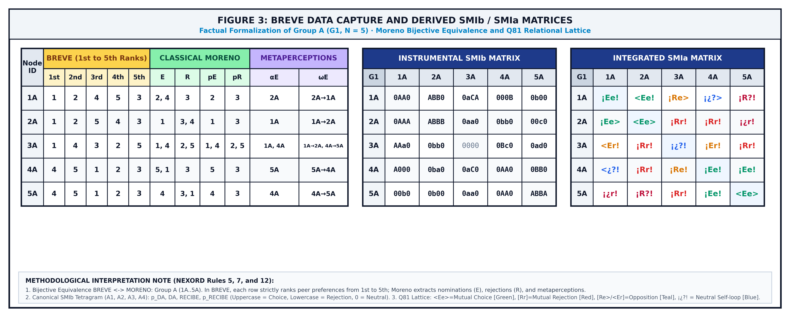  
*Figure 3. BREVE input-flow architecture and transcription into matrices A(i, rank) and B(i, j): from forced drag-and-drop (no ties) to matrix duality, with SMIb instrumental and SMIa integrated matrices.*

  
*Figure 4. Moreno's classical sociomatrix (E, R, pE, pR) in Excel format for N = 5: the traditional sociometric technique.*

  
*Figure 5. BREVE ordinal matrix (1st–5th) with self-anchoring r_ii and triadic metaperceptions αE / ωE: tie-free capture and socio-cognitive closure.*

### 2.2. Reflexive Diagonal Closure and Core Sensors (IDA, ITA, P(k))
NEXORD resolves the historical omission of the sociometric main diagonal (traditionally empty, $r_{ii} = \emptyset$) by requiring each participant to self-rank within the collective ($r_{ii} \in \{1, \dots, N\}$). This topological closure turns the sociomatrix into a continuous, complete relational space, activating three fundamental metric sensors:

* **Self-Rank Discrepancy Index ($IDA_i$):** Quantifies scalar divergence between projected self-image ($r_{ii}$) and external collective consensus ($\bar{R}_i^{\text{ext}}$):
$$IDA_i = r_{ii} - \bar{R}_i^{\text{ext}} = r_{ii} - \left( \frac{1}{N - 1} \sum_{k \neq i}^N B(k, i) \right) \tag{5}$$
where $IDA_i < 0$ reflects hierarchical overestimation, $IDA_i > 0$ peripheral self-inhibition or underestimation, and $IDA_i = 0$ isomorphic calibration with the social environment. At the group level, collective discrepancy is synthesized through root mean square dispersion:
$$\sigma_{\text{IDA}} = \sqrt{\frac{1}{N} \sum_{i=1}^N (IDA_i)^2} \tag{6}$$

* **Self-Rank Tension Index ($ITA$):** Measures structural friction induced by leadership contestation when multiple members claim rank 1 for themselves:
$$ITA = \max\left(0, \sum_{i=1}^N \mathbb{I}(r_{ii} = 1)\right) - 1 \tag{7}$$

* **Cognitive Partition and Combinatorial Anchor $P(k)$:** By self-ranking at position $k$, the subject's admissible combinatorial space collapses to:
$$P(k) = \binom{N-1}{k-1} \tag{8}$$
analytically formalizing that interpersonal choices are emitted from a reference self-anchor: upward or downward relative to one's own subjective position.

---

## 3. Relational Dynamics: Field Regimes, Friction, and Viability

### 3.1. Relational Friction Coefficient (Φ) and Structural Cohesion (ICE)
Internal resistance across the collective system is synthesized in the Relational Friction Coefficient ($\Phi$) and its complementary Structural Cohesion Index ($ICE$):

$$\Phi = \frac{2}{N(N - 1)} \sum_{i < j} |Z_{ij} - Z_{ji}|^\alpha \quad (\alpha \ge 1) \tag{9}$$

$$ICE = 1 - \Phi \tag{10}$$

Moderate values of $\Phi$ reflect internal dynamism and adaptive plasticity, while extreme values indicate risks of fragmentation or destructive turbulence.

### 3.2. Psychologization of Field Regimes and Groupthink Prevention
Collective dynamics cannot be reduced to inanimate physics: system states express distinct regimes of interpersonal and psychological articulation:

* **Structural Rigidity and Inertia Regime:** Rigid hierarchical crystalization, immobile roles, and minimal communicative permeability.
* **Fluidity and Adaptive Cohesion Regime:** Open homeostasis with flexible circulation of preferences, agreements, and divergences.
* **Dispersion and Anomie Regime:** Low coupling density, affective disengagement, and absence of shared projects.
* **Collective Effervescence and Fusion Regime:** High shared emotional arousal and intense interactive mobilization.

Through this lens, NEXORD radically challenges the conventional assumption that optimal group health equals absolute cohesion ($ICE = 1.0, \Phi = 0$). A collective devoid of internal friction or discrepancy constitutes an inherently fragile system vulnerable to groupthink (*Groupthink*, Janis, 1972), where conformity pressures suppress critical thinking and informed decision-making. Moderate friction ($\Phi \in [\Phi_{\min}, \Phi_{\max}]$) and gradient flows across GIVING/RECEIVING supply the necessary energy for institutional plasticity, organizational learning, and evolutionary adaptation.

### 3.3. The Living Puzzle Metaphor: Unjamming vs. Ecosystemic Relocation
In contrast to traditional interventions managing conflict through punitive exclusion or moral blaming of dissident members, NEXORD models the collective as a living puzzle. An actor experiencing high friction is not intrinsically pathological: they typically suffer role expectation mismatches or flow asymmetries with their immediate dyadic environment.

Diagnostic facilitation promotes unjamming through task realignment, communicative clarification, and opening reciprocal collaboration channels. When structural incompatibility persists after systematic mediation, the framework provides for dignified ecosystemic relocation: migration to an alternative group environment preserving the individual's psychosocial integrity while preventing chronic wear or ostracism.

### 3.4. The Ocean of Microstates and the Thermodynamic Stability Law
The dimension of the sociometric sample space, even in small groups, is vast. For a group of five individuals, each member ranking four peers has $4! = 24$ strict ordering options; combining choices across the five members yields $24^5 = 7,962,624$ possible matrices. Including the sender's self-ranking ($5! = 120$ orders per row), the configuration space explodes to $120^5 \approx 2.49 \times 10^{10}$—nearly 25 billion configurations—in a single room with five human beings seated around a table. Within this ocean, thermodynamic stability and systemic health do not depend on chance, but on the geometry of energy flux: minimizing shear dissipation and establishing stable attractors.

The vast majority of combinations correspond to thermal noise (dissonant high-friction matrices) or freezing traps (tectonic fault-lines and stifling monopolies). For a microstate to surpass thresholds of productive, healthy organization, it must simultaneously satisfy three thermodynamic invariants:
1. **Minimizing shear dissipation:** $\sum_i |Z_{ij} - Z_{ji}|^2 \to \min$ (reciprocity and mutual coherence).
2. **Barometric gradient balance:** $\sum_i (Z_i^{\text{in}} - Z_i^{\text{out}})^2 \le \varepsilon$ (absence of black sinks or overloaded springs).
3. **Global convective connectivity:** existence of transitive return chains without isolated nodes ($Z_i^{\text{in}} > Z_{\text{critical}}$ for all $i$).

Out of the combinatorial ocean, only a select percentage inhabits this optimal regime: group wellbeing is not the absence of structure, but an architecture of tensions where no one is condemned to absolute zero or forced to carry the collective weight alone.

In summary: group health and productivity are not matters of moral goodwill, but of relational aerodynamics and hydrostatics. A productive group is one whose ellipsoid flies level, whose energy accounts maintain homeostatic balance, and where no member drowns at the bottom of the canyon so others can sunbathe in the open sky.

---

## 4. Tensorial Algebra, Q81 Lattice, and the Densities Pentagram

### 4.1. 12-Symbol Atomic Grammar and the Relational Cell X1 X2 X3 X4
The canonical Q81 lattice formalizes the complete combinatorial space of all $3^4 = 81$ dyadic configurations structuring the relational field. To provide an exact, unambiguous notation, NEXORD establishes a 12-symbol alphabet distributed across three relational polarity states:

#### Table 1: Atomic grammar — the 12 symbols of the NEXORD relational alphabet

| Relational Dimension | Positive (+) | Neutral (0) | Negative (−) |
| :--- | :--- | :--- | :--- |
| **Sender Real Action ($i \to j$)** | `E` (Uppercase) | `¿` (Opening question) | `R` (Uppercase) |
| **Receiver Real Action ($j \to i$)** | `e` (Lowercase) | `?` (Closing question) | `r` (Lowercase) |
| **Sender Expectation ($p\_DA$)** | `<` (Opening bracket) | `i` (Neutral character) | `[` (Opening square) |
| **Receiver Attributed Expectation ($p\_REC$)** | `>` (Closing bracket) | `!` (Exclamation) | `]` (Closing square) |

Each interpersonal tie $(i, j)$ is formalized as a four-character relational word:

$$\text{Figure}_{ij} = X_1 X_2 X_3 X_4 \in \{<, i, [\} \times \{E, \text{¿}, R\} \times \{e, ?, r\} \times \{>, !, ]\} \tag{11}$$

* $X_1$: Cognitive expectation emitted by selector $i$ regarding what they expect from $j$.
* $X_2$: Active vector of real behavioral emission from $i$ toward $j$.
* $X_3$: Reactive vector of real behavioral reception returned by $j$ toward $i$.
* $X_4$: Cognitive expectation attributed by $i$ to $j$'s response.

From this atomic catalogue emerge canonical relational archetypes:
* `<Ee>`: Full harmony and resonance (mutual choice and confirmed expectation).
* `[Rr]`: Acknowledged conflict and segregation (explicit, congruent mutual rejection).
* `i¿?!`: Basal indifference or field inertia (interactive and perceptual zero-point).

Formalizing signed configurations ($+ / -$) and measuring dyadic friction dialogs constructively with contemporary research on signed graphs, communicability geometry, and structural frustration indices (Aref & Wilson, 2021; Cucuringu et al., 2023; Diaz-Diaz & Estrada, 2025).

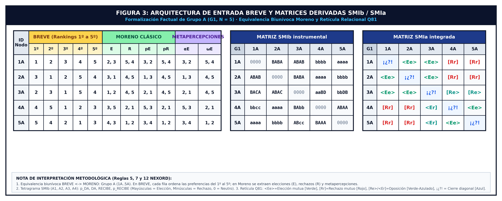  
*Figure 6. Anatomy of the SMIa dyadic cell: breakdown of its 4 canonical positions (A1 · A2 · A3 · A4) = (pDA · DA · REC · pREC).*

### 4.2. Antidiagonal Topology of the (9 × 9) Lattice and [1, 81] Numeralization as the First Density Metric
The $9 \times 9$ partition crosses 9 objective behavioral interaction profiles (rows $i = \text{<E}, \text{¡E}, \text{[E}, \text{<¿}, \text{i¿}, \text{[¿}, \text{<R}, \text{¡R}, \text{[R}$) with 9 crossed cognitive expectation profiles (columns $j = \text{e>}, \text{e!}, \text{e]}, \text{?>}, \text{?!}, \text{?]}, \text{r>}, \text{r!}, \text{r]}$). 

The numeralization of the 81 relational figures ($Q_{81}(9, 9)$) is solved geometrically via an ordered sweep of 17 secondary antidiagonals traversed bottom-up: each antidiagonal defines an isoline of constant net relational valence and energy, such that all figures situated along the same antidiagonal share an identical sum of polarities between actual actions and cognitive expectations.

This geometric ordering provides the **first metric-scalar quantification of dyadic relational density** ($D_{Q81} \in [1, 81]$), structured into three fundamental regions:
* **Hemisphere of Dissonance and Rejection (Scalars 1 to 36):** The first 8 lower antidiagonals cover $\sum_{k=1}^8 k = \frac{8 \times 9}{2} = 36$ figures situated in the zone of conflict, attrition, and relational withdrawal, originating at the pole of maximum negative density: `[Rr]` = 1.
* **Neutral Barycentric Isoline (Scalars 37 to 45):** The transversal central antidiagonal ($d = 9$, comprising 9 cells) spans scalars 37 to 45. Its central cell (coordinate 5, 5) uniquely fixes the **basal indifference centroid**:  
  $$\text{Cell}(5, 5) \implies i\text{¿}?! = 41 \tag{12}$$
* **Hemisphere of Cohesion and Resonance (Scalars 46 to 81):** The 8 upper antidiagonals cover the 36 figures of attraction, convergence, and synergy up to the tip of antidiagonal 17 (length 1), crowning the space at full harmonic resonance: `<Ee>` = 81.

**Continuous Normalization of $Q_{81}$ Density:**  
By centering the scale on the neutral indifference centroid (41), the figure's elementary dyadic density is normalized onto the canonical continuous range $[-1.00, +1.00]$:

$$D_{Q81}(i, j) = \frac{Q_{81}(i, j) - 41}{40} \tag{13}$$

where:
* $\text{Maximum Positive Density: } D_{Q81}(\text{<Ee>}) = \frac{81 - 41}{40} = \mathbf{+1.000}$
* $\text{Basal Neutral Density: } D_{Q81}(i\text{¿}?!) = \frac{41 - 41}{40} = \mathbf{0.000}$
* $\text{Maximum Negative Density: } D_{Q81}(\text{[Rr]}) = \frac{1 - 41}{40} = \mathbf{-1.000}$

This geometry preserves strict **antipodal complementary symmetry**: $\text{Antipode}(k) = 82 - k$, meaning that $\text{Figure}(i, j) + \text{Figure}(10-i, 10-j) = 82$, proving that the neutral centroid is self-invariant under polar inversion ($41 + 41 = 82$).

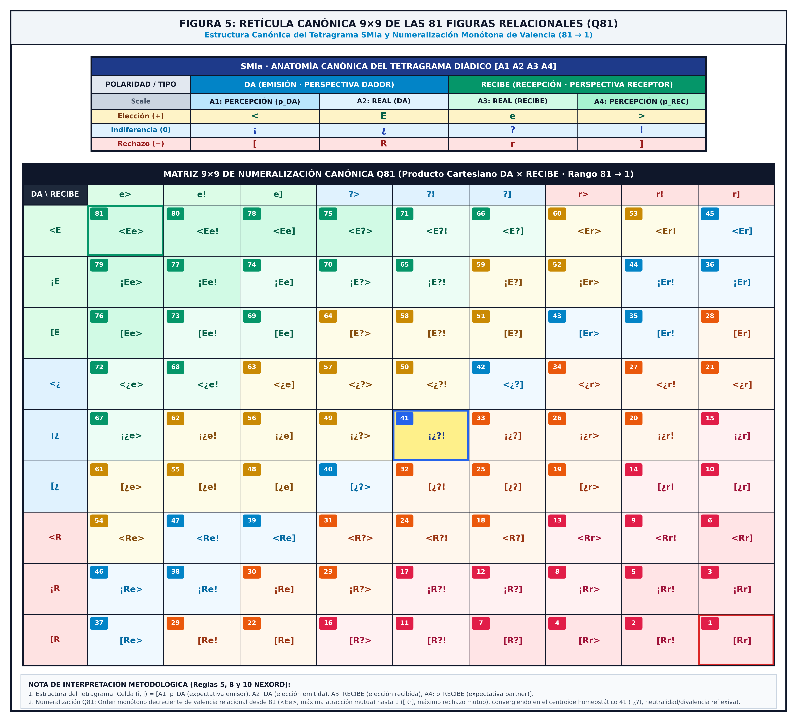  
*Figure 7. Canonical Q81 lattice (9 × 9): exhaustive classification of the 81 possible dyadic figures, indexed by increasing-valence antidiagonals (1 = [Rr] … 41 = i¿?! … 81 = <Ee>).*

### 4.3. The Subject's Structural Triptych Ti and Split Diagnosis
Collapsing an individual's ties into a simple arithmetic scalar mean represents a severe methodological flaw producing diagnostic cancellation artifacts (a person with one tie at 81 and another at 1 would falsely average 41, indistinguishable from basal indifference). NEXORD preserves topological bidimensionality by splitting subject $i$'s position into its Canonical Structural Triptych:

$$T_i = ( F_i^{\text{out}}, F_i^{\text{in}}, f_{ii} ) \tag{14}$$

* **Global Outbound Figure ($F_i^{\text{out}}$):** Two-dimensional centroid ($\bar{X}_i^{\text{out}}, \bar{Y}_i^{\text{out}}$) computed across row $i$, measuring initiative, active disposition, and baseline trust emitted by $i$.
* **Global Inbound Figure ($F_i^{\text{in}}$):** Two-dimensional centroid ($\bar{X}_i^{\text{in}}, \bar{Y}_i^{\text{in}}$) computed across column $i$, quantifying objective impact, convergent status, and expectations deposited upon $i$.
* **Reflexive Self-Anchor ($f_{ii}$):** Diagonal reflexive closure in Q81 formalizing self-image and psychosocial self-efficacy.

From positional discrepancy $\Delta_{\text{role}} = F_i^{\text{out}} - F_i^{\text{in}}$ emerge immediate diagnostic profiles:
* **Relational Burnout Syndrome:** $F_i^{\text{out}} \gg F_i^{\text{in}}$ with declining $f_{ii}$ (unreciprocated investment anticipating withdrawal).
* **Withdrawn or Reserve Leadership:** $F_i^{\text{in}} \gg F_i^{\text{out}}$ (strong collective demand paired with cautious outbound emission).
* **Status Inhibition:** $F_i^{\text{in}} \gg 41$ coexisting with $f_{ii} \le 41$ (high objective peer recognition unassimilated into self-perception).

### 4.4. The 18D Relational Hyperspace, the 3 Dual Prisms, and the Densities Pentagram (10D)

#### 4.4.1. Algorithmic Foundations of Relational Density: The 6D Traceability Matrix and Modulators
In NEXORD's canonical ordinal sociometry, Relational Density is neither a flat headcount nor an unweighted arithmetic average: it constitutes the **real thermal and structural mass** contributed by an interpersonal tie, defining the cohesive or destructive force of the interaction upon the thermodynamic continuum ($\pm\mathbb{R}$).

To ensure scientific reproducibility and eliminate algorithmic opacity, NEXORD's engine processes dyadic interaction $(i \to j)$ through a **6-Layer Traceability Matrix**. This clinical framework decomposes relational flow through an explicit set of **mathematical modulators** that rigorously weight ordinal rank, action symmetries, cognitive reciprocities, and status hierarchies:

#### Table 3b. Algorithmic Traceability Matrix and Dyadic Density Modulators

| Force Vector | Evaluated Condition | Assigned Mathematical Modulator | Structural Impact |
| :--- | :--- | :---: | :--- |
| **1. Inverse Rank Function ($1/r^k$)** | Ordinal Rank (1st, 2nd, 3rd...) | $\text{Base}$ | Sets initial tie potential. Exponentially penalizes ($k \ge 1.0$) low attentional priority. |
| **2. Dyadic Reciprocity** | Action Congruence (`Ee`, `Rr`, `Aa`) | **$1.5\times$** | Massively prioritizes (+50%) actual factual ties and symmetric relational homomorphism over mere expectation. |
| **3. Accuracy / Truth** | Perceptual Congruence (`<e>`, `(e`) | **$1.5\times$** | Thermodynamic reward for mental lucidity, empathic attunement, and structural network health. |
| **4. Opposing Sentiments** | Dissonances and Paranoias (`(]`, `Er`, `[>`) | **$-(P_i \times 0.5)$** | Destructive penalty proportional to sender's status ($P_i$). Toxicity from a leader inflicts greater network damage than from a peripheral node. |
| **5. Perceptual Effort** | Active presence of meta-perception ($pDA, pRC$) | **$1.2\times$** | Acknowledges cognitive cost of anticipatory mentalization. **Bonus strictly revoked to $1.0\times$ if structural blindness occurs**. |
| **6. Sender's Prestige ($P_i$)** | Hierarchical Network Centrality | **Variable** ($0.5$ to $1.5$) | Gravitational scale multiplier. Governs the inertial mass dragged by the sender's action across the collective. |

**Canonical Algorithm Illustration on the Dyadic Scorecard:**
* **Fully Harmonious Dyad (`<Ee>`):** High-prestige sender ($P_i = 1.5$) choosing as 1st rank ($1/r^k = 1.0$), with mutual factual reciprocity ($1.5\times$), accurate perceptual congruence ($1.5\times$), and maintained lucid effort bonus ($1.2\times$):  
  $$\text{Density}(i \to j) = (1.0 \times 1.5 \times 1.5 \times 1.2 \times 1.5) = \mathbf{4.86\text{ pts}}$$
* **Dissonant / Paranoid Dyad (`[Ae)`):** Mid-status sender ($P_i = 1.0$) relegating as 2nd option ($1/r^k = 0.354$), null reciprocity, zero accuracy, perceptual effort bonus revoked by blindness, and active opposing sentiments:  
  $$\text{Density}(i \to j) = 0.354 - (1.0 \times 0.5) = -0.146 \implies \mathbf{0.00\text{ pts}}$$  
  *(Useful radiation is nullified: the link yields zero cohesion and dissipates energy as sterile thermal friction).*

From these modulated dyadic densities, the system simultaneously computes the **4 elementary channels of the relational tetragram** for each subject $i$ by averaging across the collective of size $N$ ($j \neq i$):
1. **D1 ($D_{pDA}$ / $dDP$) — Emitted Expectation Density:**  
   Horizon projected by the sender regarding how they anticipate their own ties toward the collective:  
   $$D_1(i) = \frac{1}{N - 1} \sum_{j \neq i} W_{pDA}(i, j) \tag{16}$$
2. **D2 ($D_{DA}$ / $dDA$) — Emitted Effective Choice Density:**  
   Kinetic flow and net valence of effective choices emitted by the subject toward peers:  
   $$D_2(i) = \frac{1}{N - 1} \sum_{j \neq i} W_{DA}(i, j) \tag{17}$$
3. **D3 ($D_{RC}$ / $dRA$) — Received Effective Choice Density:**  
   Objective status and real attraction or rejection impact received from peers:  
   $$D_3(i) = \frac{1}{N - 1} \sum_{j \neq i} W_{RC}(j, i) \tag{18}$$
4. **D4 ($D_{pRC}$ / $dRP$) — Expectations Attributed to the Receiver Density:**  
   Reflected field of presumption projected by peers regarding the subject's receptivity:  
   $$D_4(i) = \frac{1}{N - 1} \sum_{j \neq i} W_{pRC}(j, i) \tag{19}$$

*(In the subject's overall bidirectional network analysis, basal components integrate emission and reception through the barycentric average $v_k(i) = \frac{1}{2}[\text{Row}_k(i) + \text{Column}_k(i)]$, ensuring symmetric matrix closure).*

**Universal S and B Prefix Convention:**  
* **S (Balance / Relative Density):** Signed magnitude ($\pm\mathbb{R}$). Quantifies force vectors, potential gradients, and direction of attraction or rejection.
* **B (Gross / Absolute Density):** Modular unsigned magnitude ($|\cdot| \ge 0$). Quantifies total mobilized relational mass, overall kinetic energy, and metabolic system volume.

#### Table 3c. Canonical Specification and Calculation of the 18 Relational Densities and Socio-Thermodynamic Invariants

| Dimension | Symbol / Alias | Partition / Axis | Exact Calculation Formula | Metric Range | Socio-Thermodynamic Significance |
| :---: | :---: | :---: | :---: | :---: | :--- |
| **1D** | $D_1$ ($dDP, D_{pDA}$) | 4D Base | $\frac{1}{N-1}\sum W_{pDA}(i, j)$ | $[-1.00, +1.00]$ | Prior expectation and anticipatory trust emitted toward the collective. |
| **2D** | $D_2$ ($dDA, D_{DA}$) | 4D Base | $\frac{1}{N-1}\sum W_{DA}(i, j)$ | $[-1.00, +1.00]$ | Kinetic flow and effective preferential action emitted by the subject. |
| **3D** | $D_3$ ($dRA, D_{RC}$) | 4D Base | $\frac{1}{N-1}\sum W_{RC}(j, i)$ | $[-1.00, +1.00]$ | Objective status and real impact of attraction or rejection received from peers. |
| **4D** | $D_4$ ($dRP, D_{pRC}$) | 4D Base | $\frac{1}{N-1}\sum W_{pRC}(j, i)$ | $[-1.00, +1.00]$ | Reflected field of presumption attributed to the subject by peers. |
| **5D** | $S_{12}$ ($SDA$) | Prism 1 Operational | $D_1 + D_2$ | $[-2.00, +2.00]$ | Net sender potential: expansiveness and initiative spring/sink. |
| **6D** | $B_{12}$ ($BDA$) | Prism 1 Operational | $\|D_1\| + \|D_2\|$ | $[0.00, +2.00]$ | Gross sender mass: total metabolic expenditure and emitted investment. |
| **7D** | $S_{34}$ ($SRC$) | Prism 1 Operational | $D_3 + D_4$ | $[-2.00, +2.00]$ | Net receiver potential: global status induced by the peer environment. |
| **8D** | $B_{34}$ ($BRC$) | Prism 1 Operational | $\|D_3\| + \|D_4\|$ | $[0.00, +2.00]$ | Gross receiver mass: incident social pressure and impact load. |
| **9D** | $S_{14}$ ($SP$) | Prism 2 Ontological | $D_1 + D_4$ | $[-2.00, +2.00]$ | Cognitive balance: climate of mutual trust and shared presumption. |
| **10D** | $B_{14}$ ($BP$) | Prism 2 Ontological | $\|D_1\| + \|D_4\|$ | $[0.00, +2.00]$ | Gross cognitive mass: volume of mental rumination and prospective burden. |
| **11D** | $S_{23}$ ($SA$) | Prism 2 Ontological | $D_2 + D_3$ | $[-2.00, +2.00]$ | Factual balance: objective ground truth of real choices and rejections. |
| **12D** | $B_{23}$ ($BA$) | Prism 2 Ontological | $\|D_2\| + \|D_3\|$ | $[0.00, +2.00]$ | Gross factual mass: volume of motor action and tangible interaction. |
| **13D** | $S_{13}$ | Prism 3 Dialectical | $D_1 + D_3$ | $[-2.00, +2.00]$ | Realism balance: confirmation vs. disillusionment (expected vs. received). |
| **14D** | $B_{13}$ | Prism 3 Dialectical | $\|D_1\| + \|D_3\|$ | $[0.00, +2.00]$ | Realism mass: affective vulnerability under reality testing. |
| **15D** | $S_{24}$ | Prism 3 Dialectical | $D_2 + D_4$ | $[-2.00, +2.00]$ | Responsiveness balance: fulfillment vs. frustration of alter's desire. |
| **16D** | $B_{24}$ | Prism 3 Dialectical | $\|D_2\| + \|D_4\|$ | $[0.00, +2.00]$ | Responsiveness mass: dyadic commitment and mutual accountability. |
| **17D** | $SDR$ | Global Invariant | $\sum S_{ij} = \sum D_k$ | $[-4.00, +4.00]$ | Total Relative Density Balance: homeostatic barometer of group climate. |
| **18D** | $BDR$ | Global Invariant | $\sum B_{ij} = \sum \|D_k\|$ | $[0.00, +4.00]$ | Gross Relational Density: heat capacity and invariable total system mass. |

*(Analytical note on dyadic asymmetries: The system complementarily derives the three imbalance indices for each prism: Operational Asymmetry $\text{Dif}_r = \|B_{12} - B_{34}\|$, Ontological Asymmetry $\text{Dif}_a = \|B_{14} - B_{23}\|$, and Dialectical Asymmetry $\text{Dif}_i = \|B_{13} - B_{24}\|$, alongside Thermal Friction $\Phi = BDR - \|SDR\|$).*

#### 4.4.2. The 3 Dual Prisms of Relational Density
The four elementary densities $\{D_1, D_2, D_3, D_4\}$ admit exactly 3 complementary dual partitions $[\binom{4}{2} / 2 = 3]$, which subject the relational tie to three independent orthogonal refractions, termed **PRISMS**:

  
*Figure 8b. Canonical Architecture of the 18D Relational Space and the 3 Dual Prisms: Structuring of the tetragram into 4 elementary densities (D1–D4), invariant global balances (SDR, BDR), and decomposition across three fundamental axes: Operational (Giver/Receiver, 10D), Ontological (Mind/Facts, 14D), and Dialectical (Realism/Commitment, 18D).*

The decomposition of the group field into its **18 Relational Densities (18D)** is not a scattered combinatorial inventory, but an ordered anatomy of psychosocial flux. The system articulates its tensions along a canonical dialectical sequence where **Gross Mass ($B$)**—the total mobilized interactive energy—and **Relative Balance ($S$)**—the net direction and vector tilt of the tie—succeed one another in harmonic counterpoint:

$$\underbrace{B_{12} \; S_{12}}_{\text{DA (Initiative)}} \quad \underbrace{B_{14} \; S_{14}}_{\text{PA (Projection)}} \quad \underbrace{B_{13} \; S_{13}}_{\text{XA (Attunement)}} \quad \big[ D_1 \;\; D_2 \;\; D_3 \;\; D_4 \big] \quad \underbrace{S_{24} \; B_{24}}_{\text{XR (Disillusion)}} \quad \underbrace{S_{23} \; B_{23}}_{\text{PR (Facts)}} \quad \underbrace{S_{34} \; B_{34}}_{\text{RC (Status)}} \quad \mathbf{SDR} \quad \mathbf{BDR}$$

This ordered sequence expresses the principle of energetic conservation: the discrepancy between gross mass ($B$) and its projected balance ($S$) reveals with millimetric precision the *Relational Wear Inertia* ($I_{\text{wear}} = B - S$) across each relational prism. The order of densities is no analytical whim: it represents the thermodynamic scale allowing one to read, at a single glance, from the active initiative of the giver to the consolidated status conferred by the group, culminating in the overarching homeostatic synthesis of $\mathbf{SDR}$ and $\mathbf{BDR}$.

#### 4.4.3. The Socio-Thermodynamic Pentagram and Relational Wear Inertia
Under the canonical correspondence $D_k \equiv X_k$ of the tetragram, the ten relational densities are organized into two polar macrodimensions (GIVING and RECEIVING) coupled under two analytical conservation strata:

* **Signed Vector Stratum (Net Valence and Harmony):** the sender's net potential $SDA = D_1 + D_2$ (emitted expectation $D_1$ plus real emitted action $D_2$), the receiver's net potential $SRC = D_3 + D_4$ (real received action $D_3$ plus attributed expectation $D_4$), and the total Relative Field Density Balance $SDR = SDA + SRC$.
* **Absolute Scalar Stratum (Total Kinetic Mass Mobilized):** the gross emission mass $BDA = |D_1| + |D_2|$ and reception mass $BRC = |D_3| + |D_4|$, whose sum defines the Gross Relational Density $BDR = BDA + BRC$.

The analytical discrepancy between the total mobilized energy and the resulting cohesive net flow formally defines **Relational Wear Inertia** ($I_{\text{wear}} = BDR - SDR$):

* **Maximum Efficiency Regime ($SDR \approx BDR \implies I_{\text{wear}} \approx 0$):** Choices and expectations converge toward positive valence (`<Ee>`). Virtually all invested energy yields structural cohesion and useful work.
* **Friction and Resistance Regime ($BDR \gg SDR \implies I_{\text{wear}} \gg 0$):** The collective mobilizes high communication volumes ($BDR$ elevated), but sign cancellations from suspicion, latent tensions, or perceptual mismatches stall progress ($SDR \to 0$). Energy dissipates into rumination, suspicion, and sterile friction, quantifying structural fatigue prior to explicit fractures.

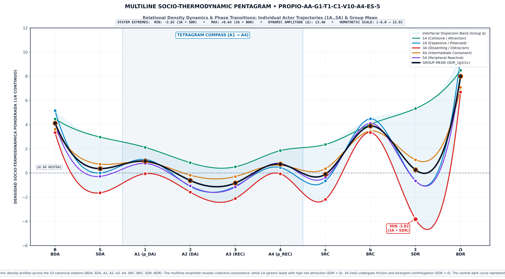  
*Figure 8. Socio-Thermodynamic Pentagram with the 10 canonical densities: emission/reception decoupling and transition to the thermodynamic continuum; the gap I_wear = BDR − SDR quantifies energy dissipated in friction.*

### 4.5. The VISORD Aquarium Paradigm and Relational Hydrostatics
As an experiential and perceptual culmination of this socio-thermodynamic formalism, **VISORD Aquarium** provides an integrated visual and acoustic interactive environment representing relational density structures within a multidimensional $G \times T \times C$ design.

The volume is modeled as a 3D continuous aquarium defined over Cartesian space:

$$\mathbf{DA} \quad \times \quad \mathbf{RECEIVE} \quad \times \quad \mathbf{DENSITY}$$

structured across three characteristic strata:
1. **Submerged Benthos:** Deep basins of negative pressure and high rejection (`[Rr]`), latent conflict, and structural isolation.
2. **Water Surface (Neutral barometric level):** Basal homeostatic waterline corresponding to the indifference centroid (`i¿?! = 41`).
3. **Open Sky (Convective atmosphere):** Upper stratum of high positive density and optimal cohesion, where resonant harmonic ties (`<Ee>`) and frictionless leadership gravitate.

Within this volume, relational densities project in **complete disjunction**:
* **Intra-Subject Level:** Differential projections of distinct relational pairs and kinematic dipoles for a given actor across peers.
* **Unitary Level:** Distribution of individual actors as dual agents: active Givers ($DA$) and impact Receivers ($RECEIVE$).
* **Macro-Relational Level:** Aggregate global densities across Groups ($G$), Waves ($T$), and Criteria ($C$).

---

## 5. Graphical Solutions, Multidimensional Space GxTyCz, and Invariant Geometry

### 5.1. Graphical Solutions: Visual Representation and Relational Topography
VISORD emerged from the necessity of rendering visible—and audible—the relational structures and processes emerging from research. Human senses are poorly adapted to parsing tables of abstract coefficients; conversely, they intuitively perceive shapes, depths, tonal shifts, relative distances, and lighting.

NEXORD implements continuous graphical solutions designed to restore the relational field without cognitive clutter:
* **Continuous 3D Sociograms (VISORD 3D/4D):** Spatial mapping of attraction basins (emerald green, `<Ee>`), intermediate opposition zones (amber), and high-shear friction filaments (magenta, `[Rr]`), with diachronic navigation (Figure 11).
* **Parallel Dual Factorial Planes (MESO Biplot $F_1 \times F_2$, CA $\parallel$ PCA):** Simultaneous projection where dyadic vector $DA \longrightarrow RC$ anchors actor positions with origin barycenters ($\Delta = 0.000$). In CA, over $\mathbb{N}_0$ count contingency under $\chi^2$; in PCA, over standardized continuous $\pm \mathbb{R}$ densities (Figure 9).
* **1D Vertical Slender Axes:** Decompositions flanked by Absolute Contribution (CTA) and Representation Quality (COR) metrics (Benzécri, 1973; Cornejo, 1988) (Figure 10).
* **Hierarchical Axonometric 6D-to-2D Projection (DIMO / ANCORM Algorithm by Dr. J. M. Cornejo Álvarez):** Overcoming classical 2D scatter constraints, NEXORD incorporates Dr. Cornejo's algorithmic method projecting up to 6 hierarchical factorial axes onto a single 2D Cartesian plane (*see Annex II for complete analytical formulation*).
* **Intergroup Structurograms:** Relational support polygons for comparative intergroup morphology.

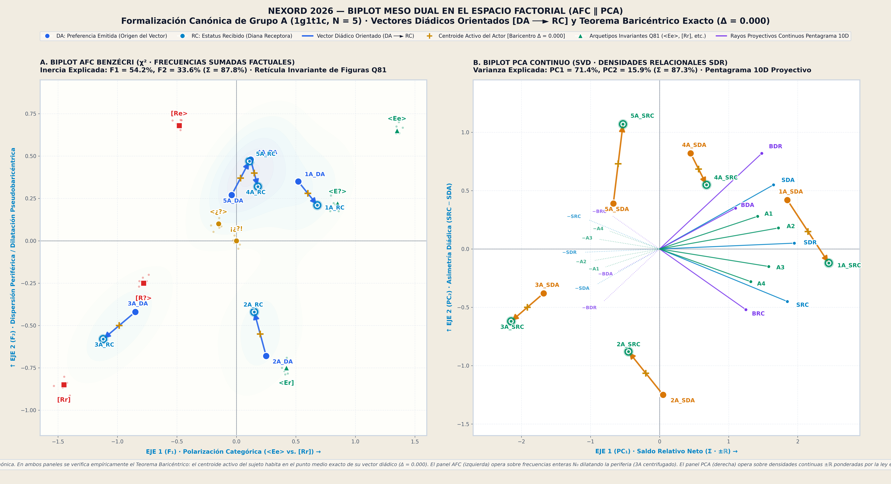  
*Figure 9. Parallel Dual Planes (MESO Biplot F1 × F2, CA ∥ PCA dual space): dyadic vector DA ⟶ RC with barycenter at the origin (Δ = 0.000).*

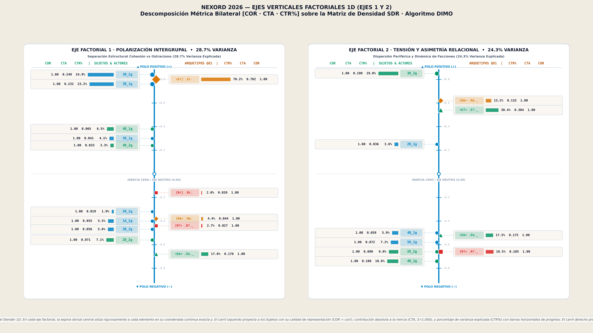  
*Figure 10. 1D vertical factorial axes (Axes 1 and 2, SDR matrix): bilateral COR–CTA–CTR metric quality of subjects and Q81 figures.*

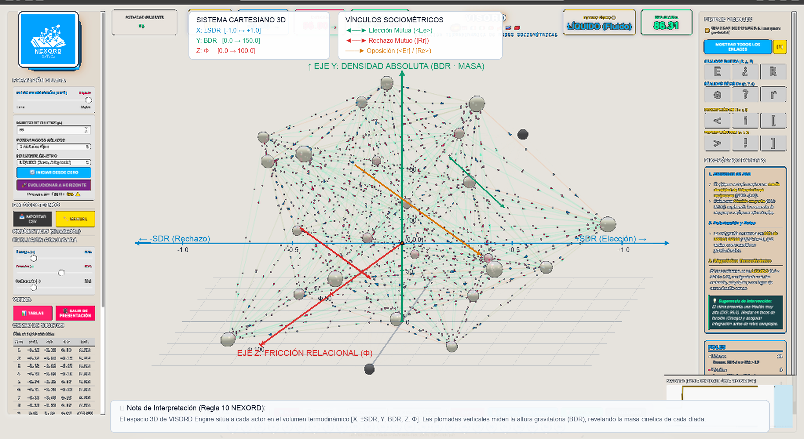  
*Figure 11. Interactive 3D navigation in the VISORD Engine: attraction basins and friction filaments in the continuous relational field.*

### 5.2. Multidimensional Space GxTyCz
The matrix formulation imposes no prior constraints on design configurations:
* **Groups (G):** Accommodates any number of independent cohorts, departments, or informal subclusters.
* **Temporal Waves (T):** Longitudinal tracking across $T$ sweeps ($T_1, T_2, \dots, T_n$), tracking cohesion and fracture evolution.
* **Sociometric Criteria (C):** Models multiple simultaneous criteria ($C_1$ operational task, $C_2$ affective affinity, $C_3$ crisis leadership).
* **Contextual Variables (Z):** Normative batteries ($V_{10}$ sociodemographic and $A_{16}$ Group Adjectival Attribution; Table 2) providing standardized frames for comparative analysis (Vicente et al., 2006).

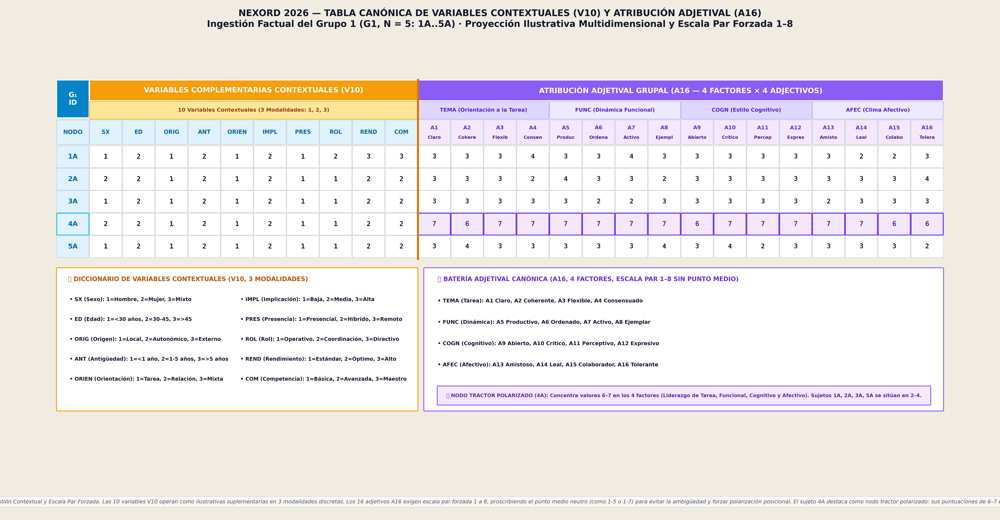  
*Table 2. Normative board of the 10 contextual-variable battery (V10, 3 modalities) and 16 group-attribution adjectives (A16, 4 × 4, 1–8 scale).*

Field application across $G \times T \times C$ is guided by the 10 ecosystemic calibration domains (Table 6), setting structural parameters—relational inertia $\alpha$ and decay $\gamma$—and canonical criteria.

  
*Table 6. Canonical catalogue of the 10 ecosystemic application domains with structural parameterization (α, γ), psychosocial focus, and canonical criteria.*

### 5.3. Multigroup PCA and Geodesic Distance on Grassmann Manifolds Gr(k, N)
To compare collectives without forcing artificial cross-group interaction, each group projects as a $k$-dimensional subspace within $\mathbb{R}^N$. From Jordan canonical principal angles $\cos(\theta_m) = \sigma_m(U_1^T U_2)$, scale-invariant geodesic distance is computed:

$$d_{\operatorname{Gr}}(U_1, U_2) = \sqrt{\sum_{m=1}^k \theta_m^2} \tag{20}$$

This metric rigorously determines (Figure 12) whether two groups share identical relational topologies regardless of sample size differences. Beyond momentary agreement among observers, it is the temporal persistence and constancy of these configurations within the geometric space that allows contrasting the stability of relational structures against conjunctural variations or random fluctuations.

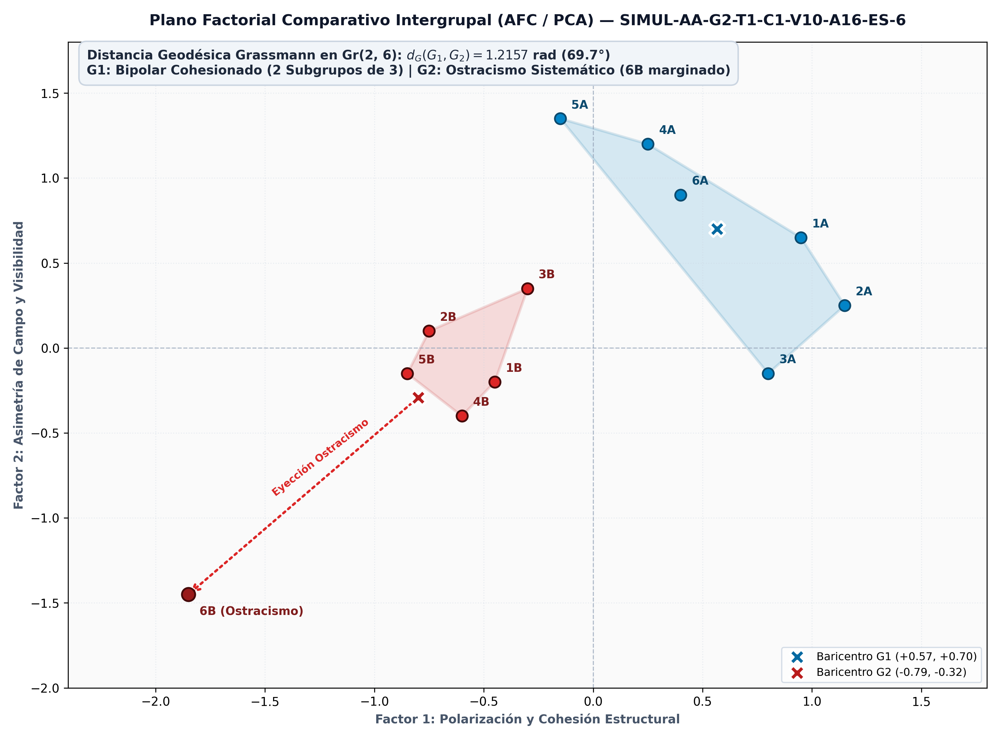  
*Figure 12. Intergroup comparative factorial plane (G1 vs G2) and diachronic structrograms; geodesic distance on Gr(k, N) quantifies shared relational morphology.*

At the subject level, the Euclidean rank interdistance matrix $d_{\text{DA}} / d_{\text{RC}}$ (Table 7) documents the relational asymmetry law: mean inbound dispersion ($4.84; SD = 0.64$) systematically exceeds outbound ($4.15; SD = 0.49$).

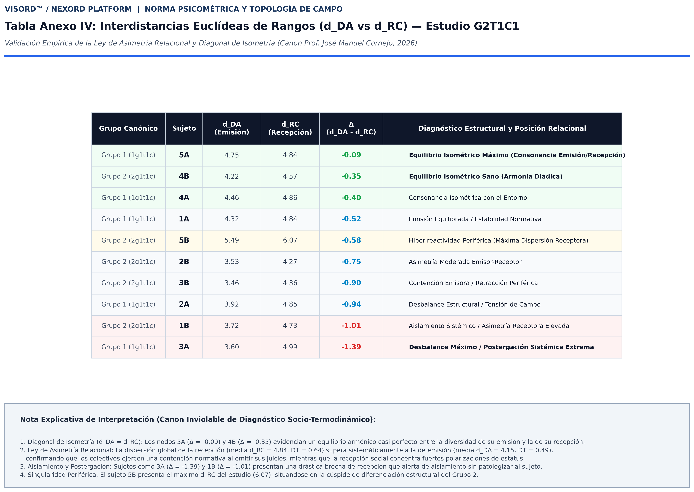  
*Table 7. Numeric matrix of Euclidean rank interdistances (d_DA, d_RC, Δ = d_DA − d_RC) with per-subject structural diagnosis, G2T1C1 corpus.*

---

## 6. Experimental Research: Physical Laboratory, Dialectical Sociometry, and Triadic Cognition

### 6.1. Experimental Monitoring in the Physical Laboratory
The platform supports real-time monitoring of complex laboratory experiments: tracking high-interdependence tasks, crisis simulations, and interventions in small group dynamics.

### 6.2. Dialectical Sociometry and Social Dilemma Analysis
In cooperative-competitive settings (e.g., Common Pool Resource dilemmas, iterated Prisoner's Dilemma), NEXORD quantifies gaps between cognitive expectations and observable relational behavior, capturing the emergence of coalitions and defection.

### 6.3. Multimodal Perception: Iceberg Model and Hydrodynamic Sonification
NEXORD implements the iceberg model through 3D visual projection (surfacing submerged structural friction) and hydrodynamic sonification (translating density fluxes into tonal streams), allowing continuous monitoring without visual fatigue (Figure 13).

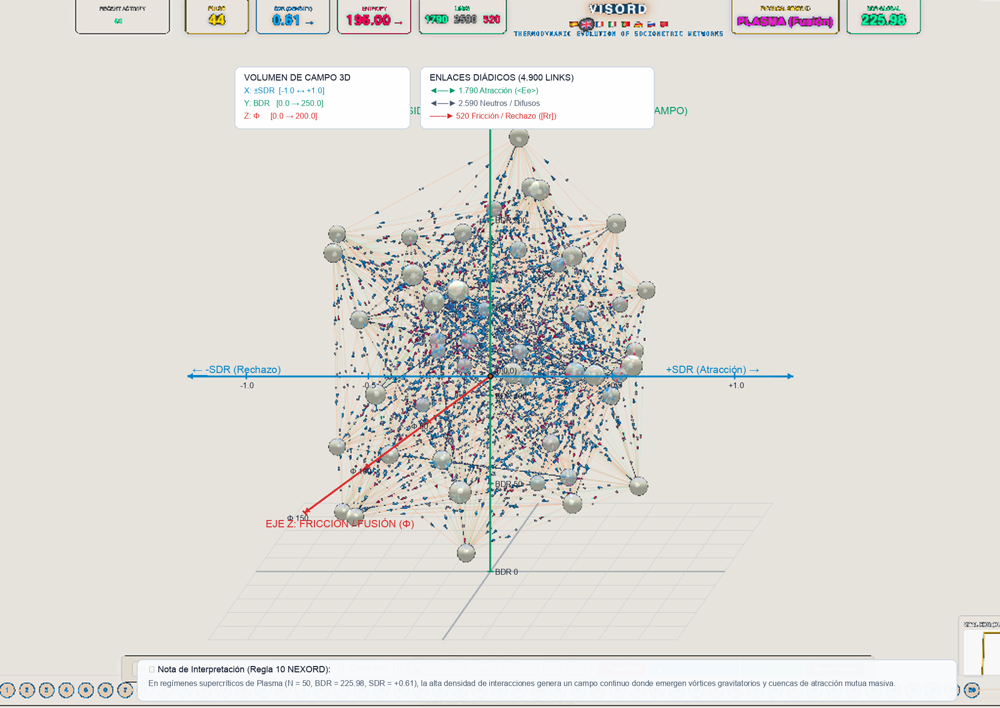  
*Figure 13. Continuous interaction field and iceberg model across N = 50 subjects: submerged relational structure rendered visible.*

### 6.4. The CULTURAL Corpus as a Zero-Reactivity Laboratory
Dramatic literature and cinema provide ideal human laboratories: closed, perfectly documented systems with zero reactivity. NEXORD has processed canonical corpora (*Twelve Angry Men*, *The House of Bernarda Alba*, *Lord of the Flies*), proving that socio-thermodynamic laws mathematically pinpoint dramatic climaxes and leadership collapses without observational bias.

### 6.5. Triadic Social Cognition: Projected Expectations αE and ωE
NEXORD extends expectation capture with two relational theory-of-mind sensors:
* **Expected Highest-Ranked ($\alpha E$):** Individual expectation regarding who the collective will choose most favorably.
* **Expected Lowest-Ranked ($\omega E$):** Individual expectation regarding who will receive the greatest group rejection or discard.

These metrics evaluate systemic awareness (Tsankova & Tair, 2021) via Euclidean distance between expectation and observed group reality:

$$\Delta_\alpha = \|\alpha E - \text{Real Choice}(\alpha)\|, \quad \Delta_\omega = \|\omega E - \text{Real Choice}(\omega)\| \tag{21}$$

Subjects with $\Delta_\alpha \approx 0$ and $\Delta_\omega \approx 0$ act as natural sensors of group dynamics.

### 6.6. Preliminary Evidence of Convergent Validity and Reliability
*[Methodological note: this section is registered as a preregistered skeleton. Cells marked $\langle \cdots \rangle$ are completed solely with empirical analysis of designated corpora; no estimates are reported without prior statistical validation.]*

#### 6.6.1. Validation Design
Convergent validity is examined by contrasting core metrics with external criteria: (a) classical status (net choices and rejections); (b) Group Activity Analysis Battery factors (AAG; Vicente et al., 2006); (c) theoretical rank orders from CULTURAL corpora. Preregistered hypotheses: H1 ($ICE$ correlates positively with perceived cohesion); H2 ($\Phi$ discriminates field regimes); H3 ($|IDA|$ correlates with self/hetero discrepancy); H4 ($SDR$ reproduces theoretical rankings); H5 (triadic cognition: low $\Delta_\alpha, \Delta_\omega$ links to low $|IDA|$).

#### 6.6.2. Convergent Validity

#### Table 3: Convergent validity matrix (preregistered skeleton)

| NEXORD Index | External Criterion | Corpus | Statistic | Value | $p$ |
| :--- | :--- | :--- | :--- | :---: | :---: |
| **$ICE$** | AAG · Affective factor (H1) | $\langle G\_T\_C\_ \rangle$ | Spearman $\rho$ | $\langle \cdots \rangle$ | $\langle \cdots \rangle$ |
| **$\Phi$** | A priori regime classification (H2) | $\langle G\_T\_C\_ \rangle$ | Cohen's $d$ | $\langle \cdots \rangle$ | $\langle \cdots \rangle$ |
| **$|IDA|$** | Metaperceptual discrepancy (H3) | $\langle G\_T\_C\_ \rangle$ | Pearson's $r$ | $\langle \cdots \rangle$ | $\langle \cdots \rangle$ |
| **$SDR$** | Classical sociometric status (net) | $\langle G\_T\_C\_ \rangle$ | Spearman $\rho$ | $\langle \cdots \rangle$ | $\langle \cdots \rangle$ |
| **$SDR$ Hierarchy** | Theoretical CULTURAL ranking (H4) | $\langle \text{work} \rangle$ | Kendall's $W$ | $\langle \cdots \rangle$ | $\langle \cdots \rangle$ |
| **$\Delta_\alpha / \Delta_\omega$** | $|IDA|$ · Systemic awareness (H5) | $\langle G\_T\_C\_ \rangle$ | Partial $r$ | $\langle \cdots \rangle$ | $\langle \cdots \rangle$ |

#### 6.6.3. Reliability

#### Table 4: Reliability (preregistered skeleton)

| Estimator | Design | Corpus | Interval | Value |
| :--- | :--- | :--- | :--- | :---: |
| **Ranking internal consistency** | Kendall's $W$ ($T_1$) | $\langle G\_T\_C\_ \rangle$ | — | $\langle \cdots \rangle$ |
| **Test-retest stability** | Ordinal correlation $T_1 - T_2$ | $\langle G\_T\_C\_ \rangle$ | $\langle \cdots \text{ days} \rangle$ | $\langle \cdots \rangle$ |
| **Inter-criteria agreement ($C_1/C_2/C_3$)** | Kendall's $W$ | $\langle G\_T\_ \rangle$ | — | $\langle \cdots \rangle$ |

#### 6.6.4. Factorial Robustness

#### Table 5: Factorial robustness by corpus (preregistered skeleton)

| Corpus | $N$ | $PC_1$ % | $PC_1$ % (permutation, mean) | $p$ | $PC_1$ % (centered) |
| :--- | :---: | :---: | :---: | :---: | :---: |
| $\langle G2T1C1 \rangle$ | $\langle \cdots \rangle$ | $\langle \cdots \rangle$ | $\langle \cdots \rangle$ | $\langle \cdots \rangle$ | $\langle \cdots \rangle$ |
| $\langle G1T4C3 \rangle$ | $\langle \cdots \rangle$ | $\langle \cdots \rangle$ | $\langle \cdots \rangle$ | $\langle \cdots \rangle$ | $\langle \cdots \rangle$ |
| $\langle \cdots \rangle$ | $\langle \cdots \rangle$ | $\langle \cdots \rangle$ | $\langle \cdots \rangle$ | $\langle \cdots \rangle$ | $\langle \cdots \rangle$ |

#### 6.6.5. Effect Sizes and Power
Reported with 95% CI and achieved power; corpora with $N < 20$ are classified exploratory.

### 6.7. In Silico Sociometric Simulation: The PLATINUM Engine
Conducting real-world sociometric field studies involves considerable logistical overhead. To support research and calibration without human subject exposure, NEXORD incorporates an in silico simulation engine (PLATINUM), analogous to synthetic biology: it extrapolates topological sociometric laws to generate challenging synthetic organizations that test platform algorithms in vitro.

Investigators configure scenarios across $G \times T \times C$ and govern collective morphology via continuous parametric families: (a) thermodynamic modulators; (b) kinetic gravity and assembly parameters; (c) longitudinal temporal modulators; and (d) contextual modulators ($V_{10}, A_{16}$). Pseudo-random seeding ensures bit-level reproducibility, enabling Monte Carlo replications under standard naming (`SIMUL-...`).

### 6.8. Web-Assisted Field Capture
NEXORD delivers automated logistics for complex field designs administered via web. The accredited Principal Investigator configures parameters, schedules connectivity, and delivers randomized protocols (`.html`) directly to participant smartphones.

The infrastructure ensures logistical validity: prior informed consent, randomized rosters neutralizing order bias, response timing controls, and delivery of private codes granting individual access to constructive personal feedback (§7.3).

---

## 7. Institutional Governance, Ethics by Design, and Open Science

### 7.1. Ethics by Design and Strictly Non-Punitive Use
NEXORD incorporates ethical safeguards directly into the core of its algorithmic architecture (*Ethics by Design*). The system explicitly prohibits the use of sociometric data for punitive purposes, disciplinary proceedings, dismissals, or layoff/exclusion lists. Any analytical processing conducted on real human collectives (the REAL category) strictly requires the formal authentication, stewardship, and responsibility of a duly accredited Principal Investigator (PI).

### 7.2. Open Science, Clélie Protocol, and Custody in the Sociometric Bank (BSOC)
In rigorous adherence to the principles of Open Science and FAIR Data (*Findable, Accessible, Interoperable, Reusable*), the methodological and mathematical foundations of the platform are placed in the public domain under open access.

Empirical field data are systematically anonymized under standardized alphanumeric codes (`1A1a` … `5A1a`) and protected via immutable cryptographic sealing utilizing the SHA3-512 algorithm (the Clélie Protocol), under the academic custody of the Sociometric Bank (BSOC).

The BSOC originates from the visionary aim of conferring retrospective utility onto the vast body of sociometric studies conducted over past decades: the BSOC is established to preserve and leverage the extensive empirical heritage generated across decades of psychosocial research, enabling sociomatrices from local and historical studies to be integrated into retrospective, comparative, and meta-analytic investigations. Once sociomatrices are deposited into the bank under the canonical SMIb standard protocol—which seamlessly unifies both data capture paradigms (MORENO and BREVE)—this extensive historical heritage is transformed into reusable scientific capital under FAIR principles, fully safeguarding the empirical investment of preceding generations of researchers.

The NEXORD Platform materializes across four integrated pillars:
1. The Python computational suite, which implements the complete formal and mathematical apparatus (under continuous revision and refinement, distributed under institutional accreditation pursuant to §7.4).
2. This Scientific Manifesto, published in open access with official DOI registration on Zenodo/CERN.
3. The seminal academic research paper submitted to a peer-reviewed scientific journal (*Psicothema*).
4. The promotional web portal hosted on GitHub Pages, featuring its interactive VISORD 3D/4D animation ecosystem—interactive modules designed for scientific dissemination and intuitive exploration, lacking direct linkage to the operational computation engine, yet fully functional as interactive visualizers for simulated or real, rigorously anonymized studies—. The web interface organizes the nine stations of the analytical model across an interactive radial navigation dial.

### 7.3. Participant Rights and Constructive Restitution
Every participant is provided with individual, time-limited credentials allowing them to verify the correct processing of their own submitted data, strictly without granting access to the individualized responses or coordinates of third parties.

The re-identification of nodes is strictly and exclusively reserved for the Principal Investigator within designated contexts of psychological support, counseling, or pedagogical mediation. All restitution of diagnostic findings is inherently reflective, formative, and constructive, oriented toward fostering systemic wellbeing and the healthy development of the human group.

### 7.4. Dual-Use Risk and Creator's Declaration
The profound diagnostic power developed by NEXORD through its advanced algorithms renders it a potential «social weapon» should its operation fall into unscrupulous, manipulative, or irresponsible hands. Sociometric information carries acute psychosocial sensitivity and has the capacity to inflict severe personal and collective harm in the absence of explicit, institutionalized academic oversight.

As the creator of NEXORD and a staunch advocate of Open Science, I consider the overarching goal of total transparency and universal dissemination of scientific knowledge to be paramount. Nevertheless, the grave risks inherent in sociometric malpractice compel me to withhold the unrestricted public distribution of this operational research software, reserving its deployment exclusively for verified and solvent university and scientific institutions. For this precise reason, NEXORD incorporates rigorous security-by-design mechanisms that prevent its execution unless the professional and institutional accreditation of the Principal Investigators (PIs) is formally authenticated, alongside their explicit, binding commitment to employ the platform in an ethical, positive, and constructive manner that nurtures personal and collective health whenever investigating real human collectives in the field.

It is vital to clarify the exact scope of this declaration. This Manifesto is a programmatic scientific document—a comprehensive exposition of the theoretical, methodological, and pragmatic architecture of the initiative—: neither this document, nor the computational platform, nor its algorithms are subjected to proprietary intellectual property restrictions; this Manifesto is disseminated openly under a Creative Commons Attribution 4.0 International license (CC BY 4.0), and the safeguards advocated herein do not restrict scientific knowledge, but rather regulate operational access to the diagnostic instrument.

From the inception of the project, its creator has harbored the steadfast intention of bequeathing the software to a prestigious public university or recognized research institution—through its designated knowledge transfer foundation—which shall serve as the sole trustee and administrator of the codebase under its exclusive stewardship, should its operational deployment eventually be extended to other interested international research centers. As the culmination of this endeavor and in keeping with my status as Professor Emeritus (Retired) at the Universitat de Barcelona (UB), I formally declare my offer to bequeath the ownership and institutional rights of the NEXORD Platform to the Universitat de Barcelona through its research and technology transfer foundation (Fundació Bosch i Gimpera, FBG), so that it may assume institutional stewardship, oversight of its strict ethical safeguards, and the administration of international agreements with accredited research centers worldwide.

---

## 8. Formalized Technical Annexes

### 8.1. Annex I: Dual Matrices (SMIb and SMIa, Q81 Lattice)
Formalization of bijective correspondence between alphanumeric ordering and computable dyadic figures in the canonical Q81 lattice.

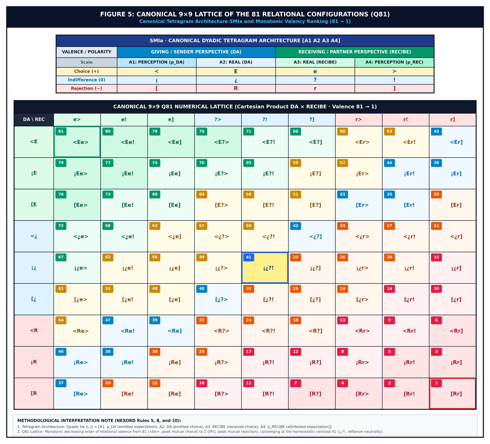  
*Table Annex I. Structural Q81 matrix with 81 canonical relational figures ordered by increasing-valence antidiagonals.*

### 8.2. Annex II: Factorial Metrics (COR, CTA, CTR), Slender Vertical Axes, and Hierarchical Axonometric 6D-to-2D Projection (DIMO / ANCORM Algorithm by Dr. J. M. Cornejo Álvarez)

In Correspondence Analysis (CA) and Principal Component Analysis (PCA), classical 2D scatter plots often suffer from cognitive crowding. NEXORD resolves this via two analytical innovations:

#### 1. 1D Slender Vertical Factorial Axes
Each primary factorial axis is decomposed into an independent vertical line where elements distribute along their exact coordinate, flanked by:
* **Quality of Representation ($	ext{COR}$):** Proportion of element inertia recovered: $	ext{COR}_{ilpha} = d^2(i, lpha) / d^2(i, G) \in [0, 1]$.
* **Absolute Contribution ($	ext{CTA}$ / $	ext{CTR}$):** Percentage weight of the element in constructing axis variance: $	ext{CTR}_{ilpha} = p_i \cdot d^2(i, lpha) / \lambda_lpha$ (summing to 100%).

#### 2. Hierarchical Axonometric 6D-to-2D Projection (DIMO / ANCORM Algorithm)
Developed in Dr. Cornejo's doctoral dissertation, DIMO solves the projection of up to 6 hierarchical factors ($F_1$ to $F_6$) onto a single 2D plane ($X, Y$) without relying on auxiliary pictorial devices (such as node color or sizing) that could hinder metric precision:
* **Basal Cartesian Anchor ($F_1, F_2$):** Factors 1 and 2 define initial Cartesian position $(f_1, f_2)$.
* **Quadrant Radial Fan for Higher Factors ($F_3, F_4, F_5, F_6$):** Each quadrant subdivides at $33^\circ$ and $66^\circ$ cuts into standardized directional rays, projected with exact geometric ratios ($1/3, 2/3, 1/2$).
* **Dynamic Pull Driven by Absolute Contribution ($	ext{CTA}$):** Displacement vectors are pulled exclusively by the information mass contributed to factors 3–6:
$$\Delta x_i = \sum_{k=3}^6 eta_k \cdot 	ext{CTA}_{ik} \cdot \cos(	heta_k), \quad \Delta y_i = \sum_{k=3}^6 eta_k \cdot 	ext{CTA}_{ik} \cdot \sin(	heta_k)$$
Elements with near-total inertia in planes 1–2 remain at baseline $(\Delta = 0)$; elements with significant variance in higher factors are displaced along the corresponding axonometric vector.
* **Continuous Vector Trace:** A fine line connects basal coordinate $(f_1, f_2)$ to the projected 6D point, eliminating spatial ambiguity.

### 8.3. Annex III: Catalogue of the 10 Ecosystemic Domains
Complete parameterization ($lpha$, $\gamma$) and application criteria for Educational, Family, Sports, Community, Critical Missions, Therapeutic, Corporate, Institutional, Military, and Correctional contexts.

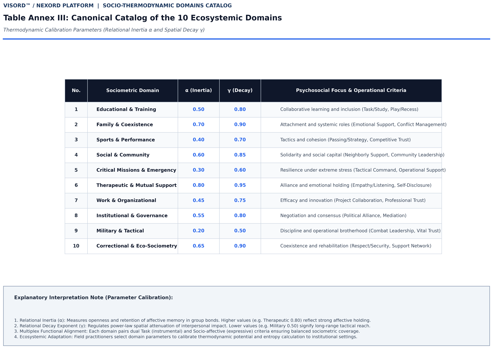  
*Table Annex III. Catalogue of the 10 ecosystemic calibration domains with relational inertia (α) and decay rate (γ).*

### 8.4. Annex IV: Sender-Receiver Rank Interdistances and Isometry Diagonal
Full Euclidean rank interdistance matrix ($d_{	ext{DA}}, d_{	ext{RC}}, \Delta$) computed over G2T1C1, validating the relational asymmetry law.

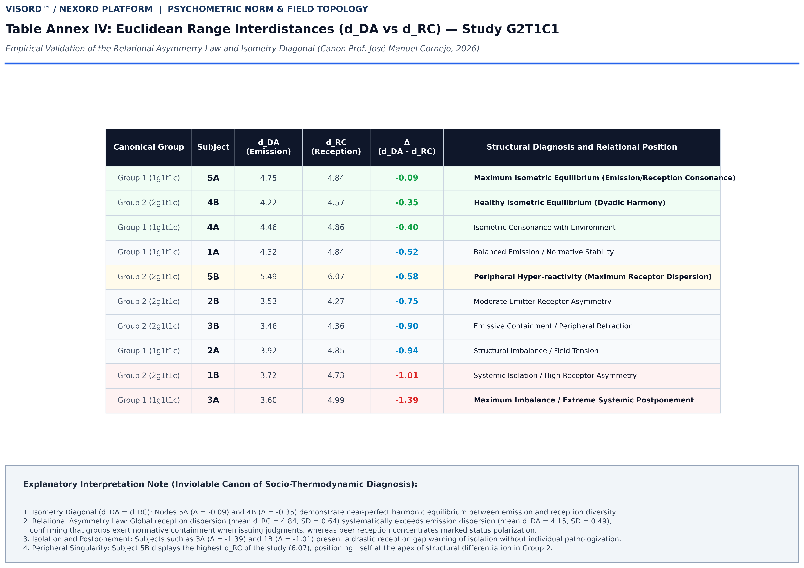  
*Table Annex IV. G2T1C1 Euclidean rank interdistance matrix with role asymmetry diagnoses.*

---

## 9. Thematic Bibliography

### I. Reference Work and NEXORD System Authorship
*Epistemological foundation, psychometric validation, and analytical engine architecture.*

1. **Cornejo, J. M. (1988).** *Técnicas de investigación social: El análisis de correspondencias*. Barcelona: PPU.
2. **Vicente, R., Cornejo, J. M., & Barbero, F. (2006).** Análisis de la Actividad Grupal (AAG). *Anuario de Psicología*, 37(3), 299–320.
3. **Cornejo, J. M. (2026).** *Computational Ordinal Sociometry (NEXORD): An updated mathematical extension of Moreno and Lewin's foundational insights*. Technical Monograph Series, Banco Sociométrico (BSOC). https://doi.org/10.5281/zenodo.18941691
4. **Cornejo Álvarez, J. M., & Morales Domínguez, J. F. (in press).** Sociometría Ordinal Computacional. La Plataforma NEXORD: Hacia una Física de lo Grupal [Computational Ordinal Sociometry. The NEXORD Platform: Towards a Physics of the Group]. *Psicothema*.

### II. Historical Roots, Group Dynamics, and Field Theory
*Relational genealogy: from the foundational affective map to the hodological field of forces and group pressures.*

5. **Scudéry, M. de (1654).** *Clélie, histoire romaine*. Paris: Augustin Courbé. *(Historical precursor of relational and affective cartography: the Carte de Tendre).*
6. **Moreno, J. L. (1934).** *Who shall survive? A new approach to the problem of human interrelations*. Washington, DC: Nervous and Mental Disease Publishing Co.
7. **Lewin, K. (1951).** *Field theory in social science: Selected theoretical papers* (D. Cartwright, Ed.). New York: Harper & Row.
8. **Bales, R. F. (1950).** *Interaction process analysis: A method for the study of small groups*. Cambridge, MA: Addison-Wesley.
9. **Festinger, L. (1950).** Informal social communication. *Psychological Review*, 57(5), 271–282. https://doi.org/10.1037/h0056932
10. **Janis, I. L. (1972).** *Victims of Groupthink: A psychological study of foreign-policy decisions and fiascoes*. Boston: Houghton Mifflin.

### III. Dyadic Interdependence, Metaperception, Ostracism, and Exclusion Dynamics
*The relational social atom: cross-expectations, affective balance, actor-partner modeling, and the psychology of invisibility.*

11. **Heider, F. (1958).** *The psychology of interpersonal relations*. New York: John Wiley & Sons.
12. **Kenny, D. A., & Garcia, R. L. (2012).** Using the Actor–Partner Interdependence Model to study the effects of group composition. *Small Group Research*, 43(4), 468–496. https://doi.org/10.1177/1046496412444424
13. **Tsankova, E., & Tair, E. (2021).** Meta-accuracy in sociometric status perceptions. *Frontiers in Psychology*, 12, 650502. https://doi.org/10.3389/fpsyg.2021.650502
14. **Williams, K. D. (2007).** Ostracism. *Annual Review of Psychology*, 58, 425–452. https://doi.org/10.1146/annurev.psych.58.110405.085641

### IV. Computational Transition, Psychometric Measurement, and Inclusive Applications
*From the pioneering computerization of the sociogram to metric precision in educational and inclusion settings.*

15. **Barrasa, Á., & Gil, F. (2004).** Un programa informático para el cálculo y la representación de índices y valores sociométricos. *Psicothema*, 16(2), 329–335.
16. **Terry, R. (2000).** Recent advances in measurement theory and the use of sociometric techniques. *New Directions for Child and Adolescent Development*, 2000(88), 27–41. https://doi.org/10.1002/cd.23220008804
17. **Avramidis, E., Strogilos, V., Aroni, K., & Kankaraki, C. T. (2017).** Using sociometric techniques to assess the social inclusion of children with special educational needs in mainstream schools: A methodological review. *International Journal of Research & Method in Education*, 40(4), 337–356. https://doi.org/10.1080/1743727X.2015.1111803

### V. Statistical Modeling of Ordinal Networks, Signed Networks, and Spectral Graphs
*The mathematical substrate of preferential ranking, rank concordance, dual polarity (choice/rejection), and network connectivity.*

18. **Kendall, M. G. (1938).** A new measure of rank correlation. *Biometrika*, 30(1/2), 81–93. https://doi.org/10.1093/biomet/30.1-2.81
19. **Fiedler, M. (1973).** Algebraic connectivity of graphs. *Czechoslovak Mathematical Journal*, 23(2), 298–305.
20. **Aref, S., & Wilson, M. C. (2021).** The frustration index is a key measure for analysing signed networks. *Journal of Complex Networks*, 7(2), cnz006. https://doi.org/10.1093/comnet/cnz006
21. **Borsboom, D., Deserno, M. K., Rhemtulla, M., Epskamp, S., Fried, E. I., McNally, R. J., ... & Waldorp, L. J. (2021).** Network analysis of multivariate data in psychological science. *Nature Reviews Methods Primers*, 1(1), 58. https://doi.org/10.1038/s43586-021-00055-w
22. **Cucuringu, M., Mantzaris, A. V., & Roberts, J. (2023).** The Bradley-Terry stochastic block model for directed ranking networks. *Journal of Complex Networks*, 11(4), cnad025. https://doi.org/10.1093/comnet/cnad025
23. **Diaz-Diaz, F., & Estrada, E. (2025).** Signed graphs in data sciences via communicability geometry. *Information Sciences*, 688, 121110. https://doi.org/10.1016/j.ins.2024.121110
24. **Krivitsky, P. N., & Butts, C. T. (2017).** Exponential-family random graph models for rank-order relational data. *Sociological Methodology*, 47(1), 68–112. https://doi.org/10.1111/socm.12038

### VI. Relational Physics, Information Theory, and Non-Equilibrium Complex Systems
*Group field physics: relative observation (Rovelli), irreducible integrated information (Tononi), and non-equilibrium self-organization (Nicolis & Prigogine).*

25. **Nicolis, G., & Prigogine, I. (1977).** *Self-organization in nonequilibrium systems: From dissipative structures to order through fluctuations*. New York: John Wiley & Sons.
26. **Rovelli, C. (1996).** Relational quantum mechanics. *International Journal of Theoretical Physics*, 35(8), 1637–1678. https://doi.org/10.1007/BF02302262
27. **Tononi, G. (2004).** An information integration theory of consciousness. *BMC Neuroscience*, 5(1), 42. https://doi.org/10.1186/1471-2202-5-42

### VII. Matrix Geometry, Grassmann Manifolds, and Multivariate Analysis
*Manifold optimization, factorial projection, and continuous metric distances in relational space.*

28. **Benzécri, J.-P. (1973).** *L'Analyse des Données: T. 2, L'Analyse des Correspondances*. Paris: Dunod.
29. **Absil, P.-A., Mahony, R., & Sepulchre, R. (2008).** *Optimization algorithms on matrix manifolds*. Princeton, NJ: Princeton University Press.
30. **Ye, K., & Lim, L.-H. (2016).** Schubert varieties and distances on Grassmann manifolds. *SIAM Journal on Matrix Analysis and Applications*, 37(3), 1176–1197. https://doi.org/10.1137/15M1047648

---

*(C) 2026 Dr. José Manuel Cornejo Álvarez / NEXORD Platform / Sociometric Bank (BSOC). Published on Zenodo under Creative Commons Attribution 4.0 International License (CC BY 4.0).*
